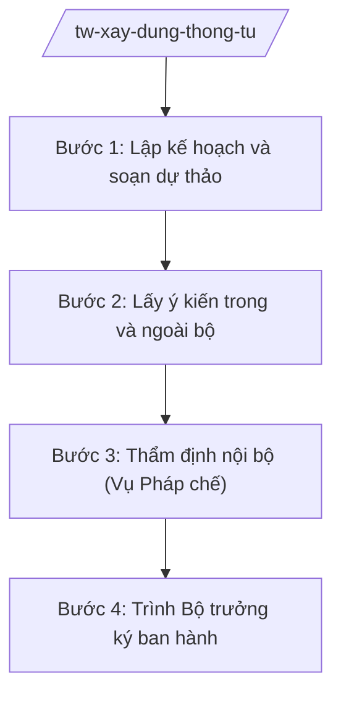

# Skill: Xây dựng thông tư của Bộ trưởng

## 2. Khi nào dùng
- Skill chỉ áp dụng ở cấp trung ương (bộ, cơ quan ngang bộ, cơ quan thuộc Chính phủ).

Khi đơn vị thuộc bộ được giao chủ trì soạn thảo thông tư của Bộ trưởng (quy định chi tiết,
hướng dẫn thi hành văn bản cấp trên hoặc quy định về lĩnh vực thuộc thẩm quyền của Bộ trưởng).

## 3. Đầu vào (Input)

| Trường | Mô tả | Bắt buộc |
|--------|-------|----------|
| `ten_thong_tu` | Tên thông tư cần xây dựng | Có |
| `can_cu` | Văn bản cấp trên cần quy định chi tiết/hướng dẫn | Có |
| `noi_dung_chinh` | Các nội dung chính cần quy định | Có |
| `don_vi_chu_tri` | Vụ/cục chủ trì soạn thảo | Có |
| `tien_do` | Mốc trình Bộ trưởng ký | Có |

## 4. Quy trình

**Bước 1. Lập kế hoạch và soạn dự thảo**

- Làm gì: Xây dựng đề cương, phân công soạn thảo; soạn dự thảo thông tư lần đầu kèm tờ trình.
- Dùng input: `ten_thong_tu`, `can_cu`, `noi_dung_chinh`, `don_vi_chu_tri`.
- Vai trò: Chuyên viên đơn vị chủ trì soạn thảo, AI hỗ trợ dựng khung điều khoản, đối chiếu với văn bản cấp trên để tránh trùng lặp/trái thẩm quyền ⏱ ~2–4 ngày (ước tính).
- Lưu ý nghiệp vụ: Thông tư không được quy định vượt quá phạm vi được giao; không đặt ra TTHC mới trái quy định.
- → Kết quả bước: Dự thảo thông tư lần 1 + tờ trình.

**Bước 2. Lấy ý kiến trong và ngoài bộ**

- Làm gì: Lấy ý kiến các vụ/cục trong bộ, các bộ/ngành/địa phương liên quan, đối tượng chịu tác động; đăng Cổng TTĐT của bộ.
- Dùng input: Dự thảo lần 1.
- Vai trò: Đơn vị chủ trì tổng hợp, AI hỗ trợ phân loại ý kiến và lập bảng tiếp thu/giải trình ⏱ ~2–3 ngày (ước tính).
- Lưu ý nghiệp vụ: Ý kiến của Vụ Pháp chế trong bộ là bắt buộc trước khi trình Bộ trưởng.
- → Kết quả bước: Dự thảo hoàn thiện + báo cáo tiếp thu ý kiến.

**Bước 3. Thẩm định nội bộ (Vụ Pháp chế)**

- Làm gì: Vụ Pháp chế thẩm định tính hợp hiến, hợp pháp, thống nhất, kỹ thuật soạn thảo; đơn vị chủ trì tiếp thu.
- Dùng input: Hồ sơ dự thảo thông tư.
- Vai trò: Vụ trưởng Vụ Pháp chế (ông Hoàng Văn EE) ký báo cáo thẩm định; AI hỗ trợ đối chiếu dự thảo với ý kiến thẩm định ⏱ ~1–2 ngày (ước tính).
- Lưu ý nghiệp vụ: Không trình Bộ trưởng ký khi chưa có ý kiến thẩm định của Vụ Pháp chế.
- → Kết quả bước: Báo cáo thẩm định + dự thảo đã tiếp thu.

**Bước 4. Trình Bộ trưởng ký ban hành**

- Làm gì: Hoàn thiện tờ trình Bộ trưởng; trình ký; phát hành, đăng Công báo, cập nhật CSDL văn bản QPPL.
- Dùng input: Hồ sơ sau thẩm định, `tien_do`.
- Vai trò: Lãnh đạo đơn vị chủ trì trình, Thứ trưởng (bà Phạm Thị DD) cho ý kiến, **Bộ trưởng (ông Lê Văn CC) ký ban hành**; AI hỗ trợ: rà soát thể thức lần cuối ⏱ ~1 ngày (ước tính).
- Lưu ý nghiệp vụ: Thông tư phải được đăng Công báo và cập nhật vào cơ sở dữ liệu quốc gia về văn bản pháp luật.
- → Kết quả bước: Thông tư của Bộ trưởng đã ký ban hành + hồ sơ phát hành.

## Luồng quy trình (Workflow)

## 5. Đầu ra (Output)

- Thông tư của Bộ trưởng đã ký ban hành.
- Tờ trình Bộ trưởng + báo cáo thẩm định của Vụ Pháp chế + báo cáo tiếp thu ý kiến.

### Cấu trúc output chuẩn

**Thông tư của Bộ trưởng** (thể thức NĐ 30/2020/NĐ-CP):
1. Quốc hiệu "CỘNG HÒA XÃ HỘI CHỦ NGHĨA VIỆT NAM" – Tiêu ngữ "Độc lập – Tự do – Hạnh phúc"; tên cơ quan ban hành ("BỘ ..."); số, ký hiệu (".../2026/TT-B..."); địa danh, ngày tháng năm.
2. Trích yếu ("Thông tư quy định/hướng dẫn ..."); căn cứ ban hành (liệt kê văn bản cấp trên).
3. Nội dung: các chương, điều, khoản.
4. Điều khoản thi hành (hiệu lực, trách nhiệm thi hành).
5. Nơi nhận; chữ ký Bộ trưởng ("KT. BỘ TRƯỞNG/THỨ TRƯỞNG" nếu ủy quyền), đóng dấu.

## 6. Checklist nghiệm thu

- [ ] Không quy định vượt thẩm quyền, không trái văn bản cấp trên.
- [ ] Đã lấy ý kiến đầy đủ, có ý kiến thẩm định của Vụ Pháp chế.
- [ ] Mọi ý kiến được tiếp thu/giải trình.
- [ ] Thể thức đúng NĐ 30/2020/NĐ-CP; Bộ trưởng (hoặc người được ủy quyền) ký.
- [ ] Đã đăng Công báo, cập nhật CSDL văn bản QPPL.
- [ ] Không bịa căn cứ pháp lý, không viện dẫn văn bản hết hiệu lực.

## 7. Ví dụ mô phỏng

*Dữ liệu dưới đây là giả lập 100% phục vụ minh họa.*

**Input mẫu:** ten_thong_tu = "Thông tư hướng dẫn quản lý chất lượng dịch vụ logistics";
can_cu = Nghị định giả lập về logistics; don_vi_chu_tri = Vụ Thị trường trong nước – Bộ Công Thương (giả lập).

**Output mẫu (trích Thông tư):**

> BỘ CÔNG THƯƠNG (giả lập)
> Số: 12/2026/TT-BCT
> (Địa danh minh họa), ngày 20 tháng 11 năm 2026
>
> **THÔNG TƯ**
> **Hướng dẫn quản lý chất lượng dịch vụ logistics**
>
> *Căn cứ Nghị định số .../2026/NĐ-CP ngày ... của Chính phủ (giả lập);*
> *Căn cứ Nghị định số 40/2025/NĐ-CP ngày 26/02/2025 của Chính phủ quy định chức năng, nhiệm vụ, quyền hạn và cơ cấu tổ chức của Bộ Công Thương;*
>
> *Bộ trưởng Bộ Công Thương ban hành Thông tư hướng dẫn quản lý chất lượng dịch vụ logistics.*
>
> **Chương I. QUY ĐỊNH CHUNG**
> **Điều 1. Phạm vi điều chỉnh** ... (giả lập)
> **Điều 2. Đối tượng áp dụng** ...
>
> **Chương II. ...**
> ...
> **Điều 12. Hiệu lực thi hành**
> 1. Thông tư này có hiệu lực từ ngày 01 tháng 01 năm 2027 (giả lập).
> 2. Vụ Thị trường trong nước chủ trì hướng dẫn, kiểm tra việc thực hiện Thông tư này.
>
> Nơi nhận: ...
> **BỘ TRƯỞNG** (ký, đóng dấu — giả lập: ông Lê Văn CC)

## 8. Human gate

- Lãnh đạo đơn vị chủ trì duyệt dự thảo trước khi lấy ý kiến.
- Vụ trưởng Vụ Pháp chế ký báo cáo thẩm định.
- **Bộ trưởng ký ban hành thông tư.**

## 9. Giới hạn

- AI không quyết định nội dung chính sách thay đơn vị chủ trì và lãnh đạo bộ.
- AI không tự ký, phát hành văn bản; không bịa ý kiến thẩm định.
- Mọi căn cứ pháp lý phải có thật.

## 10. Căn cứ & lưu ý

- Nghị định 303/2025/NĐ-CP — khung chung chức năng bộ, cơ quan ngang bộ.
- Luật Ban hành văn bản quy phạm pháp luật (tên luật, không ghi số hiệu) — thẩm quyền ban hành thông tư của Bộ trưởng.
- Nghị định 30/2020/NĐ-CP — thể thức văn bản (chỉ dùng cho thể thức).
- Lưu ý: thông tư của Bộ trưởng không được quy định những vấn đề thuộc thẩm quyền của Chính phủ, Thủ tướng Chính phủ.
