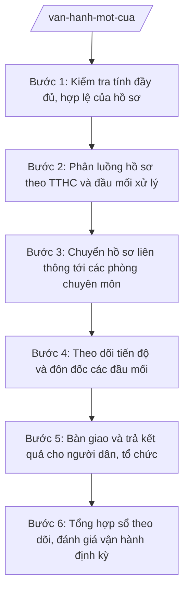

# Skill: Vận hành bộ phận một cửa, phối hợp liên thông

## Khi nào dùng

- Khi cần tổ chức tiếp nhận và phân luồng hồ sơ TTHC tại Trung tâm Phục vụ hành chính công xã theo đúng quy trình một cửa, một cửa liên thông.
- Khi hồ sơ TTHC thuộc thẩm quyền phối hợp của nhiều phòng chuyên môn (X1, X2, X3) cần chuyển liên thông và xác định đầu mối chịu trách nhiệm chính.
- Khi cần theo dõi tiến độ giải quyết hồ sơ, phát hiện hồ sơ sắp đến hạn/trễ hạn và đôn đốc các đầu mối xử lý kịp thời.
- Khi cần tổng hợp sổ theo dõi luân chuyển hồ sơ, bàn giao và trả kết quả tại Trung tâm để phục vụ báo cáo định kỳ.
- Khi lãnh đạo UBND xã yêu cầu rà soát tình hình vận hành Trung tâm PVHCC để chấn chỉnh kỷ luật giải quyết TTHC.

## Đầu vào (Input)

| Trường | Mô tả | Bắt buộc |
|--------|-------|----------|
| `danh_muc_tthc` | Danh sách TTHC thuộc thẩm quyền cấp xã đang niêm yết (tên TTHC, cơ quan có thẩm quyền, thời hạn giải quyết, phí/lệ phí) | Có |
| `ho_so_tiep_nhan` | Thông tin hồ sơ mới tiếp nhận (mã hồ sơ, tên TTHC, người nộp, thành phần hồ sơ kèm theo, ngày tiếp nhận) | Có |
| `dau_moi_phong_ban` | Bảng phân công đầu mối xử lý theo lĩnh vực: X1 — Văn phòng HĐND và UBND; X2 — Phòng Kinh tế; X3 — Phòng Văn hóa – Xã hội | Có |
| `sổ_theo_doi` | Sổ theo dõi luân chuyển hồ sơ đang xử lý (mã hồ sơ, đầu mối xử lý, hạn trả kết quả, trạng thái) | Không |
| `nguon_nhan_su` | Danh sách công chức Trung tâm PVHCC và công chức đầu mối các phòng chuyên môn | Không |
| `yeu_cau_dac_biet` | Yêu cầu đặc biệt của lãnh đạo (tăng cường ca, xử lý hồ sơ tồn đọng, báo cáo đột xuất...) | Không |

## Quy trình

**Bước 1. Kiểm tra tính đầy đủ, hợp lệ của hồ sơ**

- Làm gì: Đối chiếu thành phần hồ sơ người dân nộp với thành phần hồ sơ đã công bố trong danh mục niêm yết của TTHC tương ứng; trường hợp thiếu thì hướng dẫn bổ sung một lần, đầy đủ, có phiếu hướng dẫn bổ sung.
- Dùng input: `ho_so_tiep_nhan`, `danh_muc_tthc`
- Vai trò: Công chức Trung tâm PVHCC tiếp nhận (công chức tại quầy/khu vực tiếp nhận). AI hỗ trợ: đối chiếu nhanh checklist thành phần hồ sơ, cảnh báo khi thiếu thành phần hoặc giấy tờ hết hạn sử dụng. Thời gian ước tính: 10–15 phút/hồ sơ.
- Lưu ý nghiệp vụ: Không tiếp nhận hồ sơ khi thiếu thành phần bắt buộc mà không có phiếu hướng dẫn bổ sung; mọi trường hợp từ chối tiếp nhận phải nêu rõ lý do bằng văn bản.
- → Kết quả bước: Hồ sơ được xác nhận đủ điều kiện tiếp nhận; phiếu hẹn trả kết quả ghi rõ ngày hẹn.

**Bước 2. Phân luồng hồ sơ theo TTHC và đầu mối xử lý**

- Làm gì: Căn cứ tên TTHC và lĩnh vực nghiệp vụ, xác định đầu mối chịu trách nhiệm chính (X1, X2 hoặc X3 theo bảng phân công) và các phòng phối hợp liên thông (nếu có); ghi vào sổ theo dõi luân chuyển.
- Dùng input: `ho_so_tiep_nhan`, `dau_moi_phong_ban`, `danh_muc_tthc`
- Vai trò: Công chức Trung tâm PVHCC (đầu mối phân luồng). AI hỗ trợ: gợi ý đầu mối xử lý dựa trên lĩnh vực TTHC, cảnh báo khi TTHC liên quan nhiều phòng để thiết lập phối hợp liên thông. Thời gian ước tính: 5–10 phút/hồ sơ.
- Lưu ý nghiệp vụ: Mỗi hồ sơ chỉ có một đầu mối chịu trách nhiệm chính; phòng phối hợp phải có thời hạn xử lý phần việc của mình, không đùn đẩy trách nhiệm.
- → Kết quả bước: Phiếu phân luồng hồ sơ (mã hồ sơ, đầu mối chính, đơn vị phối hợp, thời hạn từng phần việc).

**Bước 3. Chuyển hồ sơ liên thông tới các phòng chuyên môn**

- Làm gì: Chuyển hồ sơ (bản giấy và/hoặc bản điện tử qua hệ thống một cửa) kèm phiếu yêu cầu phối hợp tới đầu mối chính và các phòng phối hợp; xác nhận ký nhận chuyển giao của từng bên.
- Dùng input: `ho_so_tiep_nhan`, `dau_moi_phong_ban`, `nguon_nhan_su`
- Vai trò: Công chức Trung tâm PVHCC thực hiện chuyển giao; công chức đầu mối các phòng (X1, X2, X3) ký nhận. AI hỗ trợ: lập phiếu chuyển giao tự động, nhắc xác nhận ký nhận khi quá thời hạn. Thời gian ước tính: trong ngày làm việc tiếp nhận.
- Lưu ý nghiệp vụ: Việc chuyển giao phải có ký nhận của cả hai bên; hồ sơ chuyển chậm quá 01 ngày làm việc phải báo cáo Phó Chủ tịch UBND xã phụ trách.
- → Kết quả bước: Phiếu chuyển giao hồ sơ có ký nhận; hồ sơ cập nhật trạng thái "đang xử lý" trên sổ theo dõi.

**Bước 4. Theo dõi tiến độ và đôn đốc các đầu mối**

- Làm gì: Cập nhật trạng thái xử lý từng hồ sơ trên sổ theo dõi; rà soát hồ sơ sắp đến hạn (trước 01 ngày làm việc) và hồ sơ trễ hạn; lập văn bản đôn đốc gửi đầu mối, đồng gửi Phó Chủ tịch UBND xã phụ trách.
- Dùng input: `sổ_theo_doi`, `dau_moi_phong_ban`
- Vai trò: Công chức Trung tâm PVHCC phụ trách theo dõi tiến độ. AI hỗ trợ: tự động cảnh báo hồ sơ sắp đến hạn/trễ hạn, soạn thảo công văn đôn đốc theo mẫu. Thời gian ước tính: rà soát hằng ngày 30 phút; đôn đốc theo từng trường hợp.
- Lưu ý nghiệp vụ: Hồ sơ trễ hạn phải ghi rõ nguyên nhân (chủ quan/khách quan) và đề xuất biện pháp khắc phục; không được tự ý gia hạn hẹn trả kết quả khi chưa có ý kiến của người có thẩm quyền.
- → Kết quả bước: Danh sách hồ sơ sắp đến hạn/trễ hạn; công văn đôn đốc các đầu mối.

**Bước 5. Bàn giao và trả kết quả cho người dân, tổ chức**

- Làm gì: Nhận kết quả giải quyết từ đầu mối xử lý, kiểm tra tính đầy đủ (văn bản kết quả, con dấu, chữ ký người có thẩm quyền); thông báo cho người nộp theo phương thức đã đăng ký (trực tiếp, điện thoại, tin nhắn); bàn giao kết quả tại Trung tâm PVHCC và ghi sổ trả kết quả.
- Dùng input: `ho_so_tiep_nhan`, `sổ_theo_doi`
- Vai trò: Công chức Trung tâm PVHCC (bộ phận trả kết quả). AI hỗ trợ: kiểm tra đối chiếu kết quả với phiếu hẹn, soạn tin nhắn thông báo trả kết quả. Thời gian ước tính: 5–10 phút/trường hợp trả kết quả.
- Lưu ý nghiệp vụ: Kết quả phải trả đúng người (đối chiếu giấy tờ tùy thân hoặc giấy ủy quyền hợp lệ); hồ sơ trễ hạn phải kèm văn bản xin lỗi người dân, tổ chức theo quy định.
- → Kết quả bước: Kết quả giải quyết được bàn giao đúng người, đúng hẹn; sổ trả kết quả được cập nhật đầy đủ.

**Bước 6. Tổng hợp sổ theo dõi, đánh giá vận hành định kỳ**

- Làm gì: Tổng hợp số liệu vận hành trong kỳ (số hồ sơ tiếp nhận, phân luồng, đang xử lý, trả đúng hạn, trễ hạn theo từng TTHC và đầu mối); lập báo cáo vận hành Trung tâm gửi Phó Chủ tịch UBND xã phụ trách; lưu trữ hồ sơ, sổ sách theo quy định.
- Dùng input: `sổ_theo_doi`, `danh_muc_tthc`, `nguon_nhan_su`
- Vai trò: Công chức Trung tâm PVHCC tổng hợp; Phó Chủ tịch UBND xã phụ trách kiểm tra; Chủ tịch UBND xã chỉ đạo chấn chỉnh (nếu cần). AI hỗ trợ: tổng hợp số liệu, vẽ biểu đồ tiến độ, dự thảo báo cáo vận hành. Thời gian ước tính: 1–2 ngày làm việc/kỳ báo cáo.
- Lưu ý nghiệp vụ: Số liệu tổng hợp phải khớp với sổ theo dõi gốc; báo cáo nêu rõ hồ sơ trễ hạn, nguyên nhân và kiến nghị xử lý trách nhiệm theo quy định.
- → Kết quả bước: Báo cáo vận hành Trung tâm PVHCC trong kỳ; sổ theo dõi được lưu trữ đầy đủ.

## Luồng quy trình (Workflow)

## Đầu ra (Output)

- Phiếu hẹn trả kết quả (cho từng hồ sơ tiếp nhận).
- Phiếu phân luồng hồ sơ một cửa liên thông.
- Phiếu chuyển giao hồ sơ giữa Trung tâm và các phòng chuyên môn.
- Công văn đôn đốc tiến độ giải quyết hồ sơ.
- Sổ theo dõi luân chuyển hồ sơ (cập nhật liên tục).
- Báo cáo vận hành Trung tâm Phục vụ hành chính công xã định kỳ.

### Cấu trúc output chuẩn

Sản phẩm chính: **Báo cáo vận hành Trung tâm Phục vụ hành chính công xã**, thể thức theo NĐ 30/2020/NĐ-CP:

1. Quốc hiệu "CỘNG HÒA XÃ HỘI CHỦ NGHĨA VIỆT NAM" – Tiêu ngữ "Độc lập – Tự do – Hạnh phúc"; tên cơ quan ban hành (ỦY BAN NHÂN DÂN XÃ A — TRUNG TÂM PHỤC VỤ HÀNH CHÍNH CÔNG).
2. Số, ký hiệu văn bản (…/BC-TTPVHCC); địa danh và ngày, tháng, năm ban hành.
3. Tên loại và trích yếu nội dung: "BÁO CÁO tình hình vận hành Trung tâm Phục vụ hành chính công xã A tháng (quý) ...".
4. Phần I — Kết quả vận hành trong kỳ: số hồ sơ tiếp nhận theo TTHC; số hồ sơ phân luồng liên thông; số hồ sơ trả đúng hạn, trễ hạn; tỷ lệ giải quyết đúng hạn.
5. Phần II — Tồn tại, hạn chế: hồ sơ trễ hạn (liệt kê mã hồ sơ, TTHC, đầu mối, số ngày trễ, nguyên nhân); khó khăn trong phối hợp liên thông.
6. Phần III — Phương hướng, kiến nghị: biện pháp khắc phục; kiến nghị với UBND xã về nhân sự, trang thiết bị.
7. Chữ ký người có thẩm quyền (ký, ghi rõ họ tên, đóng dấu).
8. Nơi nhận: UBND xã (để báo cáo), các phòng chuyên môn liên quan; lưu: VT, TTPVHCC.

## Checklist nghiệm thu

1. 100% hồ sơ tiếp nhận có phiếu hẹn trả kết quả ghi đúng ngày hẹn theo thời hạn TTHC đã công bố.
2. 100% hồ sơ được phân luồng đúng đầu mối theo bảng phân công X1/X2/X3; hồ sơ liên thông có ghi rõ đơn vị phối hợp và thời hạn từng phần việc.
3. Phiếu chuyển giao hồ sơ có ký nhận đầy đủ của cả Trung tâm và đầu mối tiếp nhận; hồ sơ chuyển trong ngày làm việc.
4. Sổ theo dõi luân chuyển hồ sơ cập nhật trạng thái kịp thời; không có hồ sơ "mất dấu" (không rõ đang ở đơn vị nào).
5. Hồ sơ sắp đến hạn được cảnh báo trước ít nhất 01 ngày làm việc; hồ sơ trễ hạn có công văn đôn đốc và ghi rõ nguyên nhân.
6. Kết quả trả đúng người, đúng hẹn; hồ sơ trễ hạn có văn bản xin lỗi người dân, tổ chức.
7. Báo cáo vận hành có đủ 3 phần (kết quả — tồn tại — kiến nghị); số liệu khớp với sổ theo dõi gốc.
8. Báo cáo đã qua human gate: Phó Chủ tịch phụ trách kiểm tra, Chủ tịch UBND xã cho ý kiến chỉ đạo trước khi lưu hành chính thức.

## Ví dụ mô phỏng
*Dữ liệu dưới đây là giả lập 100% phục vụ minh họa.*

**Input mẫu:**

- Danh mục TTHC: "Chứng thực bản sao" (thời hạn 01 ngày làm việc); "Đăng ký khai sinh" (thời hạn 01 ngày làm việc); "Đăng ký kết hôn" (thời hạn 03 ngày làm việc).
- Hồ sơ tiếp nhận tháng 10 (giả lập): 100 hồ sơ, trong đó: Chứng thực bản sao 60 hồ sơ, Đăng ký khai sinh 25 hồ sơ, Đăng ký kết hôn 15 hồ sơ.
- Đầu mối: X1 — Văn phòng HĐND và UBND xã A phụ trách toàn bộ 3 TTHC nêu trên; người dân nộp: Ông Nguyễn Văn Dân, Bà Trần Thị Dân.
- Sổ theo dõi: 95 hồ sơ đã trả kết quả đúng hạn; 5 hồ sơ trễ hạn 01–02 ngày (nguyên nhân: công chức xử lý đi công tác đột xuất).

**Output mẫu:**

CỘNG HÒA XÃ HỘI CHỦ NGHĨA VIỆT NAM
Độc lập – Tự do – Hạnh phúc

ỦY BAN NHÂN DÂN XÃ A
TRUNG TÂM PHỤC VỤ HÀNH CHÍNH CÔNG

Số: 10/BC-TTPVHCC
Xã A, ngày 05 tháng 11 năm 2026

**BÁO CÁO
Tình hình vận hành Trung tâm Phục vụ hành chính công xã A tháng 10 năm 2026**

Kính gửi: Ủy ban nhân dân xã A

**I. KẾT QUẢ VẬN HÀNH TRONG KỲ**

Tháng 10 năm 2026, Trung tâm Phục vụ hành chính công xã A đã tiếp nhận 100 hồ sơ, cụ thể:

| STT | Tên TTHC | Tiếp nhận | Trả đúng hạn | Trễ hạn | Tỷ lệ đúng hạn |
|-----|----------|-----------|--------------|---------|----------------|
| 1 | Chứng thực bản sao | 60 | 57 | 3 | 95% |
| 2 | Đăng ký khai sinh | 25 | 24 | 1 | 96% |
| 3 | Đăng ký kết hôn | 15 | 14 | 1 | 93% |
| **Tổng** | | **100** | **95** | **5** | **95%** |

Toàn bộ 100 hồ sơ được phân luồng đúng đầu mối (Văn phòng HĐND và UBND xã A); không có hồ sơ liên thông nhiều phòng trong kỳ.

**II. TỒN TẠI, HẠN CHẾ**

05 hồ sơ trễ hạn 01–02 ngày, nguyên nhân: công chức xử lý đi công tác đột xuất, chưa kịp bàn giao công việc. Trung tâm đã ban hành 02 công văn đôn đốc và văn bản xin lỗi 05 trường hợp trễ hạn.

**III. PHƯƠNG HƯỚNG, KIẾN NGHỊ**

1. Bố trí công chức dự phòng tiếp nhận hồ sơ khi công chức chính vắng mặt đột xuất.
2. Kiến nghị UBND xã bổ sung 01 máy tính phục vụ tra cứu CSDL hộ tịch điện tử tại quầy tiếp nhận.

Nơi nhận:
- UBND xã (để báo cáo);
- Văn phòng HĐND và UBND xã;
- Lưu: VT, TTPVHCC.

**TM. TRUNG TÂM PHỤC VỤ HÀNH CHÍNH CÔNG**
**PHÓ CHỦ TỊCH UBND XÃ PHỤ TRÁCH**
*(Ký, ghi rõ họ tên, đóng dấu)*
Trần Thị B

*(Dữ liệu trên là giả lập 100% phục vụ minh họa.)*

## Human gate

- Công chức Trung tâm PVHCC tổng hợp số liệu, dự thảo báo cáo → Phó Chủ tịch UBND xã phụ trách (Bà Trần Thị B) kiểm tra nội dung, số liệu → Chủ tịch UBND xã (Ông Nguyễn Văn A) cho ý kiến chỉ đạo và ký duyệt trước khi báo cáo được lưu hành chính thức.
- Công văn đôn đốc đầu mối do Phó Chủ tịch UBND xã phụ trách ký trước khi gửi.
- Văn bản xin lỗi người dân, tổ chức do trễ hạn phải được Phó Chủ tịch phụ trách xem xét trước khi bàn giao.

## Giới hạn

- AI KHÔNG ra quyết định hành chính thay người có thẩm quyền (không quyết định thụ lý/từ chối hồ sơ, không tự ý gia hạn hẹn trả kết quả).
- AI không tự ký, tự phát hành bất kỳ văn bản nào; mọi văn bản phải do người có thẩm quyền ký, đóng dấu.
- AI không bịa số liệu vận hành, không bịa căn cứ pháp lý; mọi trích dẫn phải đúng văn bản còn hiệu lực.
- AI không tư vấn vượt thẩm quyền của Trung tâm PVHCC và UBND cấp xã.
- AI không dùng văn bản pháp luật đã hết hiệu lực (như NĐ 45/2025/NĐ-CP đã bị thay thế).

## Căn cứ & lưu ý

- Nghị định 118/2025/NĐ-CP ngày 09/6/2025 của Chính phủ về cơ chế một cửa, một cửa liên thông trong giải quyết thủ tục hành chính.
- Văn bản 7216/VPCP-KSTT ngày 04/8/2025 của Văn phòng Chính phủ hướng dẫn tổ chức, hoạt động của Trung tâm Phục vụ hành chính công trong mô hình chính quyền địa phương 2 cấp.
- Nghị định 150/2025/NĐ-CP ngày 12/6/2025 của Chính phủ về tổ chức cơ quan chuyên môn thuộc UBND cấp tỉnh, cấp xã (quy định về Trung tâm Phục vụ hành chính công thuộc UBND cấp xã).
- Nghị định 370/2025/NĐ-CP ngày 31/12/2025 của Chính phủ sửa đổi, bổ sung NĐ 150/2025/NĐ-CP (khung số lượng tổ chức; xã tự quyết định thành lập phòng chuyên môn).
- Nghị định 30/2020/NĐ-CP của Chính phủ về công tác văn thư (thể thức văn bản hành chính).
- Lưu ý: khi xã tổ chức khác khung chuẩn (gộp/tách phòng theo NĐ 370/2025/NĐ-CP), tra bảng mapping lĩnh vực → đầu mối trong `khung-phong-ban-cap-xa.md`; đầu mối một cửa, TTHC luôn giữ ở Trung tâm PVHCC.
