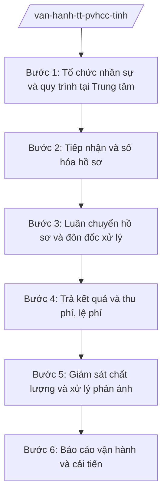

# Skill: Vận hành Trung tâm PVHCC tỉnh

## 2. Khi nào dùng

- Tổ chức bộ máy, bố trí nhân sự làm việc tại Trung tâm Phục vụ hành chính công (PVHCC) tỉnh (cán bộ các sở, ngành cử ra/biệt phái).
- Tiếp nhận hồ sơ TTHC của cá nhân, tổ chức; số hóa hồ sơ, cập nhật hệ thống một cửa.
- Luân chuyển hồ sơ đến sở, ban, ngành xử lý theo cơ chế một cửa liên thông; đôn đốc trả kết quả đúng hẹn.
- Trả kết quả giải quyết TTHC cho cá nhân, tổ chức; thu phí, lệ phí theo quy định.
- Giám sát chất lượng phục vụ: thời gian xử lý, thái độ phục vụ, mức độ hài lòng; xử lý phản ánh, kiến nghị tại Trung tâm.
- Báo cáo tình hình vận hành Trung tâm định kỳ; đề xuất cải tiến quy trình.

## 3. Đầu vào (Input)

| Trường | Mô tả | Bắt buộc |
|--------|-------|----------|
| `danh_muc_tthc_tiep_nhan_tai_trung_tam` | TTHC của các sở, ban, ngành được tiếp nhận tại Trung tâm PVHCC tỉnh | Có |
| `ho_so_cua_ca_nhan_to_chuc` | Hồ sơ đề nghị giải quyết TTHC (giấy, trực tuyến) | Có |
| `nhan_su_tai_trung_tam` | Cán bộ các sở, ngành cử ra; công chức Trung tâm | Có |
| `quy_trinh_noi_bo_tung_tthc` | Quy trình phối hợp giữa Trung tâm và sở, ngành trong xử lý từng TTHC | Có |
| `ket_qua_xu_ly_cua_so_nganh` | Kết quả giải quyết hồ sơ do sở, ban, ngành trả về | Không |
| `phan_anh_tai_trung_tam` | Phản ánh, kiến nghị của cá nhân, tổ chức về thái độ, thời gian phục vụ | Không |

## 4. Quy trình

**Bước 1. Tổ chức nhân sự và quy trình tại Trung tâm**

- Làm gì: Rà soát, bố trí cán bộ các sở, ngành làm việc tại Trung tâm theo danh mục TTHC; xây dựng/sửa đổi quy trình nội bộ phối hợp giữa Trung tâm và sở, ngành cho từng TTHC (thời gian luân chuyển, đầu mối, trách nhiệm); tập huấn nghiệp vụ, kỹ năng phục vụ.
- Dùng input: `danh_muc_tthc_tiep_nhan_tai_trung_tam`, `nhan_su_tai_trung_tam`, `quy_trinh_noi_bo_tung_tthc`.
- Vai trò: Giám đốc/Phó Giám đốc Trung tâm PVHCC tỉnh tổ chức AI hỗ trợ: rà soát danh mục TTHC — nhân sự, phát hiện TTHC thiếu đầu mối, soạn quy trình nội bộ mẫu; Chánh Văn phòng UBND tỉnh phê duyệt quy trình ⏱ ~10 ngày làm việc (khi kiện toàn (ước tính).).
- Lưu ý nghiệp vụ: Cán bộ tại Trung tâm phải có quyết định cử/biệt phái và được tập huấn; quy trình nội bộ phải phù hợp quy trình một cửa liên thông theo NĐ 118/2025/NĐ-CP.
- → Kết quả bước: Danh sách nhân sự tại Trung tâm; quy trình nội bộ phối hợp xử lý TTHC.

**Bước 2. Tiếp nhận và số hóa hồ sơ**

- Làm gì: Tiếp nhận hồ sơ trực tiếp, qua bưu chính, trực tuyến; kiểm tra tính đầy đủ, hợp lệ của hồ sơ; hướng dẫn bổ sung một lần nếu thiếu; số hóa hồ sơ giấy; cấp giấy biên nhận, hẹn ngày trả kết quả; cập nhật hệ thống một cửa.
- Dùng input: `ho_so_cua_ca_nhan_to_chuc`, `danh_muc_tthc_tiep_nhan_tai_trung_tam`.
- Vai trò: Cán bộ tiếp nhận tại Trung tâm thực hiện AI hỗ trợ: kiểm tra thành phần hồ sơ theo danh mục, sinh giấy biên nhận, tính ngày hẹn trả theo thời gian quy định. ⏱ ~hằng ngày (ước tính).
- Lưu ý nghiệp vụ: Không yêu cầu bổ sung hồ sơ ngoài danh mục đã công bố; hướng dẫn bổ sung phải một lần, bằng văn bản; hồ sơ trực tuyến phải được tiếp nhận, xử lý như hồ sơ giấy.
- → Kết quả bước: Hồ sơ đã tiếp nhận, số hóa; giấy biên nhận hẹn trả kết quả.

**Bước 3. Luân chuyển hồ sơ và đôn đốc xử lý**

- Làm gì: Chuyển hồ sơ (điện tử) đến sở, ban, ngành có thẩm quyền xử lý ngay trong ngày; theo dõi tiến độ xử lý trên hệ thống; đôn đốc đơn vị chậm xử lý; phối hợp xử lý hồ sơ liên thông nhiều cơ quan.
- Dùng input: Hồ sơ đã tiếp nhận (bước 2), `quy_trinh_noi_bo_tung_tthc`.
- Vai trò: Cán bộ Trung tâm luân chuyển, theo dõi AI hỗ trợ: cảnh báo hồ sơ sắp quá hạn/quá hạn theo từng khâu, tổng hợp danh sách đôn đốc; lãnh đạo Trung tâm ký văn bản đôn đốc sở, ngành. ⏱ ~hằng ngày (ước tính).
- Lưu ý nghiệp vụ: Hồ sơ liên thông phải được luân chuyển đồng thời, không để "ngâm" ở khâu trung gian; đơn vị chậm xử lý phải có văn bản xin lỗi và hẹn lại thời gian trả kết quả.
- → Kết quả bước: Hồ sơ được luân chuyển, xử lý đúng tiến độ; văn bản đôn đốc (nếu có).

**Bước 4. Trả kết quả và thu phí, lệ phí**

- Làm gì: Nhận kết quả từ sở, ngành; kiểm tra tính đầy đủ, đúng hẹn của kết quả; trả kết quả cho cá nhân, tổ chức (trực tiếp, bưu chính, trực tuyến); thu phí, lệ phí theo quy định, cấp biên lai; cập nhật trạng thái hoàn thành trên hệ thống.
- Dùng input: `ket_qua_xu_ly_cua_so_nganh`.
- Vai trò: Cán bộ trả kết quả tại Trung tâm thực hiện AI hỗ trợ: đối chiếu kết quả với giấy hẹn, tính phí/lệ phí, sinh biên lai. ⏱ ~hằng ngày (ước tính).
- Lưu ý nghiệp vụ: Chỉ thu phí, lệ phí theo đúng mức đã công bố; kết quả trả chậm phải kèm văn bản xin lỗi của cơ quan xử lý.
- → Kết quả bước: Kết quả TTHC đã trả; biên lai thu phí, lệ phí.

**Bước 5. Giám sát chất lượng và xử lý phản ánh**

- Làm gì: Giám sát hằng ngày: thời gian xử lý từng khâu, thái độ phục vụ (qua camera, đánh giá tại quầy, khảo sát); tiếp nhận, xử lý phản ánh, kiến nghị của cá nhân, tổ chức ngay tại Trung tâm; đánh giá mức độ hài lòng định kỳ.
- Dùng input: `phan_anh_tai_trung_tam`, số liệu xử lý hồ sơ trên hệ thống.
- Vai trò: Bộ phận giám sát của Trung tâm thực hiện AI hỗ trợ: tổng hợp điểm đánh giá hài lòng, phân tích phản ánh theo nhóm vấn đề, cảnh báo cán bộ/đơn vị bị phản ánh nhiều; Giám đốc Trung tâm xử lý, báo cáo Chánh Văn phòng. ⏱ ~thường xuyên (ước tính).
- Lưu ý nghiệp vụ: Phản ánh phải được xử lý ngay, không đùn đẩy; cán bộ vi phạm quy tắc ứng xử, gây phiền hà phải được xử lý nghiêm.
- → Kết quả bước: Báo cáo giám sát chất lượng; kết quả xử lý phản ánh, kiến nghị.

**Bước 6. Báo cáo vận hành và cải tiến**

- Làm gì: Tổng hợp báo cáo vận hành Trung tâm định kỳ (tháng, quý, năm): số hồ sơ tiếp nhận, tỷ lệ đúng hạn, mức độ hài lòng, phản ánh đã xử lý; đề xuất cải tiến: sắp xếp lại quầy, bổ sung nhân sự, số hóa thêm, tích hợp dịch vụ công trực tuyến.
- Dùng input: Số liệu xử lý hồ sơ, báo cáo giám sát chất lượng (bước 5).
- Vai trò: Chuyên viên Trung tâm tổng hợp AI hỗ trợ: tổng hợp số liệu tự động, dựng biểu đồ, soạn dự thảo báo cáo và đề xuất cải tiến; Giám đốc Trung tâm ký báo cáo gửi Văn phòng UBND tỉnh. ⏱ ~định kỳ (ước tính).
- Lưu ý nghiệp vụ: Báo cáo trung thực, số liệu khớp với hệ thống một cửa; đề xuất cải tiến phải cụ thể, có lộ trình và nguồn lực.
- → Kết quả bước: Báo cáo vận hành Trung tâm PVHCC tỉnh định kỳ; đề xuất cải tiến.

## Luồng quy trình (Workflow)

## 5. Đầu ra (Output)

- Quy trình nội bộ phối hợp xử lý TTHC giữa Trung tâm và sở, ngành.
- Giấy biên nhận, hẹn trả kết quả; hồ sơ đã số hóa.
- Văn bản đôn đốc sở, ngành xử lý hồ sơ.
- Báo cáo giám sát chất lượng phục vụ tại Trung tâm (sản phẩm chính).
- Báo cáo vận hành Trung tâm PVHCC tỉnh định kỳ.

**Cấu trúc output chuẩn:**

**BÁO CÁO GIÁM SÁT CHẤT LƯỢNG PHỤC VỤ TẠI TRUNG TÂM PVHCC TỈNH A** — các phần bắt buộc theo đúng thứ tự, đúng thể thức văn bản hành chính theo NĐ 30/2020/NĐ-CP:

1. Quốc hiệu "CỘNG HÒA XÃ HỘI CHỦ NGHĨA VIỆT NAM", Tiêu ngữ "Độc lập – Tự do – Hạnh phúc".
2. Tên cơ quan ban hành: TRUNG TÂM PHỤC VỤ HÀNH CHÍNH CÔNG TỈNH A. Số, ký hiệu văn bản; địa danh và thời gian ban hành.
3. Tên loại và trích yếu: BÁO CÁO — Giám sát chất lượng phục vụ tại Trung tâm PVHCC tỉnh A (tháng/quý ... năm ...).
4. Căn cứ (NĐ 118/2025/NĐ-CP; Văn bản 7216/VPCP-KSTT; quy chế hoạt động của Trung tâm...).
5. Kết quả giám sát: số hồ sơ tiếp nhận/giải quyết; tỷ lệ đúng hạn, quá hạn theo sở, ngành; thời gian xử lý trung bình từng khâu; kết quả đánh giá mức độ hài lòng; số phản ánh, kiến nghị và kết quả xử lý.
6. Tồn tại, hạn chế và nguyên nhân (đơn vị chậm xử lý, cán bộ bị phản ánh...).
7. Kiến nghị, đề xuất cải tiến.
8. Nơi nhận; ký, đóng dấu (Giám đốc Trung tâm).

## 6. Checklist nghiệm thu

1. 100% TTHC trong danh mục có cán bộ đầu mối và quy trình nội bộ phối hợp rõ ràng.
2. Hồ sơ được kiểm tra đầy đủ, hướng dẫn bổ sung một lần bằng văn bản; không yêu cầu thêm ngoài danh mục công bố.
3. 100% hồ sơ được số hóa, cập nhật hệ thống một cửa trong ngày tiếp nhận.
4. Hồ sơ luân chuyển ngay trong ngày; hồ sơ sắp quá hạn được cảnh báo, đôn đốc kịp thời.
5. Kết quả trả đúng hẹn ghi trên giấy biên nhận; hồ sơ chậm có văn bản xin lỗi của cơ quan xử lý.
6. Thu phí, lệ phí đúng mức công bố, có biên lai.
7. Phản ánh, kiến nghị tại Trung tâm được xử lý ngay; cán bộ vi phạm quy tắc ứng xử bị xử lý.
8. Báo cáo giám sát, báo cáo vận hành định kỳ đầy đủ, số liệu khớp hệ thống một cửa.
9. Thể thức văn bản đúng NĐ 30/2020/NĐ-CP.

## 7. Ví dụ mô phỏng

*Dữ liệu dưới đây là giả lập 100% phục vụ minh họa.*

**Input mẫu:**

| Trường | Giá trị mẫu |
|--------|-------------|
| Danh mục TTHC tiếp nhận tại Trung tâm | 800 TTHC của 12 sở, ban, ngành tỉnh A |
| Hồ sơ của cá nhân, tổ chức | Tháng 9/2027: 12.000 hồ sơ (8.000 trực tiếp, 4.000 trực tuyến) |
| Nhân sự tại Trung tâm | 40 cán bộ (25 do các sở cử ra, 15 biên chế Trung tâm) |
| Quy trình nội bộ từng TTHC | Đã ban hành quy trình nội bộ cho 800/800 TTHC |
| Kết quả xử lý của sở, ngành | 11.500 hồ sơ đã có kết quả; 500 hồ sơ đang xử lý |
| Phản ánh tại Trung tâm | 30 phản ánh: 20 về thời gian chờ đợi, 10 về thái độ phục vụ |

**Output mẫu (trích Báo cáo giám sát chất lượng tháng 9/2027):**

**TRUNG TÂM PHỤC VỤ HÀNH CHÍNH CÔNG TỈNH A**

Số: 1234/BC-TTPVHCC
Tỉnh A, ngày 05 tháng 10 năm 2027

**BÁO CÁO**
**Giám sát chất lượng phục vụ tại Trung tâm PVHCC tỉnh A tháng 9/2027**

*Căn cứ Nghị định số 118/2025/NĐ-CP ngày 09/6/2025 của Chính phủ;*
*Căn cứ Văn bản số 7216/VPCP-KSTT ngày 04/8/2025 của Văn phòng Chính phủ;*

**I. KẾT QUẢ GIÁM SÁT**
1. Tiếp nhận 12.000 hồ sơ (trực tuyến 4.000, chiếm 33%); giải quyết 11.500 hồ sơ, tỷ lệ đúng hạn 97%.
2. 350 hồ sơ quá hạn, tập trung tại 2 sở (đã có văn bản đôn đốc, xin lỗi người dân).
3. Mức độ hài lòng: 95% (khảo sát 2.000 lượt).
4. Tiếp nhận 30 phản ánh, đã xử lý 28, đang xử lý 2; 1 cán bộ bị nhắc nhở về thái độ phục vụ.

**II. TỒN TẠI VÀ KIẾN NGHỊ**
- Kiến nghị bổ sung 5 cán bộ cho quầy lĩnh vực đất đai (quá tải giờ cao điểm); đẩy tỷ lệ hồ sơ trực tuyến lên 50%...

*Nơi nhận:* ...
**GIÁM ĐỐC**
(Ký, đóng dấu)

## 8. Human gate (người kiểm duyệt)

- Cán bộ Trung tâm tiếp nhận, luân chuyển, trả kết quả → Trưởng ca/kíp kiểm tra hằng ngày → Giám đốc Trung tâm PVHCC tỉnh duyệt báo cáo giám sát, ký văn bản đôn đốc → Chánh Văn phòng UBND tỉnh theo dõi, chỉ đạo.
- Quy trình nội bộ phối hợp do Chánh Văn phòng UBND tỉnh phê duyệt.

## 9. Giới hạn (guardrails)

- AI không quyết định tiếp nhận hay từ chối hồ sơ thay cán bộ Trung tâm; không tự ý yêu cầu bổ sung hồ sơ ngoài danh mục công bố.
- AI không quyết định kết quả giải quyết TTHC thay sở, ngành có thẩm quyền.
- AI không tự ký, ban hành văn bản của Trung tâm; không thu phí, lệ phí thay cán bộ.
- AI không tiết lộ thông tin cá nhân trong hồ sơ cho người không có thẩm quyền.

## 10. Căn cứ & lưu ý

- NĐ 118/2025/NĐ-CP: cơ chế một cửa, một cửa liên thông trong giải quyết TTHC; tổ chức Trung tâm PVHCC các cấp.
- Văn bản 7216/VPCP-KSTT ngày 04/8/2025 của Văn phòng Chính phủ: hướng dẫn tổ chức, hoạt động của Trung tâm PVHCC trong mô hình chính quyền địa phương 2 cấp.
- NĐ 150/2025/NĐ-CP: quy định về Trung tâm PVHCC; Văn phòng UBND tỉnh là cơ quan chuyên môn thuộc UBND cấp tỉnh.
- NĐ 30/2020/NĐ-CP: thể thức và kỹ thuật trình bày văn bản hành chính.
