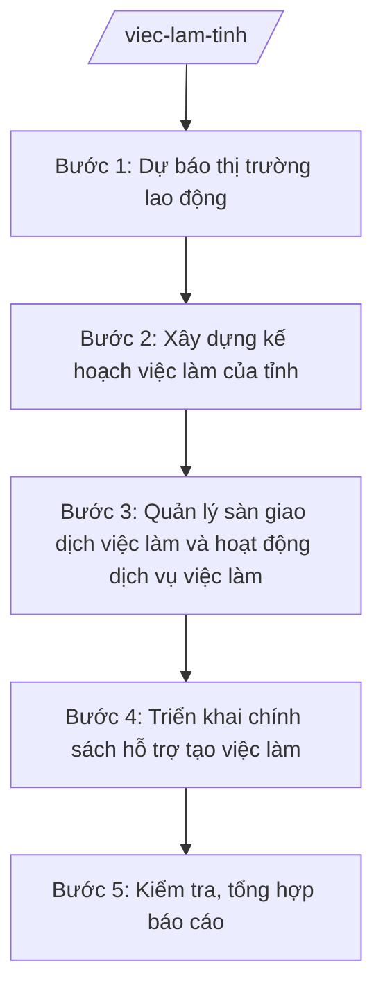

# Skill: Quản lý nhà nước về việc làm cấp tỉnh

## 2. Khi nào dùng
- Dự báo cung – cầu thị trường lao động của tỉnh hằng năm.
- Xây dựng kế hoạch việc làm, chương trình hỗ trợ tạo việc làm của tỉnh.
- Quản lý sàn giao dịch việc làm, hoạt động dịch vụ việc làm (cấp phép, kiểm tra).
- Triển khai chính sách hỗ trợ tạo việc làm (cho vay vốn, đào tạo nghề cho lao động).
- Kiểm tra, tổng hợp báo cáo tình hình việc làm, thất nghiệp toàn tỉnh.

## 3. Đầu vào (Input)
| Trường | Mô tả | Bắt buộc |
|--------|-------|----------|
| `nam_ke_hoach` | Năm kế hoạch | Có |
| `so_lieu_lao_dong` | Số liệu lực lượng lao động, việc làm, thất nghiệp (theo xã/ngành) | Có |
| `du_bao_thi_truong` | Dự báo cung – cầu lao động năm kế hoạch | Có |
| `nguon_von` | Nguồn vốn hỗ trợ tạo việc làm (ngân sách, vốn vay ưu đãi) | Có |
| `bao_cao_xa` | Báo cáo tình hình việc làm của các xã | Có |
| `ho_so_dvvl` | Hồ sơ tổ chức hoạt động dịch vụ việc làm trên địa bàn | Không |

## 4. Quy trình

**Bước 1. Dự báo thị trường lao động**
- Làm gì: Thu thập số liệu lao động – việc làm từ xã, doanh nghiệp; phân tích cung – cầu theo ngành nghề, trình độ; lập báo cáo dự báo năm.
- Dùng input: `nam_ke_hoach`, `so_lieu_lao_dong`, `du_bao_thi_truong`.
- Vai trò: Chuyên viên Phòng Việc làm (Sở Nội vụ tỉnh A) phân tích; AI hỗ trợ tổng hợp số liệu, vẽ biểu đồ cung – cầu, soạn báo cáo dự báo ⏱ ~5–7 ngày làm việc (ước tính).
- Lưu ý nghiệp vụ: Dự báo phải có cơ sở số liệu, tránh chung chung; tách riêng nhóm lao động qua đào tạo và lao động phổ thông.
- → Kết quả bước: Báo cáo dự báo thị trường lao động năm.

**Bước 2. Xây dựng kế hoạch việc làm của tỉnh**
- Làm gì: Căn cứ dự báo, soạn kế hoạch việc làm (chỉ tiêu tạo việc làm mới, giảm thất nghiệp; giải pháp: sàn giao dịch, đào tạo nghề, cho vay vốn; kinh phí).
- Dùng input: `du_bao_thi_truong`, `nguon_von`, `nam_ke_hoach`.
- Vai trò: Chuyên viên Phòng Việc làm soạn; AI hỗ trợ soạn dự thảo kế hoạch ⏱ ~3–5 ngày làm việc (ước tính).
- Lưu ý nghiệp vụ: Chỉ tiêu phải khả thi, gắn với nguồn vốn thực có; phân công rõ Sở – xã – Trung tâm Dịch vụ việc làm.
- → Kết quả bước: Dự thảo kế hoạch việc làm năm của tỉnh.

**Bước 3. Quản lý sàn giao dịch việc làm và hoạt động dịch vụ việc làm**
- Làm gì: Tổ chức phiên giao dịch việc làm định kỳ; cấp, thu hồi giấy phép hoạt động dịch vụ việc làm; kiểm tra hoạt động giới thiệu việc làm, đưa lao động đi làm việc (trong và ngoài nước theo phân cấp).
- Dùng input: `ho_so_dvvl`, `bao_cao_xa`.
- Vai trò: Phòng Việc làm chủ trì, phối hợp Trung tâm Dịch vụ việc làm tỉnh; AI hỗ trợ soạn kế hoạch phiên giao dịch, biên bản kiểm tra ⏱ thường xuyên trong năm (ước tính).
- Lưu ý nghiệp vụ: Kiên quyết xử lý tổ chức dịch vụ việc làm vi phạm (thu phí trái quy định, lừa đảo người lao động); bảo vệ quyền lợi người lao động.
- → Kết quả bước: Kế hoạch phiên giao dịch việc làm; biên bản kiểm tra, quyết định xử lý (nếu có).

**Bước 4. Triển khai chính sách hỗ trợ tạo việc làm**
- Làm gì: Hướng dẫn xã bình xét đối tượng vay vốn ưu đãi tạo việc làm; phối hợp ngân hàng chính sách giải ngân; theo dõi hiệu quả sử dụng vốn; hỗ trợ đào tạo nghề gắn với việc làm.
- Dùng input: `nguon_von`, `bao_cao_xa`.
- Vai trò: Chuyên viên Phòng Việc làm hướng dẫn, theo dõi; AI hỗ trợ soạn văn bản hướng dẫn, tổng hợp tiến độ giải ngân ⏱ ~2–3 ngày làm việc/đợt (ước tính).
- Lưu ý nghiệp vụ: Vốn vay phải đến đúng đối tượng (lao động thất nghiệp, hộ nghèo, thanh niên...); theo dõi thu hồi, tránh nợ quá hạn.
- → Kết quả bước: Văn bản hướng dẫn + báo cáo tiến độ giải ngân, hiệu quả vốn vay.

**Bước 5. Kiểm tra, tổng hợp báo cáo**
- Làm gì: Kiểm tra công tác việc làm tại xã, Trung tâm Dịch vụ việc làm; tổng hợp tỷ lệ thất nghiệp, việc làm mới; soạn báo cáo định kỳ gửi UBND tỉnh, Bộ Nội vụ.
- Dùng input: `bao_cao_xa`, kết quả các bước 1–4.
- Vai trò: Đoàn kiểm tra Sở Nội vụ thực hiện; chuyên viên tổng hợp báo cáo; AI hỗ trợ soạn báo cáo ⏱ ~3–5 ngày làm việc/đợt (ước tính).
- Lưu ý nghiệp vụ: Số liệu thất nghiệp, việc làm mới phải có phương pháp tính thống nhất; giải trình biến động.
- → Kết quả bước: Biên bản kiểm tra + báo cáo tình hình việc làm định kỳ.

## Luồng quy trình (Workflow)

## 5. Đầu ra (Output)

**Danh sách sản phẩm:**
1. Báo cáo dự báo thị trường lao động năm.
2. Kế hoạch việc làm năm của tỉnh (trình Chủ tịch UBND tỉnh phê duyệt).
3. Kế hoạch phiên giao dịch việc làm; giấy phép/biên bản kiểm tra hoạt động dịch vụ việc làm.
4. Văn bản hướng dẫn chính sách hỗ trợ tạo việc làm + báo cáo tiến độ.
5. Báo cáo tình hình việc làm, thất nghiệp định kỳ.

**Cấu trúc output chuẩn** (Kế hoạch — thể thức văn bản hành chính theo NĐ 30/2020/NĐ-CP):
1. Quốc hiệu "CỘNG HÒA XÃ HỘI CHỦ NGHĨA VIỆT NAM", Tiêu ngữ "Độc lập – Tự do – Hạnh phúc".
2. Tên cơ quan: ỦY BAN NHÂN DÂN TỈNH A; số, ký hiệu; địa danh, ngày tháng năm.
3. Tên loại và trích yếu: "KẾ HOẠCH Việc làm năm ... trên địa bàn tỉnh A".
4. Căn cứ ban hành.
5. Nội dung: đánh giá tình hình; mục tiêu (việc làm mới, tỷ lệ thất nghiệp); nhiệm vụ, giải pháp (sàn giao dịch, đào tạo nghề, vốn vay, quản lý dịch vụ việc làm); kinh phí; phân công trách nhiệm; tổ chức thực hiện.
6. Nơi nhận; chữ ký người có thẩm quyền.

## 6. Checklist nghiệm thu

- [ ] Báo cáo dự báo có cơ sở số liệu, tách nhóm lao động theo trình độ/ngành nghề
- [ ] Kế hoạch có chỉ tiêu khả thi, gắn nguồn vốn thực có, phân công rõ trách nhiệm
- [ ] Phiên giao dịch việc làm tổ chức đúng kế hoạch, có báo cáo kết quả kết nối
- [ ] Hoạt động dịch vụ việc làm được cấp phép, kiểm tra; xử lý nghiêm vi phạm
- [ ] Vốn vay hỗ trợ đến đúng đối tượng, theo dõi thu hồi đầy đủ
- [ ] Báo cáo số liệu thống nhất phương pháp tính, giải trình biến động
- [ ] Đủ thành phần thể thức văn bản hành chính theo NĐ 30/2020/NĐ-CP
- [ ] Căn cứ pháp lý đúng, còn hiệu lực, không bịa số hiệu văn bản
- [ ] Đã qua human gate: Trưởng phòng kiểm tra → Giám đốc Sở → Chủ tịch UBND tỉnh (với kế hoạch)
- [ ] Dữ liệu ví dụ (nếu có) 100% hư cấu theo quy ước

## 7. Ví dụ mô phỏng

*Dữ liệu dưới đây là giả lập 100% phục vụ minh họa.*

**Input mẫu:**
- `nam_ke_hoach`: 2026
- `so_lieu_lao_dong`: 500.000 lao động; tỷ lệ thất nghiệp 2,5% (số liệu giả lập)
- `du_bao_thi_truong`: nhu cầu tuyển dụng 20.000 lao động, tập trung công nghiệp chế biến, dịch vụ (giả lập)
- `nguon_von`: 50.000.000.000 đồng vốn vay ưu đãi tạo việc làm (giả lập)
- `bao_cao_xa`: 20/20 xã đã gửi báo cáo
- `ho_so_dvvl`: 05 tổ chức dịch vụ việc làm đang hoạt động (giả lập)

**Output mẫu (trích Kế hoạch):**

CỘNG HÒA XÃ HỘI CHỦ NGHĨA VIỆT NAM
Độc lập – Tự do – Hạnh phúc

ỦY BAN NHÂN DÂN TỈNH A
Số: 1236/QĐ-UBND
Tỉnh A, ngày 25 tháng 01 năm 2026

**KẾ HOẠCH**
**Việc làm năm 2026 trên địa bàn tỉnh A**

**I. Mục tiêu:** tạo 18.000 việc làm mới; giữ tỷ lệ thất nghiệp dưới 2,5% (số liệu giả lập).

**II. Nhiệm vụ, giải pháp:**
1. Tổ chức 12 phiên giao dịch việc làm (06 phiên lưu động tại xã).
2. Giải ngân 50.000.000.000 đồng vốn vay ưu đãi cho 2.000 lao động (số liệu giả lập).
3. Đào tạo nghề cho 5.000 lao động nông thôn gắn với nhu cầu doanh nghiệp (giả lập).
4. Kiểm tra 05 tổ chức dịch vụ việc làm; xử lý vi phạm (nếu có).

**III. Kinh phí:** ngân sách tỉnh + vốn vay ưu đãi + xã hội hóa.

**IV. Tổ chức thực hiện:** Sở Nội vụ chủ trì; Trung tâm Dịch vụ việc làm tỉnh, UBND cấp xã phối hợp.

*Nơi nhận:* ... **CHỦ TỊCH** (ký tên, đóng dấu — phần ký do người có thẩm quyền thực hiện)

## 8. Human gate (người kiểm duyệt)

- Chuyên viên Phòng Việc làm soạn thảo → Trưởng phòng (ông Bùi Văn X) kiểm tra → Phó Giám đốc Sở (ông Đỗ Văn U) cho ý kiến → Giám đốc Sở Nội vụ (ông Hoàng Văn S) ký văn bản thuộc thẩm quyền Sở.
- Kế hoạch việc làm năm: Giám đốc Sở trình → Chủ tịch UBND tỉnh (ông Phạm Văn P) phê duyệt.
- Cấp/thu hồi giấy phép dịch vụ việc làm: thực hiện theo thẩm quyền, có ý kiến Trưởng phòng trước khi Giám đốc Sở ký.

## 9. Giới hạn (guardrails)

- AI KHÔNG quyết định cấp/thu hồi giấy phép hoạt động dịch vụ việc làm thay người có thẩm quyền.
- AI KHÔNG tự ký, đóng dấu, phát hành văn bản hành chính.
- KHÔNG bịa số liệu lao động, dự báo, kinh phí, số hiệu văn bản, căn cứ pháp lý.
- KHÔNG dùng văn bản đã hết hiệu lực; phân định rõ cấp tỉnh (chính sách, quản lý vĩ mô) với cấp xã (tư vấn, giới thiệu việc làm trực tiếp) — xem skill `ho-tro-viec-lam`.
- KHÔNG tư vấn vượt thẩm quyền của Sở Nội vụ.

## 10. Căn cứ & lưu ý

- Thông tư 10/2025/TT-BNV ngày 19/6/2025; sửa đổi, bổ sung bởi TT 06/2026/TT-BNV: chức năng, nhiệm vụ của Sở Nội vụ (đầu mối lĩnh vực lao động – việc làm ở địa phương).
- Nghị định 150/2025/NĐ-CP; Nghị định 370/2025/NĐ-CP: tổ chức Sở Nội vụ.
- Nghị định 30/2020/NĐ-CP: thể thức văn bản hành chính.
- Lưu ý: cấp tỉnh làm chính sách, dự báo, quản lý hoạt động dịch vụ việc làm; cấp xã trực tiếp tư vấn, giới thiệu việc làm cho người dân (xem skill `ho-tro-viec-lam`).
