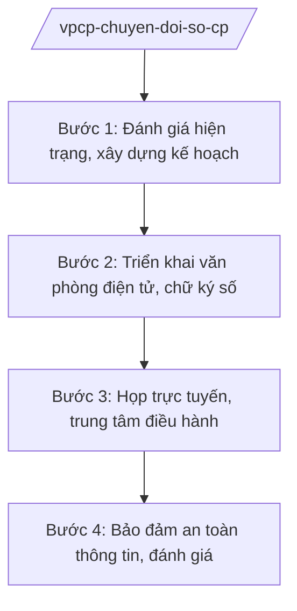

# Skill: Chuyển đổi số trong hoạt động của Chính phủ

## 2. Khi nào dùng

Khi triển khai văn phòng điện tử phục vụ Chính phủ (gửi, nhận văn bản điện tử, chữ ký số),
họp trực tuyến Chính phủ, liên thông dữ liệu phục vụ chỉ đạo, điều hành, xây dựng trung tâm
điều hành của Chính phủ.

## 3. Đầu vào (Input)

| Trường | Mô tả | Bắt buộc |
|--------|-------|----------|
| `hien_trang` | Hiện trạng ứng dụng CNTT (hệ thống văn bản, họp trực tuyến, CSDL) | Có |
| `muc_tieu` | Mục tiêu chuyển đổi số (tỷ lệ văn bản điện tử, họp không giấy...) | Có |
| `de_xuat_du_an` | Đề xuất dự án CNTT (nâng cấp hệ thống, trung tâm điều hành) | Không |
| `bao_cao_an_toan` | Báo cáo an toàn thông tin mạng | Không |

## 4. Quy trình

**Bước 1. Đánh giá hiện trạng, xây dựng kế hoạch**

- Làm gì: Khảo sát hiện trạng hệ thống thông tin phục vụ Chính phủ; xác định mục tiêu, chỉ tiêu chuyển đổi số; lập kế hoạch năm.
- Dùng input: `hien_trang`, `muc_tieu`.
- Vai trò: Chuyên viên Cục Chuyển đổi số (AI hỗ trợ tổng hợp hiện trạng, so sánh với mục tiêu quốc gia — 3 giờ); Cục trưởng (bà Vũ Thị FF) duyệt kế hoạch.
- Lưu ý nghiệp vụ: Mục tiêu phải đo lường được (100% văn bản điện tử có chữ ký số, 100% phiên họp không giấy...).
- → Kết quả bước: Kế hoạch chuyển đổi số của Văn phòng Chính phủ.

**Bước 2. Triển khai văn phòng điện tử, chữ ký số**

- Làm gì: Triển khai hệ thống quản lý văn bản điện tử liên thông Chính phủ – bộ/ngành – địa phương; cấp phát, quản lý chữ ký số; đào tạo sử dụng.
- Dùng input: `de_xuat_du_an`.
- Vai trò: Cục Chuyển đổi số triển khai (AI hỗ trợ soạn tài liệu hướng dẫn, theo dõi tiến độ — 3 giờ); Thứ trưởng/Chủ nhiệm VPCP chỉ đạo.
- Lưu ý nghiệp vụ: Văn bản điện tử có giá trị pháp lý như văn bản giấy khi đủ điều kiện; bảo đảm an toàn, chống giả mạo chữ ký số.
- → Kết quả bước: Hệ thống văn phòng điện tử vận hành + chữ ký số được cấp phát.

**Bước 3. Họp trực tuyến, trung tâm điều hành**

- Làm gì: Tổ chức họp trực tuyến Chính phủ với địa phương; xây dựng trung tâm điều hành hiển thị số liệu KT-XH trực tuyến phục vụ chỉ đạo.
- Dùng input: Kế hoạch, `bao_cao_an_toan`.
- Vai trò: Cục Chuyển đổi số vận hành (AI hỗ trợ tổng hợp số liệu hiển thị, cảnh báo chỉ số bất thường — 2 giờ).
- Lưu ý nghiệp vụ: Hệ thống họp trực tuyến phải ổn định, bảo mật; số liệu hiển thị phải chính xác, cập nhật.
- → Kết quả bước: Hệ thống họp trực tuyến + trung tâm điều hành vận hành ổn định.

**Bước 4. Bảo đảm an toàn thông tin, đánh giá**

- Làm gì: Triển khai biện pháp an toàn thông tin mạng (mã hóa, kiểm soát truy cập, diễn tập); đánh giá mức độ chuyển đổi số định kỳ.
- Dùng input: `bao_cao_an_toan`.
- Vai trò: Cục Chuyển đổi số chủ trì, phối hợp cơ quan an ninh mạng (AI hỗ trợ rà soát lỗ hổng, tổng hợp báo cáo — 2 giờ); Chủ nhiệm VPCP (ông Lê Văn CC) chỉ đạo.
- Lưu ý nghiệp vụ: Hệ thống phục vụ Chính phủ là mục tiêu trọng điểm bảo đảm an toàn thông tin; sự cố phải xử lý trong giờ.
- → Kết quả bước: Báo cáo an toàn thông tin + đánh giá chuyển đổi số.

## Luồng quy trình (Workflow)

## 5. Đầu ra (Output)

- Kế hoạch chuyển đổi số của Văn phòng Chính phủ
- Hệ thống văn phòng điện tử, chữ ký (ghi rõ chức danh, họ tên người ký; ký hiệu "KT."/"TL." khi ký thay) số vận hành
- Hệ thống họp trực tuyến, trung tâm điều hành
- Báo cáo an toàn thông tin, đánh giá chuyển đổi số

### Cấu trúc output chuẩn (Kế hoạch chuyển đổi số)

1. Quốc hiệu "CỘNG HÒA XÃ HỘI CHỦ NGHĨA VIỆT NAM", Tiêu ngữ "Độc lập – Tự do – Hạnh phúc"; tên Văn phòng Chính phủ; số, ký hiệu; địa danh, ngày tháng
2. Tên kế hoạch
3. Căn cứ (chương trình chuyển đổi số quốc gia; NĐ 36/2025/NĐ-CP)
4. Hiện trạng, mục tiêu, chỉ tiêu cụ thể
5. Nhiệm vụ, giải pháp (hạ tầng, dữ liệu, nhân lực, an toàn)
6. Kinh phí
7. Phân công trách nhiệm
8. Chữ ký người có thẩm quyền (theo NĐ 30/2020/NĐ-CP)
9. Nơi nhận (kết thúc "- Lưu: VT, [mã đơn vị].").

> **Checklist thể thức văn bản theo NĐ 30/2020/NĐ-CP** — đối chiếu trước khi trình ký:
> 1. Quốc hiệu và Tiêu ngữ.
> 2. Tên cơ quan, tổ chức ban hành văn bản.
> 3. Số, ký hiệu của văn bản.
> 4. Địa danh và thời gian ban hành văn bản.
> 5. Tên loại và trích yếu nội dung văn bản.
> 6. Nội dung văn bản.
> 7. Chức vụ, họ tên và chữ ký của người có thẩm quyền.
> 8. Dấu, chữ ký số của cơ quan, tổ chức.
> 9. Nơi nhận (kèm Phụ lục nếu có).

## 6. Checklist nghiệm thu

- [ ] Chỉ tiêu chuyển đổi số đo lường được, có lộ trình
- [ ] Văn bản điện tử, chữ ký số có giá trị pháp lý, an toàn
- [ ] Hệ thống họp trực tuyến ổn định, bảo mật
- [ ] Số liệu trung tâm điều hành chính xác, cập nhật
- [ ] Có phương án bảo đảm an toàn thông tin, xử lý sự cố kịp thời
- [ ] Thể thức đúng NĐ 30/2020/NĐ-CP; đã qua human gate

## 7. Ví dụ mô phỏng

*Dữ liệu dưới đây là giả lập 100% phục vụ minh họa.*

**Input mẫu:**

| Trường | Giá trị |
|--------|---------|
| hien_trang | 80% văn bản trao đổi điện tử; 50% phiên họp trực tuyến với địa phương |
| muc_tieu | Năm 2026: 100% văn bản điện tử có chữ ký số; 100% phiên họp không giấy |

**Output mẫu (trích Kế hoạch):**

> **VĂN PHÒNG CHÍNH PHỦ**
> Số: 1234/QĐ-VPCP
>
> **QUYẾT ĐỊNH**
> **Ban hành Kế hoạch chuyển đổi số của Văn phòng Chính phủ năm 2026**
>
> Điều 1. Mục tiêu: 100% văn bản trao đổi dưới dạng điện tử có chữ ký số; 100% phiên họp Chính phủ không giấy...
> Điều 2. Cục Chuyển đổi số chủ trì triển khai...

## 8. Human gate

- Cục trưởng Cục Chuyển đổi số (bà Vũ Thị FF): duyệt kế hoạch, ký văn bản kỹ thuật
- Chủ nhiệm Văn phòng Chính phủ (ông Lê Văn CC): phê duyệt kế hoạch, chỉ đạo triển khai

## 9. Giới hạn

- AI không tự phê duyệt dự án CNTT, không cấp phát chữ ký số
- Không bịa số liệu chuyển đổi số, kết quả đánh giá
- Không can thiệp hệ thống an toàn thông tin; sự cố do con người xử lý
- Bảo mật hệ thống, dữ liệu phục vụ Chính phủ
- Không viện dẫn văn bản hết hiệu lực

## 10. Căn cứ & lưu ý

- Nghị định 36/2025/NĐ-CP ngày 25/02/2025 của Chính phủ — chức năng, nhiệm vụ, quyền hạn và cơ cấu tổ chức của Văn phòng Chính phủ (được sửa đổi tại Nghị định 369/2025/NĐ-CP)
- Nghị quyết 176/2025/QH15 — cơ cấu tổ chức của Chính phủ
- Nghị định 303/2025/NĐ-CP — khung chung về chức năng, nhiệm vụ của bộ, cơ quan ngang bộ
- Nghị định 30/2020/NĐ-CP — công tác văn thư (thể thức văn bản)
- Lưu ý: gắn với Chương trình chuyển đổi số quốc gia; phối hợp Bộ Khoa học và Công nghệ (NĐ 55/2025/NĐ-CP) về hạ tầng, an toàn thông tin
