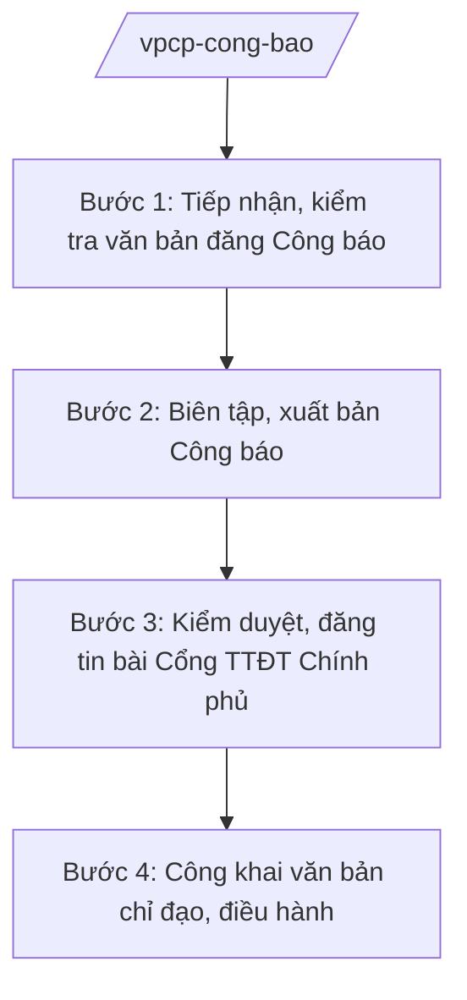

# Skill: Công báo, Cổng TTĐT Chính phủ

## 2. Khi nào dùng

Khi đăng văn bản QPPL lên Công báo, biên tập, kiểm duyệt tin bài trên Cổng TTĐT Chính phủ,
công khai văn bản chỉ đạo, điều hành của Chính phủ, Thủ tướng.

## 3. Đầu vào (Input)

| Trường | Mô tả | Bắt buộc |
|--------|-------|----------|
| `van_ban_cong_bao` | Văn bản QPPL cần đăng Công báo (bản chính đã ký) | Có |
| `tin_bai` | Tin, bài, ảnh, video đăng Cổng TTĐT Chính phủ | Không |
| `van_ban_cong_khai` | Văn bản chỉ đạo, điều hành cần công khai | Không |

## 4. Quy trình

**Bước 1. Tiếp nhận, kiểm tra văn bản đăng Công báo**

- Làm gì: Tiếp nhận bản chính văn bản QPPL; kiểm tra tính hợp lệ (chữ ký, dấu, thể thức); xếp lịch đăng Công báo.
- Dùng input: `van_ban_cong_bao`.
- Vai trò: Chuyên viên Ban Công báo kiểm tra (AI hỗ trợ kiểm tra thể thức, phát hiện lỗi chính tả, số hiệu — 1 giờ); Trưởng ban Công báo duyệt.
- Lưu ý nghiệp vụ: Chỉ đăng văn bản đã ký đúng thẩm quyền; bảo đảm thời hạn đăng Công báo theo quy định (văn bản có hiệu lực sau khi đăng Công báo).
- → Kết quả bước: Lịch đăng Công báo + văn bản đã kiểm tra.

**Bước 2. Biên tập, xuất bản Công báo**

- Làm gì: Biên tập, dàn trang; xuất bản Công báo điện tử và bản giấy; lưu trữ.
- Dùng input: Văn bản đã kiểm tra.
- Vai trò: Ban Công báo thực hiện (AI hỗ trợ dàn trang, kiểm tra lỗi — 2 giờ).
- Lưu ý nghiệp vụ: Nội dung Công báo phải khớp 100% bản chính; số Công báo liên tục, không bỏ số.
- → Kết quả bước: Số Công báo được xuất bản.

**Bước 3. Kiểm duyệt, đăng tin bài Cổng TTĐT Chính phủ**

- Làm gì: Biên tập tin bài về hoạt động của Chính phủ, Thủ tướng; kiểm duyệt nội dung, hình ảnh; đăng tải; xử lý thông tin sai lệch.
- Dùng input: `tin_bai`, `van_ban_cong_khai`.
- Vai trò: Chuyên viên Cổng TTĐT biên tập (AI hỗ trợ kiểm tra chính tả, gợi ý tiêu đề — 1 giờ); Tổng Biên tập Cổng TTĐT duyệt đăng.
- Lưu ý nghiệp vụ: Tin bài chính xác, khách quan, kịp thời; không đăng thông tin mật, thông tin chưa kiểm chứng.
- → Kết quả bước: Tin bài được đăng tải trên Cổng TTĐT Chính phủ.

**Bước 4. Công khai văn bản chỉ đạo, điều hành**

- Làm gì: Đăng tải văn bản chỉ đạo, điều hành của Chính phủ, Thủ tướng (trừ văn bản mật); cập nhật chuyên mục văn bản.
- Dùng input: `van_ban_cong_khai`.
- Vai trò: Cổng TTĐT thực hiện (AI hỗ trợ phân loại, gắn thẻ văn bản — 1 giờ).
- Lưu ý nghiệp vụ: Phân loại mật đúng quy định; văn bản mật không đăng công khai.
- → Kết quả bước: Văn bản được công khai, tra cứu được.

## Luồng quy trình (Workflow)

## 5. Đầu ra (Output)

- Số Công báo đã xuất bản (điện tử + bản giấy)
- Tin, bài trên Cổng TTĐT Chính phủ
- Chuyên mục văn bản chỉ đạo, điều hành được cập nhật

### Cấu trúc output chuẩn (thể thức NĐ 30/2020/NĐ-CP) (Công báo — trang bìa số)

1. Quốc hiệu: CỘNG HÒA XÃ HỘI CHỦ NGHĨA VIỆT NAM
2. Tên: CÔNG BÁO
3. Số Công báo, ngày xuất bản
4. Mục lục văn bản trong số (số hiệu, tên văn bản, trang)
5. Nội dung từng văn bản (khớp bản chính 100%)
6. Nơi nhận (kết thúc "- Lưu: VT, [mã đơn vị].").
## 6. Checklist nghiệm thu

- [ ] Văn bản đăng Công báo khớp 100% bản chính đã ký
- [ ] Đăng đúng thời hạn quy định
- [ ] Tin bài chính xác, khách quan, không thông tin mật/chưa kiểm chứng
- [ ] Văn bản công khai phân loại mật đúng quy định
- [ ] Số Công báo liên tục, lưu trữ đầy đủ
- [ ] Đã qua human gate

## 7. Ví dụ mô phỏng

*Dữ liệu dưới đây là giả lập 100% phục vụ minh họa.*

**Input mẫu:**

| Trường | Giá trị |
|--------|---------|
| van_ban_cong_bao | Nghị định số 123/2026/NĐ-CP (giả lập) đã ký ban hành |
| tin_bai | Tin: Thủ tướng chủ trì phiên họp Chính phủ thường kỳ tháng 9/2026 (giả lập) |

**Output mẫu (Mục lục Công báo):**

> **CỘNG HÒA XÃ HỘI CHỦ NGHĨA VIỆT NAM**
> **CÔNG BÁO**
> Số 123 + 124, ngày 01/10/2026 (giả lập)
>
> MỤC LỤC
> 1. Nghị định số 123/2026/NĐ-CP quy định... (trang 2)

## 8. Human gate

- Trưởng ban Công báo: duyệt đăng Công báo
- Tổng Biên tập Cổng TTĐT Chính phủ: duyệt tin bài đăng tải
- Chủ nhiệm Văn phòng Chính phủ (ông Lê Văn CC): chỉ đạo nội dung quan trọng

## 9. Giới hạn

- AI không tự đăng Công báo, không tự đăng tin bài
- Không bịa nội dung văn bản, tin bài
- Không đăng tải văn bản mật, thông tin chưa kiểm chứng
- Không viện dẫn văn bản hết hiệu lực

## 10. Căn cứ & lưu ý

- Nghị định 36/2025/NĐ-CP ngày 25/02/2025 của Chính phủ — chức năng, nhiệm vụ, quyền hạn và cơ cấu tổ chức của Văn phòng Chính phủ (được sửa đổi tại Nghị định 369/2025/NĐ-CP)
- Nghị quyết 176/2025/QH15 — cơ cấu tổ chức của Chính phủ
- Nghị định 30/2020/NĐ-CP — công tác văn thư (thể thức văn bản)
- Lưu ý: hiệu lực của văn bản QPPL gắn với việc đăng Công báo theo quy định của pháp luật về ban hành VBQPPL
