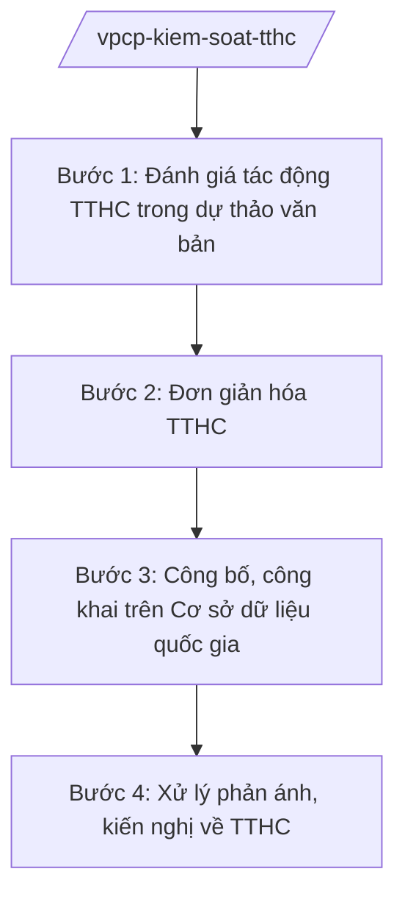

# Skill: Kiểm soát TTHC (cấp Chính phủ)

## 2. Khi nào dùng

Khi rà soát, đánh giá tác động của TTHC trong dự thảo văn bản QPPL trình Chính phủ; đơn giản hóa
TTHC; công bố, công khai TTHC trên Cơ sở dữ liệu quốc gia; xử lý phản ánh, kiến nghị về TTHC.

## 3. Đầu vào (Input)

| Trường | Mô tả | Bắt buộc |
|--------|-------|----------|
| `du_thao_vb` | Dự thảo văn bản QPPL có quy định TTHC trình Chính phủ | Có |
| `danh_muc_tthc` | Danh mục TTHC cần rà soát, đơn giản hóa | Có |
| `phan_anh_kien_nghi` | Phản ánh, kiến nghị của cá nhân, tổ chức về TTHC | Không |
| `bao_cao_bo_nganh` | Báo cáo kiểm soát TTHC của bộ/ngành, địa phương | Không |

## 4. Quy trình

**Bước 1. Đánh giá tác động TTHC trong dự thảo văn bản**

- Làm gì: Rà soát quy định TTHC trong dự thảo văn bản trình Chính phủ; đánh giá sự cần thiết, tính hợp lý, chi phí tuân thủ; yêu cầu cắt giảm, đơn giản hóa.
- Dùng input: `du_thao_vb`.
- Vai trò: Chuyên viên Cục Kiểm soát TTHC đánh giá (AI hỗ trợ đối chiếu với danh mục TTHC hiện hành, tính chi phí tuân thủ — 4 giờ); Cục trưởng (bà Vũ Thị FF) ký ý kiến đánh giá.
- Lưu ý nghiệp vụ: Kiên quyết không để phát sinh TTHC mới không cần thiết; mọi TTHC phải có căn cứ pháp lý rõ ràng.
- → Kết quả bước: Ý kiến đánh giá tác động TTHC (đồng ý/yêu cầu sửa).

**Bước 2. Đơn giản hóa TTHC**

- Làm gì: Rà soát danh mục TTHC; đề xuất bãi bỏ, đơn giản hóa (cắt giảm thành phần hồ sơ, thời gian giải quyết, chi phí); trình Thủ tướng phê duyệt phương án.
- Dùng input: `danh_muc_tthc`, `bao_cao_bo_nganh`.
- Vai trò: Cục Kiểm soát TTHC chủ trì, phối hợp bộ/ngành (AI hỗ trợ thống kê TTHC trùng lặp, đề xuất gộp — 4 giờ); Thứ trưởng/Chủ nhiệm VPCP trình Thủ tướng.
- Lưu ý nghiệp vụ: Ưu tiên TTHC liên quan người dân, doanh nghiệp; gắn với cung cấp dịch vụ công trực tuyến.
- → Kết quả bước: Phương án đơn giản hóa TTHC trình Thủ tướng phê duyệt.

**Bước 3. Công bố, công khai trên Cơ sở dữ liệu quốc gia**

- Làm gì: Tiếp nhận quyết định công bố TTHC của bộ/ngành, địa phương; kiểm tra; cập nhật Cơ sở dữ liệu quốc gia về TTHC; công khai trên Cổng Dịch vụ công quốc gia.
- Dùng input: Quyết định công bố TTHC.
- Vai trò: Cục Kiểm soát TTHC vận hành CSDL (AI hỗ trợ kiểm tra tính nhất quán dữ liệu — 2 giờ).
- Lưu ý nghiệp vụ: Dữ liệu phải chính xác, cập nhật kịp thời; là căn cứ duy nhất để giải quyết TTHC cho dân.
- → Kết quả bước: TTHC được công khai trên Cổng Dịch vụ công quốc gia.

**Bước 4. Xử lý phản ánh, kiến nghị về TTHC**

- Làm gì: Tiếp nhận phản ánh, kiến nghị qua Cổng tham vấn; chuyển cơ quan có thẩm quyền xử lý; theo dõi, đôn đốc; công khai kết quả.
- Dùng input: `phan_anh_kien_nghi`.
- Vai trò: Cục Kiểm soát TTHC xử lý (AI hỗ trợ phân loại phản ánh, theo dõi hạn — 2 giờ).
- Lưu ý nghiệp vụ: Phản ánh phải được xử lý dứt điểm, công khai; là nguồn rà soát, đơn giản hóa TTHC.
- → Kết quả bước: Văn bản xử lý phản ánh + báo cáo tổng hợp.

## Luồng quy trình (Workflow)

## 5. Đầu ra (Output)

- Ý kiến đánh giá tác động TTHC đối với dự thảo văn bản
- Phương án đơn giản hóa TTHC trình Thủ tướng
- Dữ liệu TTHC công khai trên Cổng Dịch vụ công quốc gia
- Báo cáo xử lý phản ánh, kiến nghị về TTHC

### Cấu trúc output chuẩn (Ý kiến đánh giá tác động TTHC)

1. Quốc hiệu "CỘNG HÒA XÃ HỘI CHỦ NGHĨA VIỆT NAM", Tiêu ngữ "Độc lập – Tự do – Hạnh phúc"; tên Văn phòng Chính phủ/Cục; số, ký hiệu; địa danh, ngày tháng
2. Tên văn bản ý kiến
3. Kính gửi (cơ quan chủ trì soạn thảo)
4. Nội dung đánh giá: sự cần thiết, tính hợp lý của từng TTHC; chi phí tuân thủ
5. Yêu cầu: giữ nguyên/sửa đổi/bãi bỏ từng quy định
6. Kiến nghị
7. Chữ ký (ghi rõ chức danh, họ tên người ký; ký hiệu "KT."/"TL." khi ký thay) người có thẩm quyền (theo NĐ 30/2020/NĐ-CP)
8. Nơi nhận (kết thúc "- Lưu: VT, [mã đơn vị].").

> **Checklist thể thức văn bản theo NĐ 30/2020/NĐ-CP** — đối chiếu trước khi trình ký:
> 1. Quốc hiệu và Tiêu ngữ.
> 2. Tên cơ quan, tổ chức ban hành văn bản.
> 3. Số, ký hiệu của văn bản.
> 4. Địa danh và thời gian ban hành văn bản.
> 5. Tên loại và trích yếu nội dung văn bản.
> 6. Nội dung văn bản.
> 7. Chức vụ, họ tên và chữ ký của người có thẩm quyền.
> 8. Dấu, chữ ký số của cơ quan, tổ chức.
> 9. Nơi nhận (kèm Phụ lục nếu có).

## 6. Checklist nghiệm thu

- [ ] Mọi TTHC mới đều được đánh giá tác động trước khi trình Chính phủ
- [ ] Không phát sinh TTHC không cần thiết, không có căn cứ pháp lý
- [ ] Phương án đơn giản hóa có chỉ tiêu cắt giảm cụ thể
- [ ] Dữ liệu TTHC công khai chính xác, cập nhật kịp thời
- [ ] Phản ánh, kiến nghị được xử lý dứt điểm, công khai
- [ ] Thể thức đúng NĐ 30/2020/NĐ-CP; đã qua human gate

## 7. Ví dụ mô phỏng

*Dữ liệu dưới đây là giả lập 100% phục vụ minh họa.*

**Input mẫu:**

| Trường | Giá trị |
|--------|---------|
| du_thao_vb | Dự thảo nghị định quy định 5 TTHC mới về cấp phép (giả lập) |
| danh_muc_tthc | 6.000 TTHC toàn quốc cần rà soát năm 2026 |
| phan_anh_kien_nghi | 100 phản ánh về TTHC đất đai rườm rà |

**Output mẫu (trích Ý kiến đánh giá):**

> **VĂN PHÒNG CHÍNH PHỦ**
> **CỤC KIỂM SOÁT THỦ TỤC HÀNH CHÍNH**
> Số: 1234/KS TTHC
>
> **Ý KIẾN**
> **Đánh giá tác động thủ tục hành chính trong dự thảo nghị định...**
>
> 1. Trong 5 TTHC dự thảo: 3 TTHC cần thiết, 2 TTHC trùng lặp đề nghị bãi bỏ...
> 2. Yêu cầu cắt giảm 30% thành phần hồ sơ, rút thời gian giải quyết từ 15 ngày xuống 10 ngày...

## 8. Human gate

- Cục trưởng Cục Kiểm soát TTHC (bà Vũ Thị FF): ký ý kiến đánh giá, văn bản xử lý phản ánh
- Thứ trưởng/Chủ nhiệm Văn phòng Chính phủ: trình phương án đơn giản hóa
- Thủ tướng Chính phủ (ông Nguyễn Văn AA): phê duyệt phương án đơn giản hóa TTHC

## 9. Giới hạn

- AI không tự quyết định bãi bỏ/đơn giản hóa TTHC
- Không bịa số liệu TTHC, chi phí tuân thủ, kết quả rà soát
- Không thay cơ quan có thẩm quyền công bố TTHC
- Không viện dẫn văn bản hết hiệu lực

## 10. Căn cứ & lưu ý

- Nghị định 36/2025/NĐ-CP ngày 25/02/2025 của Chính phủ — chức năng, nhiệm vụ, quyền hạn và cơ cấu tổ chức của Văn phòng Chính phủ (được sửa đổi tại Nghị định 369/2025/NĐ-CP)
- Nghị định 118/2025/NĐ-CP — thực hiện cơ chế một cửa, một cửa liên thông trong giải quyết TTHC
- Nghị quyết 176/2025/QH15 — cơ cấu tổ chức của Chính phủ
- Nghị định 30/2020/NĐ-CP — công tác văn thư (thể thức văn bản)
- Lưu ý: phân định với kiểm soát TTHC cấp tỉnh (Sở/VP UBND tỉnh) — Cục Kiểm soát TTHC làm đầu mối quốc gia
