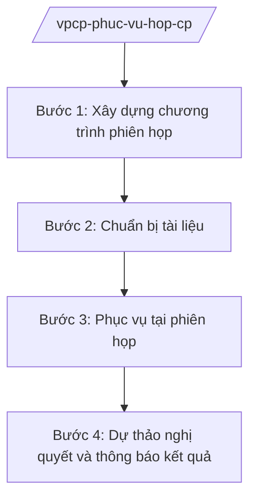

# Skill: Phục vụ phiên họp Chính phủ

## 2. Khi nào dùng

Khi chuẩn bị và phục vụ phiên họp Chính phủ thường kỳ, chuyên đề, đột xuất: xây dựng chương trình,
tổng hợp tài liệu, dự thảo nghị quyết phiên họp, thông báo kết quả.

## 3. Đầu vào (Input)

| Trường | Mô tả | Bắt buộc |
|--------|-------|----------|
| `chuong_trinh_du_kien` | Chương trình phiên họp dự kiến (nội dung, cơ quan trình) | Có |
| `tai_lieu_trinh` | Tài liệu, tờ trình của bộ/ngành cho từng nội dung | Có |
| `y_kien_tham_muu` | Ý kiến thẩm tra của các vụ chức năng VPCP | Không |

## 4. Quy trình

**Bước 1. Xây dựng chương trình phiên họp**

- Làm gì: Tổng hợp đề xuất nội dung từ bộ/ngành; sắp xếp chương trình theo thứ tự ưu tiên; trình Thủ tướng phê duyệt chương trình.
- Dùng input: `chuong_trinh_du_kien`.
- Vai trò: Vụ tổng hợp xây dựng chương trình (AI hỗ trợ tổng hợp đề xuất, sắp xếp logic ⏱ 2 giờ (ước tính)); Chủ nhiệm VPCP (ông Lê Văn CC) trình Thủ tướng (ông Nguyễn Văn AA) phê duyệt.
- Lưu ý nghiệp vụ: Ưu tiên nội dung cấp bách, nội dung đã đủ hồ sơ; không đưa nội dung chưa chuẩn bị kỹ vào chương trình.
- → Kết quả bước: Chương trình phiên họp được Thủ tướng phê duyệt.

**Bước 2. Chuẩn bị tài liệu**

- Làm gì: Thu thập tài liệu trình của bộ/ngành; Vụ chức năng VPCP thẩm tra, có ý kiến độc lập; tổng hợp thành bộ tài liệu phiên họp gửi thành viên Chính phủ.
- Dùng input: `tai_lieu_trinh`, `y_kien_tham_muu`.
- Vai trò: Các vụ chức năng thẩm tra (AI hỗ trợ kiểm tra tính đầy đủ hồ sơ, tóm tắt nội dung chính ⏱ 3 giờ (ước tính)); Vụ trưởng duyệt.
- Lưu ý nghiệp vụ: Tài liệu gửi đúng thời hạn theo Quy chế làm việc; ý kiến VPCP phải độc lập, khách quan.
- → Kết quả bước: Bộ tài liệu phiên họp hoàn chỉnh.

**Bước 3. Phục vụ tại phiên họp**

- Làm gì: Bảo đảm hậu cần, lễ tân, kỹ thuật; ghi biên bản, ghi âm; chuẩn bị dự thảo kết luận từng nội dung.
- Dùng input: Chương trình, tài liệu phiên họp.
- Vai trò: Văn phòng Chính phủ phục vụ (AI hỗ trợ ghi biên bản từ ghi âm ⏱ 2 giờ (ước tính), con người kiểm tra lại 100%).
- Lưu ý nghiệp vụ: Biên bản phải chính xác ý kiến chỉ đạo; bảo mật nội dung thảo luận.
- → Kết quả bước: Biên bản phiên họp + dự thảo kết luận từng nội dung.

**Bước 4. Dự thảo nghị quyết và thông báo kết quả**

- Làm gì: Dự thảo Nghị quyết phiên họp Chính phủ; trình Thủ tướng ký ban hành; ra thông báo báo chí về kết quả phiên họp.
- Dùng input: Biên bản, kết luận phiên họp.
- Vai trò: Vụ tổng hợp dự thảo nghị quyết (AI hỗ trợ soạn thảo theo mẫu ⏱ 2 giờ (ước tính)); Chủ nhiệm VPCP trình; Thủ tướng ký ban hành.
- Lưu ý nghiệp vụ: Nghị quyết phải thể hiện đầy đủ kết luận của tập thể; thông báo báo chí chính xác, không tiết lộ nội dung mật.
- → Kết quả bước: Nghị quyết phiên họp Chính phủ + thông báo báo chí.

## Luồng quy trình (Workflow)

## 5. Đầu ra (Output)

- Chương trình phiên họp Chính phủ
- Bộ tài liệu phiên họp
- Biên bản phiên họp
- Dự thảo/Nghị quyết phiên họp Chính phủ
- Thông báo báo chí

### Cấu trúc output chuẩn (Nghị quyết phiên họp Chính phủ)

1. Quốc hiệu "CỘNG HÒA XÃ HỘI CHỦ NGHĨA VIỆT NAM", Tiêu ngữ "Độc lập – Tự do – Hạnh phúc"; tên Chính phủ; số, ký hiệu; địa danh, ngày tháng
2. Tên nghị quyết (Nghị quyết phiên họp Chính phủ thường kỳ tháng.../chuyên đề...)
3. Căn cứ (Luật Tổ chức Chính phủ; Quy chế làm việc)
4. Các nội dung kết luận (theo từng vấn đề: đánh giá tình hình; nhiệm vụ, giải pháp; phân công)
5. Điều khoản thi hành
6. Chữ ký (ghi rõ chức danh, họ tên người ký; ký hiệu "KT."/"TL." khi ký thay) Thủ tướng, dấu (theo NĐ 30/2020/NĐ-CP)
7. Nơi nhận (kết thúc "- Lưu: VT, [mã đơn vị].").

> **Checklist thể thức văn bản theo NĐ 30/2020/NĐ-CP** — đối chiếu trước khi trình ký:
> 1. Quốc hiệu và Tiêu ngữ.
> 2. Tên cơ quan, tổ chức ban hành văn bản.
> 3. Số, ký hiệu của văn bản.
> 4. Địa danh và thời gian ban hành văn bản.
> 5. Tên loại và trích yếu nội dung văn bản.
> 6. Nội dung văn bản.
> 7. Chức vụ, họ tên và chữ ký của người có thẩm quyền.
> 8. Dấu, chữ ký số của cơ quan, tổ chức.
> 9. Nơi nhận (kèm Phụ lục nếu có).

## 6. Checklist nghiệm thu

- [ ] Chương trình được Thủ tướng phê duyệt, nội dung đủ hồ sơ
- [ ] Tài liệu gửi đúng thời hạn, ý kiến VPCP độc lập, khách quan
- [ ] Biên bản chính xác ý kiến chỉ đạo
- [ ] Nghị quyết thể hiện đầy đủ kết luận tập thể
- [ ] Bảo mật nội dung thảo luận, không lộ thông tin mật
- [ ] Thể thức đúng NĐ 30/2020/NĐ-CP; đã qua human gate

## 7. Ví dụ mô phỏng

*Dữ liệu dưới đây là giả lập 100% phục vụ minh họa.*

**Input mẫu:**

| Trường | Giá trị |
|--------|---------|
| chuong_trinh_du_kien | Phiên họp thường kỳ tháng 9/2026: tình hình KT-XH 9 tháng; 3 dự thảo nghị định (giả lập) |
| tai_lieu_trinh | Tờ trình + dự thảo của 3 bộ |

**Output mẫu (trích Nghị quyết):**

> **CHÍNH PHỦ**
> Số: 123/NQ-CP
>
> **NGHỊ QUYẾT**
> **Phiên họp Chính phủ thường kỳ tháng 9 năm 2026**
>
> **CHÍNH PHỦ**
>
> Căn cứ Luật Tổ chức Chính phủ;
> ...
> **QUYẾT NGHỊ:**
>
> 1. Về tình hình KT-XH 9 tháng: cơ bản đạt mục tiêu...
> 2. Thông qua 3 dự thảo nghị định, giao các Bộ hoàn thiện trình ký...

## 8. Human gate

- Vụ trưởng Vụ tổng hợp (ông Hoàng Văn EE): duyệt chương trình, tài liệu
- Chủ nhiệm Văn phòng Chính phủ (ông Lê Văn CC): trình Thủ tướng, ký văn bản phục vụ
- Thủ tướng Chính phủ (ông Nguyễn Văn AA): phê duyệt chương trình, ký ban hành nghị quyết

## 9. Giới hạn

- AI không tự quyết định nội dung chương trình, kết luận phiên họp
- Biên bản từ ghi âm do AI hỗ trợ phải được con người kiểm tra 100%
- Không bịa ý kiến phát biểu của thành viên Chính phủ
- Bảo mật tuyệt đối nội dung thảo luận tại phiên họp
- Không viện dẫn văn bản hết hiệu lực

## 10. Căn cứ & lưu ý

- Nghị định 36/2025/NĐ-CP ngày 25/02/2025 của Chính phủ — chức năng, nhiệm vụ, quyền hạn và cơ cấu tổ chức của Văn phòng Chính phủ (được sửa đổi tại Nghị định 369/2025/NĐ-CP)
- Nghị quyết 176/2025/QH15 — cơ cấu tổ chức của Chính phủ
- Nghị định 30/2020/NĐ-CP — công tác văn thư (thể thức văn bản)
- Lưu ý: thực hiện theo Quy chế làm việc của Chính phủ và Luật Tổ chức Chính phủ (chỉ dẫn tên luật)
