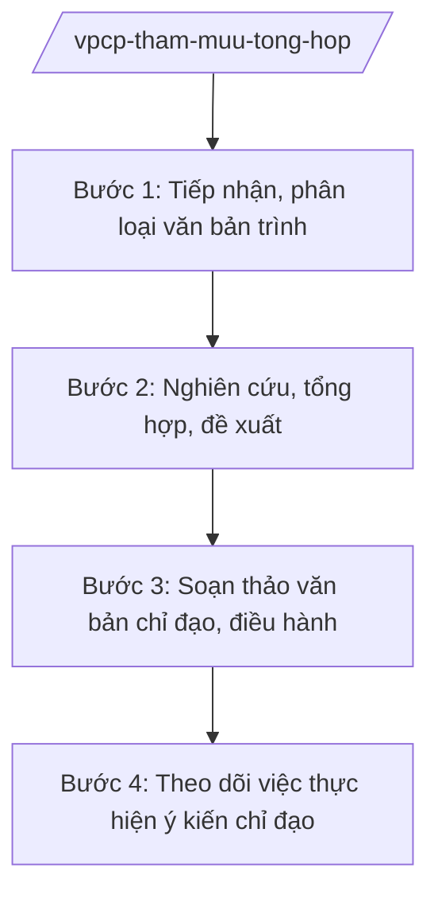

# Skill: Tham mưu tổng hợp phục vụ Chính phủ, Thủ tướng

## 2. Khi nào dùng

Khi tổng hợp tình hình kinh tế - xã hội phục vụ chỉ đạo, điều hành của Chính phủ, Thủ tướng;
chuẩn bị tài liệu, dự thảo kết luận, chỉ thị, công điện; xử lý văn bản đến trình Chính phủ, Thủ tướng.

## 3. Đầu vào (Input)

| Trường | Mô tả | Bắt buộc |
|--------|-------|----------|
| `van_ban_trinh` | Văn bản bộ/ngành, địa phương trình Chính phủ, Thủ tướng | Có |
| `so_lieu_tong_hop` | Số liệu KT-XH, báo cáo của bộ/ngành, địa phương | Có |
| `noi_dung_chi_dao` | Nội dung chỉ đạo cần tham mưu (kết luận, chỉ thị, công điện) | Có |
| `y_kien_tham_muu` | Ý kiến của các vụ chức năng thuộc Văn phòng Chính phủ | Không |

## 4. Quy trình

**Bước 1. Tiếp nhận, phân loại văn bản trình**

- Làm gì: Tiếp nhận văn bản trình Chính phủ, Thủ tướng; kiểm tra tính đầy đủ, hợp lệ của hồ sơ; phân loại theo lĩnh vực, mức độ khẩn.
- Dùng input: `van_ban_trinh`.
- Vai trò: Chuyên viên Vụ tổng hợp kiểm tra hồ sơ (AI hỗ trợ kiểm tra thành phần hồ sơ theo quy chế làm việc của Chính phủ, phân loại tự động — 2 giờ); Vụ trưởng (ông Hoàng Văn EE) phân công xử lý.
- Lưu ý nghiệp vụ: Hồ sơ thiếu thành phần phải trả lại ngay, không để tồn đọng; văn bản khẩn xử lý trong ngày.
- → Kết quả bước: Phiếu xử lý văn bản trình + phân công vụ chức năng.

**Bước 2. Nghiên cứu, tổng hợp, đề xuất**

- Làm gì: Nghiên cứu nội dung trình; tổng hợp số liệu, ý kiến liên quan; đề xuất phương án xử lý (đồng ý, yêu cầu bổ sung, báo cáo xin ý kiến).
- Dùng input: `so_lieu_tong_hop`, `y_kien_tham_muu`.
- Vai trò: Chuyên viên Vụ tổng hợp nghiên cứu (AI hỗ trợ tra cứu văn bản liên quan, tổng hợp số liệu so sánh — 4 giờ); Vụ trưởng duyệt phiếu trình.
- Lưu ý nghiệp vụ: Đề xuất phải khách quan, có căn cứ; nêu rõ ưu, nhược điểm từng phương án; không né tránh vấn đề khó.
- → Kết quả bước: Phiếu trình Thủ tướng/Phó Thủ tướng kèm dự thảo văn bản trả lời.

**Bước 3. Soạn thảo văn bản chỉ đạo, điều hành**

- Làm gì: Dự thảo kết luận, chỉ thị, công điện, thông báo ý kiến chỉ đạo của Chính phủ, Thủ tướng theo nội dung đã được phê duyệt.
- Dùng input: `noi_dung_chi_dao`, ý kiến chỉ đạo đã phê duyệt.
- Vai trò: Chuyên viên soạn thảo (AI hỗ trợ dự thảo theo mẫu, kiểm tra thể thức NĐ 30/2020 — 2 giờ); Vụ trưởng kiểm tra; Chủ nhiệm Văn phòng Chính phủ (ông Lê Văn CC) ký thừa ủy quyền hoặc trình Thủ tướng ký.
- Lưu ý nghiệp vụ: Văn bản chỉ đạo phải rõ việc, rõ đầu mối, rõ thời hạn; thể thức đúng NĐ 30/2020/NĐ-CP.
- → Kết quả bước: Văn bản chỉ đạo của Chính phủ/Thủ tướng được ban hành.

**Bước 4. Theo dõi việc thực hiện ý kiến chỉ đạo**

- Làm gì: Chuyển văn bản đến cơ quan thực hiện; theo dõi, đôn đốc; tổng hợp báo cáo kết quả.
- Dùng input: Văn bản chỉ đạo đã ban hành.
- Vai trò: Vụ tổng hợp theo dõi (AI hỗ trợ lập sổ theo dõi nhiệm vụ, cảnh báo quá hạn — 2 giờ).
- Lưu ý nghiệp vụ: Báo cáo trung thực kết quả; nhiệm vụ chưa hoàn thành phải nêu rõ nguyên nhân và đề xuất hướng xử lý tiếp.
- → Kết quả bước: Báo cáo kết quả thực hiện ý kiến chỉ đạo.

## Luồng quy trình (Workflow)

## 5. Đầu ra (Output)

- Phiếu trình Thủ tướng/Phó Thủ tướng
- Dự thảo văn bản chỉ đạo (kết luận, chỉ thị, công điện, thông báo)
- Báo cáo tổng hợp tình hình KT-XH phục vụ chỉ đạo, điều hành
- Báo cáo kết quả thực hiện ý kiến chỉ đạo

### Cấu trúc output chuẩn (thể thức NĐ 30/2020/NĐ-CP) (Phiếu trình)

**Khung thể thức chung (NĐ 30/2020/NĐ-CP):** mọi văn bản trong output đều trình bày đầy đủ: Quốc hiệu "CỘNG HÒA XÃ HỘI CHỦ NGHĨA VIỆT NAM", Tiêu ngữ "Độc lập – Tự do – Hạnh phúc"; tên cơ quan ban hành; số, ký hiệu văn bản; địa danh, ngày tháng năm ban hành; tên loại văn bản; nội dung theo các mục dưới đây; nơi nhận (kết thúc "- Lưu: VT, [mã đơn vị]."); khối chữ ký (chức danh, họ tên người ký; ký hiệu "KT."/"TL." khi ký thay).

1. Tên Văn phòng Chính phủ, Vụ trình; số phiếu, ngày tháng
2. Kính gửi (Thủ tướng/Phó Thủ tướng)
3. Tóm tắt nội dung trình của bộ/ngành, địa phương
4. Ý kiến của các cơ quan liên quan
5. Đề xuất của Văn phòng Chính phủ (phương án xử lý)
6. Dự thảo văn bản kèm theo (nếu có)
7. Chữ ký (ghi rõ chức danh, họ tên người ký; ký hiệu "KT."/"TL." khi ký thay) Vụ trưởng/Thứ trưởng/Chủ nhiệm (theo phân cấp)

> **Checklist thể thức văn bản theo NĐ 30/2020/NĐ-CP** — đối chiếu trước khi trình ký:
> 1. Quốc hiệu và Tiêu ngữ.
> 2. Tên cơ quan, tổ chức ban hành văn bản.
> 3. Số, ký hiệu của văn bản.
> 4. Địa danh và thời gian ban hành văn bản.
> 5. Tên loại và trích yếu nội dung văn bản.
> 6. Nội dung văn bản.
> 7. Chức vụ, họ tên và chữ ký của người có thẩm quyền.
> 8. Dấu, chữ ký số của cơ quan, tổ chức.
> 9. Nơi nhận (kèm Phụ lục nếu có).

## 6. Checklist nghiệm thu

- [ ] Hồ sơ trình đầy đủ, hợp lệ; phân loại đúng lĩnh vực, mức độ khẩn
- [ ] Đề xuất khách quan, có căn cứ, nêu rõ phương án
- [ ] Văn bản chỉ đạo rõ việc, rõ đầu mối, rõ thời hạn
- [ ] Thể thức đúng NĐ 30/2020/NĐ-CP
- [ ] Theo dõi, đôn đốc đầy đủ sau ban hành
- [ ] Đã qua human gate

## 7. Ví dụ mô phỏng

*Dữ liệu dưới đây là giả lập 100% phục vụ minh họa.*

**Input mẫu:**

| Trường | Giá trị |
|--------|---------|
| van_ban_trinh | Tờ trình của Bộ Y tế đề nghị Thủ tướng cho chủ trương mua vắc xin phòng dịch (giả lập) |
| so_lieu_tong_hop | 1.000 ca mắc tại 10 tỉnh; tồn kho vắc xin đủ 50% nhu cầu |
| noi_dung_chi_dao | Dự thảo công điện của Thủ tướng về tăng cường phòng chống dịch |

**Output mẫu (trích Phiếu trình):**

> **VĂN PHÒNG CHÍNH PHỦ**
> **VỤ TỔNG HỢP**
> Phiếu trình số: 1234/PT-VPCP
>
> Kính gửi: Thủ tướng Chính phủ Nguyễn Văn AA
>
> Tóm tắt: Bộ Y tế trình xin chủ trương mua bổ sung vắc xin...
> Ý kiến VPCP: nhất trí về chủ trương; đề nghị Thủ tướng giao Bộ Y tế phối hợp Bộ Tài chính khẩn trương thực hiện...
> Kèm theo: dự thảo Công điện của Thủ tướng.

## 8. Human gate

- Vụ trưởng Vụ tổng hợp (ông Hoàng Văn EE): phân công, duyệt phiếu trình
- Thứ trưởng/Chủ nhiệm Văn phòng Chính phủ: duyệt nội dung trình Thủ tướng
- Chủ nhiệm Văn phòng Chính phủ (ông Lê Văn CC): ký văn bản thừa ủy quyền / trình Thủ tướng ký
- Thủ tướng Chính phủ (ông Nguyễn Văn AA): quyết định cuối cùng

## 9. Giới hạn

- AI không tự quyết định thay Thủ tướng, không ký văn bản chỉ đạo
- Không bịa nội dung trình của bộ/ngành, ý kiến chỉ đạo
- Bảo mật tài liệu trình Chính phủ (tài liệu mật xử lý theo quy định bảo mật)
- Không viện dẫn văn bản hết hiệu lực

## 10. Căn cứ & lưu ý

- Nghị định 36/2025/NĐ-CP ngày 25/02/2025 của Chính phủ — chức năng, nhiệm vụ, quyền hạn và cơ cấu tổ chức của Văn phòng Chính phủ (được sửa đổi tại Nghị định 369/2025/NĐ-CP)
- Nghị quyết 176/2025/QH15 — cơ cấu tổ chức của Chính phủ
- Nghị định 303/2025/NĐ-CP — khung chung về chức năng, nhiệm vụ của bộ, cơ quan ngang bộ
- Nghị định 30/2020/NĐ-CP — công tác văn thư (thể thức văn bản)
- Lưu ý: thực hiện theo Quy chế làm việc của Chính phủ; phân định với tham mưu tổng hợp của Văn phòng UBND tỉnh (phục vụ UBND tỉnh)
