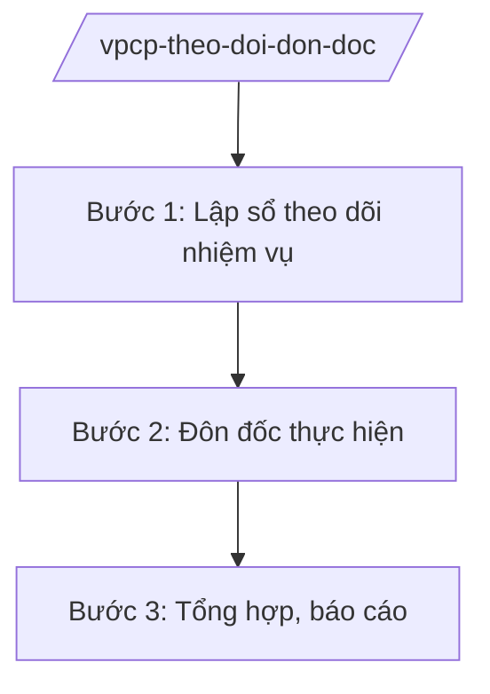

# Skill: Theo dõi, đôn đốc thực hiện nhiệm vụ Chính phủ giao

## 2. Khi nào dùng

Khi theo dõi việc thực hiện nhiệm vụ, kết luận, ý kiến chỉ đạo do Chính phủ, Thủ tướng giao cho
bộ/ngành, địa phương; đôn đốc, tổng hợp báo cáo định kỳ và đột xuất.

## 3. Đầu vào (Input)

| Trường | Mô tả | Bắt buộc |
|--------|-------|----------|
| `nhiem_vu_giao` | Nhiệm vụ được giao (nội dung, cơ quan thực hiện, thời hạn) | Có |
| `van_ban_giao` | Văn bản giao nhiệm vụ (nghị quyết, kết luận, công điện, thông báo) | Có |
| `bao_cao_thuc_hien` | Báo cáo kết quả thực hiện của cơ quan được giao | Không |

## 4. Quy trình

**Bước 1. Lập sổ theo dõi nhiệm vụ**

- Làm gì: Bóc tách nhiệm vụ từ văn bản giao (nghị quyết phiên họp, kết luận, công điện); lập sổ theo dõi: nội dung, đầu mối, thời hạn, mức độ.
- Dùng input: `nhiem_vu_giao`, `van_ban_giao`.
- Vai trò: Chuyên viên Vụ tổng hợp bóc tách nhiệm vụ (AI hỗ trợ trích xuất nhiệm vụ từ văn bản, lập bảng theo dõi tự động ⏱ ~2 giờ (ước tính)); Vụ trưởng (ông Hoàng Văn EE) duyệt sổ theo dõi.
- Lưu ý nghiệp vụ: Bóc tách đầy đủ, không sót nhiệm vụ; phân loại theo mức độ ưu tiên, thời hạn.
- → Kết quả bước: Sổ theo dõi nhiệm vụ Chính phủ giao.

**Bước 2. Đôn đốc thực hiện**

- Làm gì: Gửi văn bản đôn đốc trước hạn; nhắc nhở cơ quan chậm; đề xuất biện pháp với nhiệm vụ có nguy cơ quá hạn.
- Dùng input: Sổ theo dõi, `bao_cao_thuc_hien`.
- Vai trò: Vụ tổng hợp đôn đốc (AI hỗ trợ cảnh báo tự động nhiệm vụ sắp/quá hạn ⏱ ~1 giờ (ước tính)).
- Lưu ý nghiệp vụ: Đôn đốc kiên trì, có văn bản; với nhiệm vụ quá hạn phải báo cáo Thủ tướng.
- → Kết quả bước: Văn bản đôn đốc + cập nhật tiến độ.

**Bước 3. Tổng hợp, báo cáo**

- Làm gì: Tổng hợp tình hình thực hiện nhiệm vụ (hoàn thành, đang thực hiện, quá hạn); phân tích nguyên nhân chậm; báo cáo Chính phủ, Thủ tướng định kỳ và đột xuất.
- Dùng input: `bao_cao_thuc_hien`, sổ theo dõi.
- Vai trò: Vụ tổng hợp soạn báo cáo (AI hỗ trợ tổng hợp số liệu, vẽ biểu đồ tiến độ ⏱ ~3 giờ (ước tính)); Chủ nhiệm Văn phòng Chính phủ (ông Lê Văn CC) ký báo cáo.
- Lưu ý nghiệp vụ: Báo cáo trung thực, nêu rõ cơ quan chậm và nguyên nhân; kiến nghị xử lý trách nhiệm nếu cần.
- → Kết quả bước: Báo cáo tình hình thực hiện nhiệm vụ Chính phủ giao.

## Luồng quy trình (Workflow)

## 5. Đầu ra (Output)

- Sổ theo dõi nhiệm vụ Chính phủ, Thủ tướng giao
- Văn bản đôn đốc
- Báo cáo tình hình thực hiện nhiệm vụ (định kỳ, đột xuất)

### Cấu trúc output chuẩn (Báo cáo tình hình thực hiện nhiệm vụ)

1. Quốc hiệu "CỘNG HÒA XÃ HỘI CHỦ NGHĨA VIỆT NAM", Tiêu ngữ "Độc lập – Tự do – Hạnh phúc"; tên Văn phòng Chính phủ; số, ký hiệu; địa danh, ngày tháng
2. Tên báo cáo, kỳ báo cáo
3. Tổng số nhiệm vụ được giao trong kỳ
4. Kết quả: hoàn thành đúng hạn / đang thực hiện / quá hạn (chi tiết theo cơ quan)
5. Nhiệm vụ quá hạn: nguyên nhân, trách nhiệm
6. Kiến nghị (đôn đốc, xử lý, điều chỉnh thời hạn)
7. Chữ ký (ghi rõ chức danh, họ tên người ký; ký hiệu "KT."/"TL." khi ký thay) người có thẩm quyền (theo NĐ 30/2020/NĐ-CP)
8. Nơi nhận (kết thúc "- Lưu: VT, [mã đơn vị].").
## 6. Checklist nghiệm thu

- [ ] Bóc tách đầy đủ nhiệm vụ từ văn bản giao, không sót
- [ ] Đôn đốc kịp thời, có văn bản, đúng đối tượng
- [ ] Báo cáo trung thực, nêu rõ cơ quan chậm và nguyên nhân
- [ ] Có cảnh báo sớm nhiệm vụ có nguy cơ quá hạn
- [ ] Thể thức đúng NĐ 30/2020/NĐ-CP; đã qua human gate

## 7. Ví dụ mô phỏng

*Dữ liệu dưới đây là giả lập 100% phục vụ minh họa.*

**Input mẫu:**

| Trường | Giá trị |
|--------|---------|
| nhiem_vu_giao | 50 nhiệm vụ tại Nghị quyết phiên họp Chính phủ tháng 9/2026 (giả lập) |
| van_ban_giao | Nghị quyết số 123/NQ-CP (giả lập) |
| bao_cao_thuc_hien | 40 nhiệm vụ hoàn thành, 8 đang thực hiện, 2 quá hạn |

**Output mẫu (trích Báo cáo):**

> **VĂN PHÒNG CHÍNH PHỦ**
> Số: 1234/BC-VPCP
>
> **BÁO CÁO**
> **Tình hình thực hiện nhiệm vụ do Chính phủ, Thủ tướng Chính phủ giao**
> **tháng 9/2026**
>
> 1. Tổng số 50 nhiệm vụ: hoàn thành 40, đang thực hiện 8, quá hạn 2...
> 2. 02 nhiệm vụ quá hạn của Bộ AA, Bộ BB (giả lập): nguyên nhân...
> 3. Kiến nghị: Thủ tướng phê bình, yêu cầu hoàn thành trước ngày...

## 8. Human gate

- Vụ trưởng Vụ tổng hợp (ông Hoàng Văn EE): duyệt sổ theo dõi, báo cáo
- Chủ nhiệm Văn phòng Chính phủ (ông Lê Văn CC): ký báo cáo trình Chính phủ, Thủ tướng
- Thủ tướng Chính phủ (ông Nguyễn Văn AA): chỉ đạo xử lý nhiệm vụ quá hạn

## 9. Giới hạn

- AI không tự kết luận hoàn thành/quá hạn thay người theo dõi
- Không bịa tiến độ, kết quả thực hiện nhiệm vụ
- Không che giấu nhiệm vụ quá hạn, không làm đẹp số liệu
- Bảo mật nội dung nhạy cảm trong báo cáo
- Không viện dẫn văn bản hết hiệu lực

## 10. Căn cứ & lưu ý

- Nghị định 36/2025/NĐ-CP ngày 25/02/2025 của Chính phủ — chức năng, nhiệm vụ, quyền hạn và cơ cấu tổ chức của Văn phòng Chính phủ (được sửa đổi tại Nghị định 369/2025/NĐ-CP)
- Nghị quyết 176/2025/QH15 — cơ cấu tổ chức của Chính phủ
- Nghị định 30/2020/NĐ-CP — công tác văn thư (thể thức văn bản)
- Lưu ý: thực hiện theo Quy chế làm việc của Chính phủ; phân định với theo dõi nhiệm vụ của Văn phòng UBND tỉnh
