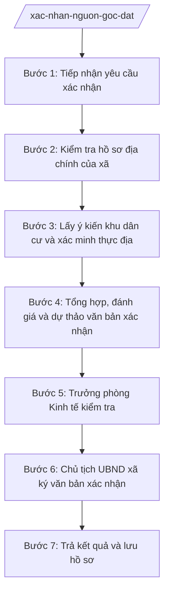

# Skill: Xác nhận nguồn gốc, hiện trạng sử dụng đất

## 2. Khi nào dùng

- Người dân đề nghị UBND xã xác nhận nguồn gốc, quá trình sử dụng đất để làm thủ tục cấp GCN lần đầu;
- Cần văn bản xác nhận của UBND xã phục vụ hồ sơ chuyển mục đích sử dụng đất;
- Cần xác nhận hiện trạng sử dụng đất phục vụ hòa giải tranh chấp đất đai ở cơ sở;
- Cơ quan, tổ chức có thẩm quyền yêu cầu UBND xã xác nhận thông tin đất đai của hộ gia đình, cá nhân.

## 3. Đầu vào (Input)

| Trường | Mô tả | Bắt buộc |
|--------|-------|----------|
| `ho_ten_nguoi_de_nghi` | Họ tên hộ gia đình, cá nhân đề nghị xác nhận | Có |
| `muc_dich_xac_nhan` | Mục đích sử dụng văn bản xác nhận (cấp GCN, chuyển mục đích, hòa giải tranh chấp...) | Có |
| `vi_tri_thua_dat` | Vị trí thửa đất: thôn/tổ dân phố, tờ bản đồ, số thửa (nếu có) | Có |
| `giay_to_lien_quan` | Giấy tờ liên quan đến đất (nếu có): giấy mua bán, tặng cho, thừa kế, biên lai thuế... | Không |
| `thoi_diem_bat_dau_su_dung` | Thời điểm hộ gia đình, cá nhân bắt đầu sử dụng đất (theo khai báo) | Có |
| `hien_trang_su_dung` | Hiện trạng sử dụng đất hiện nay (mục đích, công trình trên đất...) | Có |

## 4. Quy trình

**Bước 1. Tiếp nhận yêu cầu xác nhận**
- Làm gì: Tiếp nhận đơn/yêu cầu xác nhận nguồn gốc đất của hộ gia đình, cá nhân tại Trung tâm Phục vụ hành chính công xã (hoặc bộ phận tiếp nhận); kiểm tra tính đầy đủ của giấy tờ kèm theo; viết giấy hẹn trả kết quả.
- Dùng input: `ho_ten_nguoi_de_nghi`, `muc_dich_xac_nhan`, `vi_tri_thua_dat`, `giay_to_lien_quan`.
- Vai trò: Công chức Trung tâm PVHCC tiếp nhận, AI hỗ trợ kiểm tra danh mục giấy tờ, in giấy hẹn; ⏱ ~0 (ước tính),5 ngày làm việc.
- Lưu ý nghiệp vụ: Ghi rõ mục đích xác nhận để nội dung văn bản xác nhận đáp ứng đúng yêu cầu; hồ sơ thiếu hướng dẫn bổ sung một lần.
- → Kết quả bước: Đơn yêu cầu đã tiếp nhận + giấy hẹn trả kết quả.

**Bước 2. Kiểm tra hồ sơ địa chính của xã**
- Làm gì: Công chức địa chính tra cứu hồ sơ địa chính, sổ mục kê, bản đồ địa chính của xã để đối chiếu thông tin thửa đất do người dân khai báo (diện tích, ranh giới, biến động, tình trạng tranh chấp, quy hoạch).
- Dùng input: `vi_tri_thua_dat`, `thoi_diem_bat_dau_su_dung`, `giay_to_lien_quan`.
- Vai trò: Công chức địa chính xã tra cứu, AI hỗ trợ tổng hợp thông tin tra cứu thành phiếu kiểm tra hồ sơ địa chính; ⏱ ~1–2 ngày làm việc (ước tính).
- Lưu ý nghiệp vụ: Thông tin trong hồ sơ địa chính là căn cứ quan trọng nhất; nội dung xác nhận không được trái với hồ sơ địa chính đang quản lý.
- → Kết quả bước: Phiếu kiểm tra, đối chiếu hồ sơ địa chính thửa đất.

**Bước 3. Lấy ý kiến khu dân cư và xác minh thực địa**
- Làm gì: Lấy ý kiến của trưởng thôn/tổ dân phố và các hộ dân liền kề về nguồn gốc, quá trình sử dụng đất của hộ đề nghị; công chức địa chính trực tiếp kiểm tra hiện trạng sử dụng đất tại thực địa.
- Dùng input: Kết quả Bước 2, `hien_trang_su_dung`.
- Vai trò: Công chức địa chính phối hợp trưởng thôn/tổ dân phố thực hiện, AI hỗ trợ soạn biên bản lấy ý kiến khu dân cư và biên bản kiểm tra thực địa; ⏱ ~2–3 ngày làm việc (ước tính).
- Lưu ý nghiệp vụ: Ý kiến khu dân cư phải được lập thành biên bản có chữ ký xác nhận; kiểm tra thực địa phải đối chiếu hiện trạng với nội dung khai báo và hồ sơ địa chính.
- → Kết quả bước: Biên bản lấy ý kiến khu dân cư + biên bản kiểm tra hiện trạng thực địa.

**Bước 4. Tổng hợp, đánh giá và dự thảo văn bản xác nhận**
- Làm gì: Tổng hợp kết quả kiểm tra hồ sơ địa chính, ý kiến khu dân cư và kiểm tra thực địa; đánh giá tính thống nhất của các nguồn thông tin; dự thảo văn bản xác nhận của UBND xã (nêu rõ nguồn gốc, quá trình, hiện trạng sử dụng đất và mục đích xác nhận).
- Dùng input: Kết quả Bước 2–3; `muc_dich_xac_nhan`.
- Vai trò: Công chức địa chính tổng hợp, dự thảo; AI hỗ trợ soạn thảo văn bản đúng thể thức, kiểm tra tính thống nhất thông tin giữa các nguồn; ⏱ ~1–2 ngày làm việc (ước tính).
- Lưu ý nghiệp vụ: Nội dung xác nhận phải trung thực, chỉ xác nhận những nội dung đã được kiểm chứng; trường hợp thông tin mâu thuẫn, chưa đủ cơ sở thì phải xác minh bổ sung, không xác nhận ẩu.
- → Kết quả bước: Dự thảo văn bản xác nhận của UBND xã.

**Bước 5. Trưởng phòng Kinh tế kiểm tra**
- Làm gì: Trưởng phòng Kinh tế kiểm tra dự thảo văn bản xác nhận: tính đầy đủ của căn cứ xác minh, tính thống nhất của nội dung với hồ sơ địa chính và biên bản xác minh, thể thức văn bản.
- Dùng input: Dự thảo văn bản xác nhận + toàn bộ hồ sơ xác minh (Bước 2–3).
- Vai trò: Trưởng phòng Kinh tế kiểm tra, AI hỗ trợ đối chiếu nội dung dự thảo với phiếu kiểm tra hồ sơ địa chính và biên bản xác minh, chỉ ra điểm chưa thống nhất; ⏱ ~1 ngày làm việc (ước tính).
- Lưu ý nghiệp vụ: Văn bản xác nhận của UBND xã có giá trị pháp lý làm căn cứ cho các thủ tục tiếp theo, nên khâu kiểm tra phải chặt chẽ.
- → Kết quả bước: Dự thảo văn bản xác nhận đã được kiểm tra, đủ điều kiện trình ký.

**Bước 6. Chủ tịch UBND xã ký văn bản xác nhận**
- Làm gì: Chủ tịch UBND xã xem xét hồ sơ xác minh và dự thảo văn bản; ký ban hành văn bản xác nhận nguồn gốc, quá trình, hiện trạng sử dụng đất.
- Dùng input: Dự thảo đã kiểm tra ở Bước 5.
- Vai trò: Chủ tịch UBND xã quyết định ký; công chức hoàn thiện văn bản theo ý kiến chỉ đạo, AI hỗ trợ cập nhật nhanh các chỉnh sửa kỹ thuật; ⏱ ~1 ngày làm việc (ước tính).
- Lưu ý nghiệp vụ: AI chỉ hỗ trợ chỉnh sửa kỹ thuật; quyết định nội dung xác nhận thuộc thẩm quyền của Chủ tịch UBND xã.
- → Kết quả bước: Văn bản xác nhận của UBND xã (đã ký, đóng dấu).

**Bước 7. Trả kết quả và lưu hồ sơ**
- Làm gì: Trao văn bản xác nhận cho người đề nghị tại Trung tâm PVHCC theo giấy hẹn; lưu toàn bộ hồ sơ xác minh, văn bản xác nhận (bản lưu) vào hồ sơ địa chính của xã.
- Dùng input: Văn bản xác nhận đã ký, giấy hẹn trả kết quả.
- Vai trò: Công chức Trung tâm PVHCC trả kết quả, công chức địa chính lưu hồ sơ; AI hỗ trợ cập nhật sổ theo dõi; ⏱ ~0 (ước tính),5 ngày làm việc.
- Lưu ý nghiệp vụ: Người nhận ký nhận vào sổ giao nhận; hồ sơ bản lưu đầy đủ để phục vụ tra cứu, giải quyết khiếu nại về sau.
- → Kết quả bước: Văn bản xác nhận đã trao cho người dân; hồ sơ lưu trữ đầy đủ.

## Luồng quy trình (Workflow)

## 5. Đầu ra (Output)

- Văn bản xác nhận của UBND xã về nguồn gốc, quá trình và hiện trạng sử dụng đất (đã ký, đóng dấu);
- Bộ hồ sơ xác minh bản lưu (đơn đề nghị, phiếu kiểm tra hồ sơ địa chính, biên bản lấy ý kiến khu dân cư, biên bản kiểm tra thực địa, giấy tờ liên quan).

### Cấu trúc output chuẩn (Văn bản xác nhận của UBND xã)

1. Quốc hiệu "CỘNG HÒA XÃ HỘI CHỦ NGHĨA VIỆT NAM" – Tiêu ngữ "Độc lập – Tự do – Hạnh phúc"; (đúng thể thức NĐ 30/2020/NĐ-CP)
2. Tên cơ quan ban hành: ỦY BAN NHÂN DÂN XÃ A; số, ký hiệu văn bản; địa danh và ngày, tháng, năm ban hành;
3. Tên loại và trích yếu: XÁC NHẬN — Về nguồn gốc, quá trình và hiện trạng sử dụng đất của hộ ông/bà...;
4. Căn cứ xác minh (Luật Đất đai; hồ sơ địa chính xã; biên bản lấy ý kiến khu dân cư; biên bản kiểm tra thực địa...);
5. Nội dung xác nhận:
   - Thông tin người được xác nhận và thửa đất (vị trí, diện tích, ranh giới);
   - Nguồn gốc đất (nhận chuyển nhượng/tặng cho/thừa kế/khai hoang... từ thời điểm nào);
   - Quá trình sử dụng đất (các biến động nếu có);
   - Hiện trạng sử dụng đất (mục đích sử dụng hiện nay, công trình trên đất, tình trạng tranh chấp);
   - Mục đích của việc xác nhận;
6. Nơi nhận;
7. Thẩm quyền, chức vụ, họ tên người ký: TM. ỦY BAN NHÂN DÂN — CHỦ TỊCH — (chữ ký, họ tên), dấu của cơ quan.

## 6. Checklist nghiệm thu

- [ ] Đơn yêu cầu được tiếp nhận đúng quy trình, có giấy hẹn trả kết quả;
- [ ] Đã tra cứu, đối chiếu hồ sơ địa chính của xã; nội dung xác nhận không trái hồ sơ địa chính;
- [ ] Có biên bản lấy ý kiến khu dân cư (trưởng thôn/tổ dân phố, hộ giáp ranh) có chữ ký xác nhận;
- [ ] Có biên bản kiểm tra hiện trạng thực địa của công chức địa chính;
- [ ] Nội dung xác nhận đầy đủ 4 yếu tố: nguồn gốc, quá trình, hiện trạng, mục đích xác nhận;
- [ ] Văn bản đúng thể thức hành chính, có số/ký hiệu, ngày tháng, nơi nhận, chữ ký, dấu;
- [ ] Đã qua kiểm tra của Trưởng phòng Kinh tế và được Chủ tịch UBND xã ký;
- [ ] Thông tin thửa đất thống nhất trong toàn bộ hồ sơ;
- [ ] Hồ sơ bản lưu đầy đủ để tra cứu về sau.

## 7. Ví dụ mô phỏng

*Dữ liệu dưới đây là giả lập 100% phục vụ minh họa.*

### Input mẫu

| Trường | Giá trị giả lập |
|--------|-----------------|
| ho_ten_nguoi_de_nghi | Bà Trần Thị Dân |
| muc_dich_xac_nhan | Làm thủ tục cấp Giấy chứng nhận QSD đất lần đầu |
| vi_tri_thua_dat | Thôn 2, xã A; tờ bản đồ số 12, thửa số 350 |
| giay_to_lien_quan | Giấy tặng cho đất viết tay năm 2010 (bản sao); biên lai thuế sử dụng đất các năm 2020–2025 |
| thoi_diem_bat_dau_su_dung | Năm 2010 (nhận tặng cho từ cha mẹ) |
| hien_trang_su_dung | Đất ở, có nhà cấp 4 xây dựng năm 2015; không tranh chấp |

### Output mẫu (Văn bản xác nhận — trích)

> **CỘNG HÒA XÃ HỘI CHỦ NGHĨA VIỆT NAM**
> **Độc lập – Tự do – Hạnh phúc**
>
> **ỦY BAN NHÂN DÂN XÃ A**
> Số: 123/XN-UBND
> Xã A, ngày 05 tháng 4 năm 2027
>
> **XÁC NHẬN**
> **Về nguồn gốc, quá trình và hiện trạng sử dụng đất của hộ bà Trần Thị Dân**
>
> Căn cứ Luật Đất đai;
> Căn cứ hồ sơ địa chính xã A; biên bản lấy ý kiến khu dân cư thôn 2 ngày 28/3/2027; biên bản kiểm tra thực địa ngày 30/3/2027;
> UBND xã A xác nhận như sau:
>
> 1. Thửa đất tại thôn 2, xã A; tờ bản đồ số 12, thửa số 350; diện tích 400 m².
> 2. Nguồn gốc: hộ bà Trần Thị Dân nhận tặng cho từ cha mẹ năm 2010, sử dụng ổn định từ đó đến nay.
> 3. Hiện trạng: đất ở, có nhà cấp 4 xây dựng năm 2015; không có tranh chấp, phù hợp quy hoạch.
> 4. Văn bản xác nhận này phục vụ làm thủ tục cấp Giấy chứng nhận quyền sử dụng đất lần đầu.
>
> ***Nơi nhận:*** ...
>
> **TM. ỦY BAN NHÂN DÂN**
> **CHỦ TỊCH**
> *(ký, đóng dấu)*
> **Nguyễn Văn A**

## 8. Human gate

1. Công chức Trung tâm PVHCC tiếp nhận yêu cầu, viết giấy hẹn (Bước 1);
2. Công chức địa chính xã kiểm tra hồ sơ địa chính, lấy ý kiến khu dân cư, xác minh thực địa, dự thảo văn bản (Bước 2–4);
3. Trưởng phòng Kinh tế kiểm tra tính đầy đủ, thống nhất của hồ sơ xác minh và dự thảo (Bước 5);
4. Chủ tịch UBND xã xem xét, ký văn bản xác nhận (Bước 6) — thẩm quyền ký thuộc Chủ tịch UBND xã.

## 9. Giới hạn

- AI KHÔNG ra quyết định về nội dung xác nhận thay người có thẩm quyền;
- AI KHÔNG tự ký, tự phát hành văn bản xác nhận hay bất kỳ văn bản nào;
- AI KHÔNG bịa nguồn gốc, quá trình, hiện trạng sử dụng đất; chỉ tổng hợp từ hồ sơ và kết quả xác minh do công chức cung cấp;
- AI KHÔNG bịa căn cứ pháp lý, không trích dẫn văn bản đã hết hiệu lực;
- AI KHÔNG "làm thay" việc lấy ý kiến khu dân cư, kiểm tra thực địa — đây là việc công chức và người dân thực hiện trực tiếp.

## 10. Căn cứ & lưu ý

- Nghị định 151/2025/NĐ-CP về phân định thẩm quyền chính quyền địa phương 2 cấp, phân quyền, phân cấp trong lĩnh vực đất đai;
- Thông tư 19/2025/TT-BNNMT hướng dẫn chức năng, nhiệm vụ, quyền hạn của cơ quan chuyên môn về nông nghiệp và môi trường thuộc UBND cấp tỉnh, cấp xã;
- Luật Đất đai (chỉ nêu tên luật, không kèm số hiệu);
- Nghị định 30/2020/NĐ-CP về công tác văn thư (chỉ dùng cho thể thức văn bản);
- Lưu ý: văn bản xác nhận của UBND xã là căn cứ quan trọng cho các thủ tục đất đai tiếp theo (cấp GCN, chuyển mục đích, hòa giải tranh chấp); nội dung xác nhận phải trung thực, có đủ căn cứ xác minh, không được xác nhận những nội dung chưa kiểm chứng.
