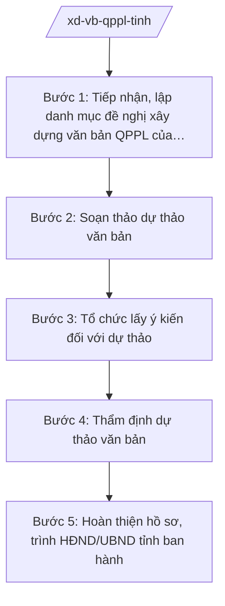

# Skill: Xây dựng văn bản QPPL của HĐND/UBND tỉnh

## 2. Khi nào dùng
- Đầu năm (hoặc đầu nhiệm kỳ) cần tổng hợp đề nghị của các sở, ngành để lập danh mục, chương trình xây dựng văn bản quy phạm pháp luật (VBQPPL) của tỉnh.
- Cơ quan chủ trì soạn thảo cần hỗ trợ kỹ thuật lập pháp: cấu trúc dự thảo, ngôn ngữ pháp lý, rà soát tính thống nhất nội tại.
- Sở Tư pháp cần thẩm định dự thảo VBQPPL của HĐND/UBND tỉnh trước khi trình: đánh giá sự cần thiết, tính hợp hiến, hợp pháp, tính thống nhất với hệ thống pháp luật, tính khả thi.
- Cần hoàn thiện hồ sơ trình ban hành: tờ trình, dự thảo, báo cáo thẩm định, bảng tổng hợp ý kiến tiếp thu, giải trình.

## 3. Đầu vào (Input)

| Trường | Mô tả | Bắt buộc |
|--------|-------|----------|
| `de_nghi_xd` | Đề nghị xây dựng văn bản: tên văn bản, loại hình (nghị quyết/quyết định), cơ quan chủ trì soạn thảo | Có |
| `pham_vi_doi_tuong` | Phạm vi điều chỉnh, đối tượng áp dụng dự kiến của văn bản | Có |
| `can_cu_chinh_sach` | Chủ trương, chính sách, văn bản của Trung ương làm căn cứ | Có |
| `du_thao` | Dự thảo văn bản qua các lần (lần 1, lần 2 sau tiếp thu...) | Không |
| `y_kien_tham_gia` | Ý kiến góp ý của sở, ngành, UBND cấp xã, đối tượng chịu tác động | Không |
| `bao_cao_tham_dinh` | Báo cáo thẩm định của Sở Tư pháp (khi đã có) | Không |

## 4. Quy trình

**Bước 1. Tiếp nhận, lập danh mục đề nghị xây dựng văn bản QPPL của tỉnh**
- Làm gì: Tổng hợp đề nghị xây dựng VBQPPL của các sở, ngành; rà soát sự cần thiết ban hành, thẩm quyền của HĐND/UBND tỉnh, đối chiếu tránh trùng lặp, chồng chéo với văn bản hiện hành; lập danh mục đề nghị trình UBND tỉnh xem xét.
- Dùng input: `de_nghi_xd`, `can_cu_chinh_sach`.
- Vai trò: Chuyên viên Phòng Xây dựng và kiểm tra văn bản QPPL (Sở Tư pháp tỉnh A) chủ trì tổng hợp. AI hỗ trợ đối chiếu từng đề nghị với danh mục VBQPPL hiện hành của tỉnh để phát hiện trùng lặp, chồng chéo về phạm vi điều chỉnh ⏱ ~03 ngày làm việc (ước tính).
- Lưu ý nghiệp vụ: Chỉ đưa vào danh mục văn bản thuộc thẩm quyền của HĐND/UBND tỉnh; mỗi đề nghị phải nêu rõ sự cần thiết, căn cứ chính sách, phạm vi điều chỉnh dự kiến, cơ quan chủ trì soạn thảo.
- → Kết quả bước: Danh mục đề nghị xây dựng VBQPPL của tỉnh trong năm/kỳ, kèm phiếu đánh giá sự cần thiết của từng đề nghị.

**Bước 2. Soạn thảo dự thảo văn bản**
- Làm gì: Cơ quan chủ trì soạn thảo xây dựng dự thảo lần 1: bố cục chương/mục/điều, nội dung điều chỉnh, quy định chuyển tiếp, hiệu lực thi hành; Sở Tư pháp hỗ trợ về kỹ thuật trình bày VBQPPL và ngôn ngữ pháp lý.
- Dùng input: `de_nghi_xd`, `pham_vi_doi_tuong`, `can_cu_chinh_sach`.
- Vai trò: Chuyên viên cơ quan chủ trì soạn thảo (sở, ngành) soạn dự thảo; chuyên viên Phòng Xây dựng và kiểm tra VBQPPL hỗ trợ kỹ thuật. AI hỗ trợ rà soát cấu trúc dự thảo, phát hiện điều khoản mâu thuẫn nội tại, gợi ý diễn đạt chuẩn pháp lý ⏱ ~05 ngày làm việc (ước tính).
- Lưu ý nghiệp vụ: Nội dung dự thảo không được trái Hiến pháp, luật và văn bản của cơ quan nhà nước cấp trên còn hiệu lực; không quy định thủ tục hành chính mới vượt thẩm quyền; ngôn ngữ rõ ràng, thống nhất.
- → Kết quả bước: Dự thảo văn bản lần 1 đúng cấu trúc chương/điều, kèm bản thuyết minh từng điều khoản.

**Bước 3. Tổ chức lấy ý kiến đối với dự thảo**
- Làm gì: Gửi dự thảo lấy ý kiến các sở, ngành, UBND cấp xã, đối tượng chịu sự tác động trực tiếp; tổ chức hội nghị, hội thảo góp ý đối với văn bản quan trọng; đăng tải lấy ý kiến rộng rãi theo quy định.
- Dùng input: `du_thao`, danh sách đơn vị lấy ý kiến.
- Vai trò: Trưởng phòng Xây dựng và kiểm tra VBQPPL điều phối việc lấy ý kiến. AI hỗ trợ soạn công văn lấy ý kiến, tổng hợp ý kiến góp ý theo từng điều khoản, lập bảng tiếp thu/giải trình ⏱ ~10 ngày làm việc, gồm thời hạn lấy ý kiến (ước tính).
- Lưu ý nghiệp vụ: Bảo đảm thời hạn lấy ý kiến theo quy định; mọi ý kiến phải được tiếp thu hoặc giải trình bằng văn bản; lưu đầy đủ văn bản góp ý vào hồ sơ soạn thảo.
- → Kết quả bước: Bảng tổng hợp ý kiến góp ý + bảng tiếp thu, giải trình; dự thảo lần 2 sau tiếp thu ý kiến.

**Bước 4. Thẩm định dự thảo văn bản**
- Làm gì: Sở Tư pháp thẩm định dự thảo theo các nội dung: sự cần thiết ban hành; đối tượng, phạm vi điều chỉnh; tính hợp hiến, hợp pháp, tính thống nhất với hệ thống pháp luật; ngôn ngữ, kỹ thuật trình bày; tính khả thi. Lập báo cáo thẩm định.
- Dùng input: `du_thao` (bản sau tiếp thu), `y_kien_tham_gia`, `can_cu_chinh_sach`.
- Vai trò: Chuyên viên Phòng Xây dựng và kiểm tra VBQPPL thực hiện thẩm định; Trưởng phòng kiểm tra; Phó Giám đốc Sở phụ trách ký báo cáo thẩm định. AI hỗ trợ đối chiếu dự thảo với văn bản cấp trên còn hiệu lực, lập checklist 05 nội dung thẩm định và dự thảo báo cáo thẩm định ⏱ ~05 ngày làm việc (ước tính).
- Lưu ý nghiệp vụ: Thẩm định độc lập, khách quan; ý kiến thẩm định phải cụ thể đến từng điều khoản; dự thảo chưa đạt yêu cầu phải trả lại cơ quan soạn thảo hoàn thiện, không "thẩm định cho xong".
- → Kết quả bước: Báo cáo thẩm định của Sở Tư pháp (kết luận đạt/chưa đạt, ý kiến cụ thể từng nội dung).

**Bước 5. Hoàn thiện hồ sơ, trình HĐND/UBND tỉnh ban hành**
- Làm gì: Cơ quan soạn thảo hoàn thiện dự thảo theo ý kiến thẩm định; lập hồ sơ trình gồm tờ trình, dự thảo văn bản, báo cáo thẩm định, bảng tổng hợp ý kiến; Sở Tư pháp kiểm tra hồ sơ lần cuối trước khi trình.
- Dùng input: `bao_cao_tham_dinh`, `du_thao` hoàn thiện.
- Vai trò: Giám đốc Sở Tư pháp ký văn bản gửi hồ sơ trình; Chủ tịch/Phó Chủ tịch UBND tỉnh xem xét; HĐND tỉnh (đối với nghị quyết) xem xét, thông qua. AI hỗ trợ kiểm tra tính đầy đủ thành phần hồ sơ, rà soát thể thức văn bản theo NĐ 30/2020/NĐ-CP ⏱ ~03 ngày làm việc (ước tính).
- Lưu ý nghiệp vụ: Hồ sơ trình phải đầy đủ thành phần; văn bản sau khi ban hành phải được đăng Công báo, cập nhật vào hệ thống VBQPPL của tỉnh và gửi cơ quan có thẩm quyền kiểm tra theo quy định.
- → Kết quả bước: Hồ sơ trình ban hành đầy đủ; văn bản QPPL được HĐND/UBND tỉnh ban hành, đăng Công báo, lưu hồ sơ.

## Luồng quy trình (Workflow)

## 5. Đầu ra (Output)

Sản phẩm:
- Danh mục đề nghị xây dựng VBQPPL của tỉnh — trình UBND tỉnh xem xét
- Dự thảo văn bản QPPL qua các lần + bản thuyết minh — lưu hồ sơ soạn thảo
- Bảng tổng hợp ý kiến góp ý, tiếp thu, giải trình — kèm hồ sơ trình
- Báo cáo thẩm định của Sở Tư pháp — gửi cơ quan soạn thảo, kèm hồ sơ trình
- Nghị quyết của HĐND tỉnh / Quyết định QPPL của UBND tỉnh (đã ban hành) — đăng Công báo

**Cấu trúc output chuẩn:**

Khung văn bản QPPL của HĐND/UBND tỉnh (Nghị quyết/Quyết định quy phạm) gồm các phần theo đúng thứ tự, đúng thể thức NĐ 30/2020/NĐ-CP:
1. Quốc hiệu "CỘNG HÒA XÃ HỘI CHỦ NGHĨA VIỆT NAM" — Tiêu ngữ "Độc lập – Tự do – Hạnh phúc"
2. Tên cơ quan ban hành: "HỘI ĐỒNG NHÂN DÂN TỈNH A" / "ỦY BAN NHÂN DÂN TỈNH A"
3. Số, ký hiệu: số.../NQ-HĐND hoặc số.../QĐ-UBND; địa danh, ngày, tháng, năm ban hành
4. Tên văn bản: "NGHỊ QUYẾT" / "QUYẾT ĐỊNH" + trích yếu nội dung
5. Căn cứ ban hành (liệt kê văn bản của cơ quan nhà nước cấp trên còn hiệu lực)
6. Nội dung: bố cục chương, mục, điều, khoản, điểm; quy định chuyển tiếp; hiệu lực thi hành
7. Điều khoản thi hành (trách nhiệm tổ chức thực hiện của các cơ quan, đơn vị)
8. Nơi nhận (cơ quan kiểm tra văn bản, các sở, ngành, UBND cấp xã, Công báo...)
9. Chữ ký: "TM. HỘI ĐỒNG NHÂN DÂN / CHỦ TỊCH" hoặc "TM. ỦY BAN NHÂN DÂN / CHỦ TỊCH" + họ tên, đóng dấu

## 6. Checklist nghiệm thu
- [ ] Đề nghị xây dựng văn bản nêu rõ sự cần thiết, thẩm quyền, không trùng lặp văn bản hiện hành
- [ ] Dự thảo đúng cấu trúc chương/mục/điều, ngôn ngữ pháp lý rõ ràng, thống nhất
- [ ] Đã lấy ý kiến đầy đủ sở, ngành, UBND cấp xã, đối tượng chịu tác động; có bảng tiếp thu, giải trình
- [ ] Báo cáo thẩm định độc lập, đánh giá đủ 05 nội dung, ý kiến cụ thể đến từng điều khoản
- [ ] Nội dung không trái Hiến pháp, luật, văn bản cấp trên còn hiệu lực
- [ ] Hồ sơ trình đầy đủ thành phần: tờ trình, dự thảo, báo cáo thẩm định, tổng hợp ý kiến
- [ ] Văn bản ban hành đúng thẩm quyền HĐND/UBND tỉnh; đã đăng Công báo, gửi kiểm tra theo quy định
- [ ] Thể thức văn bản đúng NĐ 30/2020/NĐ-CP
- [ ] Không có căn cứ pháp lý, số hiệu văn bản nào do AI bịa ra
- [ ] Đã qua human gate: chuyên viên soạn → Trưởng phòng kiểm tra → Phó Giám đốc Sở ký báo cáo thẩm định → Giám đốc Sở ký trình → HĐND/UBND tỉnh quyết định ban hành

## 7. Ví dụ mô phỏng

*Dữ liệu dưới đây là giả lập 100% phục vụ minh họa.*

### Input mẫu
- de_nghi_xd: Nghị quyết của HĐND tỉnh A quy định chính sách hỗ trợ học phí cho học sinh dân tộc thiểu số có hoàn cảnh khó khăn trên địa bàn tỉnh A, giai đoạn 2026–2030; cơ quan chủ trì soạn thảo: Sở Giáo dục và Đào tạo tỉnh A
- pham_vi_doi_tuong: Học sinh phổ thông là người dân tộc thiểu số thuộc hộ nghèo, hộ cận nghèo trên địa bàn tỉnh A
- can_cu_chinh_sach: Chủ trương của Tỉnh ủy A về phát triển giáo dục vùng đồng bào dân tộc thiểu số; quy định pháp luật hiện hành về chính sách dân tộc và giáo dục
- y_kien_tham_gia: Sở Tài chính tỉnh A, Sở Nội vụ tỉnh A, Ban Dân tộc tỉnh A, UBND 05 xã (giả lập) góp ý về mức hỗ trợ và đối tượng

### Output mẫu

**NGHỊ QUYẾT QUY ĐỊNH CHÍNH SÁCH HỖ TRỢ HỌC PHÍ CHO HỌC SINH DÂN TỘC THIỂU SỐ**

CỘNG HÒA XÃ HỘI CHỦ NGHĨA VIỆT NAM
Độc lập – Tự do – Hạnh phúc

HỘI ĐỒNG NHÂN DÂN TỈNH A

Số: 123/NQ-HĐND

Tỉnh A, ngày 20 tháng 07 năm 2026

**NGHỊ QUYẾT**
**Quy định chính sách hỗ trợ học phí cho học sinh dân tộc thiểu số có hoàn cảnh khó khăn trên địa bàn tỉnh A, giai đoạn 2026–2030**

*Căn cứ văn bản của cơ quan nhà nước cấp trên còn hiệu lực về tổ chức chính quyền địa phương, chính sách dân tộc và giáo dục;*

HỘI ĐỒNG NHÂN DÂN TỈNH A QUYẾT NGHỊ:

**Điều 1. Phạm vi điều chỉnh và đối tượng áp dụng**
1. Nghị quyết này quy định chính sách hỗ trợ học phí cho học sinh phổ thông là người dân tộc thiểu số thuộc hộ nghèo, hộ cận nghèo trên địa bàn tỉnh A, giai đoạn 2026–2030.
2. Đối tượng áp dụng: học sinh quy định tại khoản 1 Điều này; cơ quan, tổ chức, cá nhân có liên quan.

**Điều 2. Mức hỗ trợ và phương thức thực hiện**
1. Mức hỗ trợ: 100% học phí theo quy định hiện hành, chi trả theo học kỳ.
2. Kinh phí thực hiện từ ngân sách tỉnh A, bố trí trong dự toán hằng năm của Sở Giáo dục và Đào tạo tỉnh A.

**Điều 3. Điều khoản thi hành**
1. Nghị quyết này có hiệu lực thi hành từ ngày 01 tháng 8 năm 2026 đến hết ngày 31 tháng 12 năm 2030.
2. UBND tỉnh A tổ chức triển khai thực hiện Nghị quyết; hằng năm báo cáo HĐND tỉnh A kết quả thực hiện.

Nơi nhận:
- Cơ quan kiểm tra văn bản QPPL;
- Các sở, ngành tỉnh A; UBND các xã;
- Công báo tỉnh A;
- Lưu: Văn phòng.

TM. HỘI ĐỒNG NHÂN DÂN
CHỦ TỊCH
(ký, đóng dấu)

## 8. Human gate
Chuyên viên Phòng Xây dựng và kiểm tra VBQPPL soạn, rà soát → Trưởng phòng kiểm tra → Phó Giám đốc Sở phụ trách ký báo cáo thẩm định → Giám đốc Sở Tư pháp ký văn bản trình → Chủ tịch/Phó Chủ tịch UBND tỉnh xem xét → HĐND tỉnh thông qua (nghị quyết) / UBND tỉnh ban hành (quyết định). AI chỉ hỗ trợ rà soát, tổng hợp, dự thảo tài liệu; việc kết luận thẩm định và quyết định ban hành do con người thực hiện.

## 9. Giới hạn
AI tuyệt đối KHÔNG: kết luận tính hợp hiến, hợp pháp của dự thảo thay Sở Tư pháp; tự ký báo cáo thẩm định, tờ trình; bịa căn cứ pháp lý, số hiệu văn bản; dùng văn bản đã hết hiệu lực làm căn cứ ban hành; đề xuất nội dung vượt thẩm quyền của HĐND/UBND tỉnh.

## 10. Căn cứ & lưu ý
- TT 09/2025/TT-BTP (Sở Tư pháp tham mưu quản lý nhà nước về xây dựng pháp luật; hiệu lực 01/7/2025)
- NĐ 120/2025/NĐ-CP (phân định thẩm quyền CQĐP 2 cấp trong lĩnh vực quản lý nhà nước của Bộ Tư pháp)
- NĐ 150/2025/NĐ-CP; NĐ 370/2025/NĐ-CP (tổ chức cơ quan chuyên môn thuộc UBND cấp tỉnh)
- NĐ 30/2020/NĐ-CP (thể thức văn bản hành chính)
- Lưu ý: trình tự, thủ tục xây dựng, ban hành VBQPPL thực hiện theo quy định pháp luật chuyên ngành hiện hành về ban hành VBQPPL; văn bản sau ban hành phải đăng Công báo và gửi cơ quan có thẩm quyền kiểm tra theo quy định.
