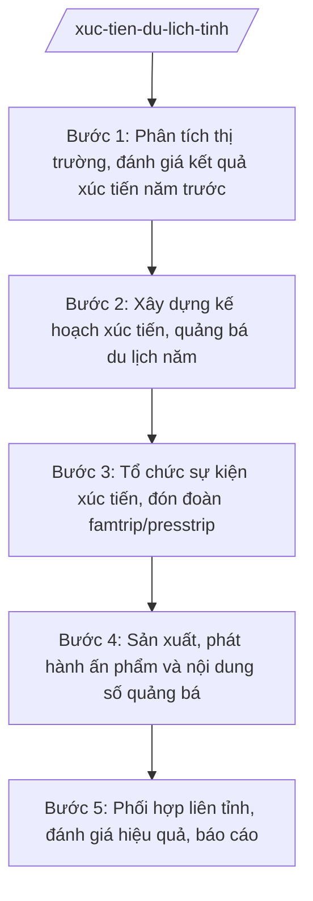

# Skill: Xúc tiến, quảng bá du lịch

## 2. Khi nào dùng

- Xây dựng kế hoạch xúc tiến, quảng bá du lịch hằng năm của tỉnh: thị trường mục tiêu, thông điệp, kênh truyền thông, sự kiện.
- Tổ chức gian hàng, sự kiện quảng bá tại hội chợ du lịch trong nước và quốc tế; tổ chức roadshow giới thiệu du lịch tỉnh.
- Đón, tổ chức đoàn famtrip (doanh nghiệp lữ hành) và presstrip (báo chí) khảo sát sản phẩm du lịch tỉnh.
- Sản xuất ấn phẩm (tờ rơi, bản đồ, cẩm nang), video, nội dung số quảng bá điểm đến trên website, mạng xã hội.
- Phối hợp xúc tiến liên tỉnh, liên vùng (tour liên tuyến, sự kiện chung); đánh giá hiệu quả xúc tiến, báo cáo UBND tỉnh.

## 3. Đầu vào (Input)

| Trường | Mô tả | Bắt buộc |
|--------|-------|----------|
| `muc_tieu` | Mục tiêu xúc tiến năm: lượt khách, doanh thu du lịch, thị trường trọng điểm cần thu hút | Có |
| `thi_truong_muc_tieu` | Thị trường khách mục tiêu: nội địa (vùng/miền), quốc tế (quốc gia); phân khúc (nghỉ dưỡng, văn hóa, sinh thái, MICE...) | Có |
| `danh_muc_su_kien` | Sự kiện xúc tiến dự kiến: hội chợ, triển lãm, roadshow, famtrip, presstrip (thời gian, địa điểm, quy mô, đơn vị phối hợp) | Không |
| `ke_hoach_an_pham` | Ấn phẩm, video, nội dung số dự kiến sản xuất: loại hình, số lượng, kênh phát hành | Không |
| `doi_tac_lien_tinh` | Tỉnh/thành phố, hiệp hội, doanh nghiệp dự kiến phối hợp xúc tiến liên vùng | Không |
| `du_toan` | Dự toán kinh phí xúc tiến năm (ngân sách, xã hội hóa) | Có |
| `thoi_han` | Thời hạn ban hành kế hoạch năm | Có |

## 4. Quy trình

**Bước 1. Phân tích thị trường, đánh giá kết quả xúc tiến năm trước**

- Làm gì: Thu thập số liệu khách du lịch đến tỉnh (lượt khách, cơ cấu thị trường, mức chi tiêu); đánh giá hiệu quả các hoạt động xúc tiến năm trước (sự kiện, famtrip, ấn phẩm); phân tích đối thủ cạnh tranh (các tỉnh cùng vùng); xác định thị trường mục tiêu năm nay.
- Dùng input: `muc_tieu`, `thi_truong_muc_tieu`.
- Vai trò: Chuyên viên Phòng Quản lý du lịch (bà Đặng Thị S) chủ trì phân tích, phối hợp Trung tâm Xúc tiến du lịch tỉnh (đơn vị sự nghiệp trực thuộc Sở); Trưởng phòng (bà Hoàng Thị N) kiểm tra. AI hỗ trợ: tổng hợp số liệu khách du lịch thành bảng, biểu đồ; soạn báo cáo đánh giá hiệu quả xúc tiến; lập ma trận thị trường mục tiêu. ⏱ ~7–10 ngày làm việc (ước tính).
- Lưu ý nghiệp vụ: Số liệu khách phải có nguồn rõ ràng (cơ sở lưu trú, khu/điểm du lịch, cửa khẩu nếu có); đánh giá hiệu quả phải gắn với chi phí đã bỏ ra, tránh cảm tính.
- → Kết quả bước: Báo cáo phân tích thị trường và đánh giá hiệu quả xúc tiến năm trước.

**Bước 2. Xây dựng kế hoạch xúc tiến, quảng bá du lịch năm**

- Làm gì: Dự thảo Kế hoạch xúc tiến, quảng bá du lịch tỉnh năm: mục tiêu, thị trường mục tiêu, thông điệp chủ đạo; danh mục sự kiện (trong nước, quốc tế); kế hoạch famtrip/presstrip; kế hoạch ấn phẩm, nội dung số; phối hợp liên tỉnh; dự toán kinh phí chi tiết từng hoạt động.
- Dùng input: `danh_muc_su_kien`, `ke_hoach_an_pham`, `doi_tac_lien_tinh`, `du_toan`, kết quả bước 1.
- Vai trò: Chuyên viên Phòng Quản lý du lịch soạn dự thảo, phối hợp Trung tâm Xúc tiến du lịch tỉnh và Phòng Kế hoạch – Tài chính Sở; Trưởng phòng (bà Hoàng Thị N) kiểm tra; Phó Giám đốc Sở (ông Đỗ Văn U) cho ý kiến. AI hỗ trợ: soạn dự thảo kế hoạch, lập bảng danh mục hoạt động theo quý, lập bảng dự toán chi tiết, lịch triển khai. ⏱ ~7–10 ngày làm việc (ước tính).
- Lưu ý nghiệp vụ: Hoạt động xúc tiến phải gắn với sản phẩm du lịch thật của tỉnh, tránh quảng bá quá mức; ưu tiên thị trường có khả năng tăng trưởng; kinh phí xã hội hóa phải huy động từ doanh nghiệp một cách minh bạch.
- → Kết quả bước: Dự thảo Kế hoạch xúc tiến, quảng bá du lịch tỉnh năm + phụ lục (danh mục hoạt động, dự toán).

**Bước 3. Tổ chức sự kiện xúc tiến, đón đoàn famtrip/presstrip**

- Làm gì: Triển khai gian hàng tại hội chợ, roadshow theo kế hoạch; xây dựng chương trình, đón tiếp đoàn famtrip/presstrip (lịch khảo sát điểm đến, làm việc với doanh nghiệp địa phương); bảo đảm hậu cần, an toàn cho đoàn.
- Dùng input: Kế hoạch đã phê duyệt; `danh_muc_su_kien`.
- Vai trò: Trung tâm Xúc tiến du lịch tỉnh trực tiếp tổ chức, Phòng Quản lý du lịch theo dõi, đôn đốc; Trưởng phòng (bà Hoàng Thị N) kiểm tra nội dung quảng bá. AI hỗ trợ: soạn kịch bản chương trình, lịch trình đoàn khảo sát, dự toán từng sự kiện, mẫu phiếu đánh giá của đoàn. ⏱ theo lịch sự kiện trong năm (ước tính).
- Lưu ý nghiệp vụ: Nội dung quảng bá phải trung thực, đúng với thực tế điểm đến; chi tiêu đúng dự toán được duyệt, đầy đủ chứng từ thanh quyết toán.
- → Kết quả bước: Các sự kiện, đoàn famtrip/presstrip được tổ chức theo kế hoạch + báo cáo kết quả từng hoạt động.

**Bước 4. Sản xuất, phát hành ấn phẩm và nội dung số quảng bá**

- Làm gì: Sản xuất tờ rơi, bản đồ du lịch, cẩm nang, video giới thiệu điểm đến; xây dựng, cập nhật nội dung trên website du lịch tỉnh, fanpage, kênh video; bảo đảm hình ảnh, thông tin chính xác, có bản quyền.
- Dùng input: `ke_hoach_an_pham`, kết quả bước 1 (thông điệp, thị trường mục tiêu).
- Vai trò: Trung tâm Xúc tiến du lịch tỉnh chủ trì sản xuất, phối hợp đơn vị tư liệu; chuyên viên Phòng Quản lý du lịch thẩm định nội dung trước khi phát hành. AI hỗ trợ: soạn đề cương nội dung ấn phẩm/video, biên tập bài viết quảng bá, lập kế hoạch đăng tải theo kênh. ⏱ ~10–15 ngày làm việc/đợt sản xuất (ước tính).
- Lưu ý nghiệp vụ: Mọi hình ảnh, video phải có bản quyền hoặc được phép sử dụng; thông tin điểm đến (giá vé, giờ mở cửa, liên hệ) phải chính xác, cập nhật; không sử dụng hình ảnh, thông tin sai sự thật.
- → Kết quả bước: Bộ ấn phẩm, video, nội dung số quảng bá du lịch tỉnh đã phát hành.

**Bước 5. Phối hợp liên tỉnh, đánh giá hiệu quả, báo cáo**

- Làm gì: Ký kết, triển khai chương trình phối hợp xúc tiến liên tỉnh, liên vùng (tour liên tuyến, sự kiện chung, chia sẻ dữ liệu khách); đánh giá hiệu quả từng hoạt động xúc tiến (lượt tiếp cận, hợp đồng du lịch ký kết, lượng khách tăng thêm); tổng hợp báo cáo gửi UBND tỉnh, Bộ VHTTDL.
- Dùng input: Kết quả các bước 3–4; `doi_tac_lien_tinh`.
- Vai trò: Trưởng phòng (bà Hoàng Thị N) chủ trì phối hợp liên tỉnh; chuyên viên tổng hợp đánh giá; Giám đốc Sở (bà Vũ Thị T) ký báo cáo. AI hỗ trợ: soạn dự thảo văn bản phối hợp liên tỉnh, lập bảng đánh giá hiệu quả theo chỉ số, soạn báo cáo tổng kết. ⏱ ~5–7 ngày làm việc (ước tính).
- Lưu ý nghiệp vụ: Phối hợp liên tỉnh phải trên cơ sở văn bản thống nhất, phân rõ trách nhiệm, kinh phí đóng góp; đánh giá hiệu quả phải có số liệu đối chứng, làm cơ sở cho kế hoạch năm sau.
- → Kết quả bước: Văn bản phối hợp liên tỉnh + báo cáo đánh giá hiệu quả xúc tiến du lịch năm.

## Luồng quy trình (Workflow)

## 5. Đầu ra (Output)

### Sản phẩm

1. **Kế hoạch xúc tiến, quảng bá du lịch tỉnh năm …** (sản phẩm chính).
2. Báo cáo phân tích thị trường và đánh giá hiệu quả xúc tiến năm trước.
3. Hồ sơ tổ chức sự kiện xúc tiến, đoàn famtrip/presstrip (kịch bản, dự toán, báo cáo kết quả).
4. Bộ ấn phẩm, video, nội dung số quảng bá du lịch tỉnh.
5. Văn bản phối hợp xúc tiến liên tỉnh + báo cáo đánh giá hiệu quả năm.

**Cấu trúc output chuẩn (Kế hoạch xúc tiến, quảng bá du lịch tỉnh năm):**
- Thể thức: tuân thủ Nghị định 30/2020/NĐ-CP về công tác văn thư.

1. Quốc hiệu "CỘNG HÒA XÃ HỘI CHỦ NGHĨA VIỆT NAM", Tiêu ngữ "Độc lập – Tự do – Hạnh phúc": CỘNG HÒA XÃ HỘI CHỦ NGHĨA VIỆT NAM / Độc lập – Tự do – Hạnh phúc.
2. Tên cơ quan ban hành: SỞ VĂN HÓA, THỂ THAO VÀ DU LỊCH TỈNH A.
3. Số, ký hiệu văn bản: số/KH-SVHTTDL.
4. Địa danh, ngày tháng năm ban hành: Tỉnh A, ngày … tháng … năm ….
5. Tên loại và trích yếu nội dung: KẾ HOẠCH / Xúc tiến, quảng bá du lịch tỉnh A năm ….
6. Căn cứ ban hành: Thông tư số 10/2025/TT-BVHTTDL ngày 19/6/2025; Nghị định số 137/2025/NĐ-CP ngày 12/6/2025; Nghị định số 138/2025/NĐ-CP ngày 12/6/2025 (ghi rõ số hiệu, ngày ban hành).
7. Nội dung chính:
   - I. Mục đích, yêu cầu;
   - II. Mục tiêu, thị trường mục tiêu, thông điệp quảng bá chủ đạo;
   - III. Nội dung hoạt động (sự kiện xúc tiến trong nước/quốc tế; famtrip, presstrip; ấn phẩm, nội dung số; phối hợp liên tỉnh, liên vùng);
   - IV. Kinh phí thực hiện (ngân sách, xã hội hóa);
   - V. Tổ chức thực hiện (phân công đơn vị, tiến độ theo quý).
8. Nơi nhận (UBND tỉnh (báo cáo); Bộ VHTTDL (báo cáo); các phòng, đơn vị trực thuộc Sở; Hiệp hội Du lịch tỉnh; các doanh nghiệp lữ hành, lưu trú tiêu biểu; lưu VT, DL).
9. Chữ ký, họ tên người ký: GIÁM ĐỐC / (ký, đóng dấu, ghi rõ họ tên).

## 6. Checklist nghiệm thu

- [ ] Đủ 9 phần theo Cấu trúc output chuẩn mục 5, đúng thứ tự thể thức NĐ 30/2020/NĐ-CP.
- [ ] Mục tiêu cụ thể, đo lường được (lượt khách, doanh thu), gắn với thị trường mục tiêu.
- [ ] Danh mục hoạt động có thời gian, địa điểm, đơn vị chủ trì, dự toán từng hoạt động.
- [ ] Nội dung quảng bá trung thực, đúng thực tế điểm đến; hình ảnh có bản quyền.
- [ ] Có nội dung phối hợp liên tỉnh, liên vùng cụ thể (không chung chung).
- [ ] Dự toán chi tiết, phân rõ nguồn ngân sách và xã hội hóa.
- [ ] Căn cứ pháp lý ghi đúng số hiệu, ngày ban hành của TT 10/2025/TT-BVHTTDL, NĐ 137/2025, NĐ 138/2025.
- [ ] Đã qua đủ human gate: chuyên viên soạn → Trưởng phòng kiểm tra → Phó Giám đốc Sở → Giám đốc Sở phê duyệt.

## 7. Ví dụ mô phỏng

*Dữ liệu dưới đây là giả lập 100% phục vụ minh họa.*

**Input mẫu:**

| Trường | Giá trị mẫu |
|--------|-------------|
| muc_tieu | Năm 2027: đón 2 triệu lượt khách, doanh thu du lịch 3.000 tỷ đồng |
| thi_truong_muc_tieu | Nội địa: các tỉnh đồng bằng phía Bắc; quốc tế: khách Đông Bắc Á; phân khúc: du lịch văn hóa – tâm linh, sinh thái |
| danh_muc_su_kien | Gian hàng tại Hội chợ du lịch quốc tế (tháng 4); roadshow tại 02 tỉnh bạn (tháng 6, 9); 04 đoàn famtrip, 02 đoàn presstrip |
| ke_hoach_an_pham | Bản đồ du lịch (10.000 tờ), cẩm nang (5.000 cuốn), 03 video quảng bá, vận hành fanpage du lịch tỉnh |
| du_toan | 5 tỷ đồng (ngân sách 3,5 tỷ, xã hội hóa 1,5 tỷ) |
| thoi_han | 31/01/2027 |

**Output mẫu:**

CỘNG HÒA XÃ HỘI CHỦ NGHĨA VIỆT NAM
Độc lập – Tự do – Hạnh phúc
---------------

SỞ VĂN HÓA, THỂ THAO VÀ DU LỊCH TỈNH A

Số: 1235/KH-SVHTTDL

Tỉnh A, ngày 25 tháng 01 năm 2027

**KẾ HOẠCH**
**Xúc tiến, quảng bá du lịch tỉnh A năm 2027**

*Căn cứ* Thông tư số 10/2025/TT-BVHTTDL ngày 19/6/2025 của Bộ Văn hóa, Thể thao và Du lịch; Nghị định số 137/2025/NĐ-CP ngày 12/6/2025 của Chính phủ; Nghị định số 138/2025/NĐ-CP ngày 12/6/2025 của Chính phủ;

Sở Văn hóa, Thể thao và Du lịch tỉnh A ban hành Kế hoạch xúc tiến, quảng bá du lịch năm 2027 như sau:

**I. MỤC ĐÍCH, YÊU CẦU**

Quảng bá hình ảnh du lịch tỉnh A; thu hút khách du lịch, phấn đấu đạt 2 triệu lượt khách, doanh thu 3.000 tỷ đồng.

**II. MỤC TIÊU, THỊ TRƯỜNG MỤC TIÊU, THÔNG ĐIỆP**

1. Thị trường mục tiêu: khách nội địa (các tỉnh đồng bằng phía Bắc), khách quốc tế Đông Bắc Á; phân khúc du lịch văn hóa – tâm linh, sinh thái.
2. Thông điệp chủ đạo: "Tỉnh A — điểm đến văn hóa và sinh thái".

**III. NỘI DUNG HOẠT ĐỘNG**

1. Sự kiện xúc tiến: gian hàng tại Hội chợ du lịch quốc tế (tháng 4); roadshow tại 02 tỉnh bạn (tháng 6, 9).
2. Đón 04 đoàn famtrip, 02 đoàn presstrip khảo sát sản phẩm du lịch tỉnh.
3. Ấn phẩm, nội dung số: bản đồ du lịch (10.000 tờ), cẩm nang (5.000 cuốn), 03 video quảng bá; vận hành fanpage du lịch tỉnh.
4. Phối hợp 02 tỉnh bạn xây dựng tour liên tuyến văn hóa – sinh thái.

**IV. KINH PHÍ THỰC HIỆN**

Tổng 5 tỷ đồng: ngân sách tỉnh 3,5 tỷ đồng, xã hội hóa 1,5 tỷ đồng (chi tiết tại phụ lục).

**V. TỔ CHỨC THỰC HIỆN**

Trung tâm Xúc tiến du lịch tỉnh chủ trì triển khai; Phòng Quản lý du lịch theo dõi, đôn đốc; Văn phòng Sở quản lý kinh phí; báo cáo sơ kết 6 tháng và tổng kết năm./.

***Nơi nhận:***
- UBND tỉnh (báo cáo); Bộ VHTTDL (báo cáo);
- Các phòng, đơn vị trực thuộc Sở;
- Hiệp hội Du lịch tỉnh;
- Lưu: VT, DL.

**GIÁM ĐỐC**

*(Ký, đóng dấu)*

**Vũ Thị T**

## 8. Human gate (người kiểm duyệt)

- Chuyên viên Phòng Quản lý du lịch (bà Đặng Thị S) soạn dự thảo kế hoạch, phân tích thị trường, chịu trách nhiệm về số liệu khách du lịch.
- Trưởng phòng Quản lý du lịch (bà Hoàng Thị N) kiểm tra nội dung, danh mục hoạt động, dự toán ở bước 1–2 và bước 5.
- Phó Giám đốc Sở (ông Đỗ Văn U) cho ý kiến trước khi trình Giám đốc Sở.
- Giám đốc Sở (bà Vũ Thị T) phê duyệt Kế hoạch xúc tiến, quảng bá du lịch năm. Kế hoạch chỉ có hiệu lực sau khi Giám đốc Sở ký.

## 9. Giới hạn (guardrails)

- AI KHÔNG phê duyệt kế hoạch, quyết định chi tiêu ngân sách thay Giám đốc Sở và người có thẩm quyền.
- AI không bịa số liệu khách du lịch, doanh thu, hiệu quả xúc tiến; không quảng bá quá mức so với thực tế điểm đến.
- AI không bịa căn cứ pháp lý, số hiệu văn bản; không viện dẫn văn bản đã hết hiệu lực.
- AI không sử dụng hình ảnh, video không rõ bản quyền trong ấn phẩm quảng bá.
- AI không cam kết hiệu quả xúc tiến (lượt khách, doanh thu) như bảo đảm chắc chắn — chỉ nêu mục tiêu phấn đấu.

## 10. Căn cứ & lưu ý

- Thông tư 10/2025/TT-BVHTTDL ngày 19/6/2025 (hiệu lực 01/7/2025) của Bộ VHTTDL — hướng dẫn chức năng, nhiệm vụ của Sở Văn hóa, Thể thao và Du lịch (thay thế TT 08/2021/TT-BVHTTDL).
- Nghị định 137/2025/NĐ-CP ngày 12/6/2025 — phân định thẩm quyền của chính quyền địa phương 02 cấp trong lĩnh vực văn hóa, thể thao và du lịch.
- Nghị định 138/2025/NĐ-CP ngày 12/6/2025 — phân quyền, phân cấp trong lĩnh vực văn hóa, thể thao và du lịch.
- Luật Du lịch (chỉ nêu tên, không kèm số hiệu).
- Nghị định 30/2020/NĐ-CP — thể thức văn bản hành chính.
- Lưu ý: hoạt động xúc tiến du lịch ở nước ngoài (nếu có) phải phối hợp cơ quan đại diện Việt Nam ở nước ngoài và tuân thủ quy định pháp luật hiện hành.
