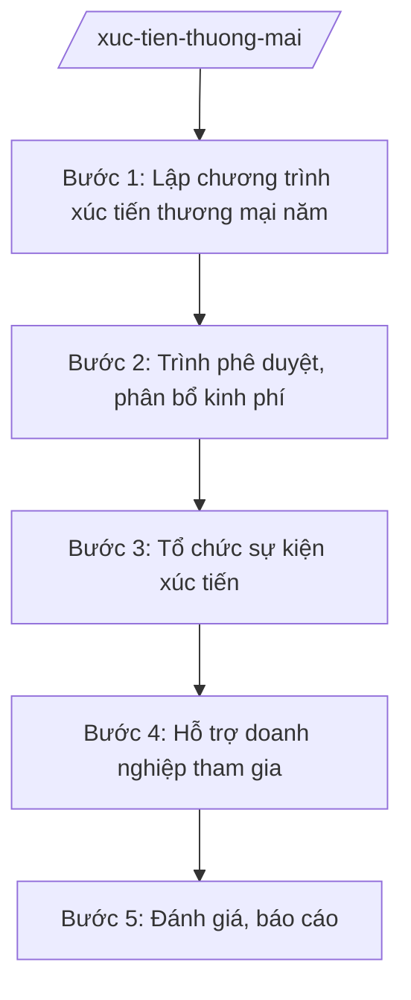

# Skill: Xúc tiến thương mại

## 2. Khi nào dùng

- Khi lập chương trình xúc tiến thương mại hằng năm của tỉnh.
- Khi tổ chức hội chợ, triển lãm, tuần lễ hàng Việt, phiên chợ đưa hàng về nông thôn/miền núi.
- Khi hỗ trợ doanh nghiệp tham gia hội chợ ngoài tỉnh, xúc tiến xuất khẩu.
- Khi tổng hợp báo cáo kết quả xúc tiến thương mại.

## 3. Đầu vào (Input)

| Trường | Mô tả | Bắt buộc |
|--------|-------|----------|
| `nam` | Năm thực hiện chương trình | Có |
| `loai_viec` | lập chương trình / tổ chức sự kiện / hỗ trợ DN / báo cáo | Có |
| `su_kien` | Tên sự kiện, quy mô, địa điểm, thời gian dự kiến | Không |
| `doi_tuong_dn` | Nhóm doanh nghiệp, HTX, cơ sở sản xuất tham gia | Không |
| `kinh_phi` | Kinh phí dự kiến | Không |

## 4. Quy trình

**Bước 1. Lập chương trình xúc tiến thương mại năm**
- Làm gì: Rà soát nhu cầu của doanh nghiệp, sản phẩm chủ lực của tỉnh; xây dựng chương trình năm (sự kiện trong/ngoài tỉnh, kinh phí, tiến độ).
- Dùng input: `nam`, `kinh_phi`.
- Vai trò: Chuyên viên Phòng Quản lý thương mại dự thảo; AI hỗ trợ phân tích hiệu quả năm trước, gợi ý danh mục sự kiện — ⏱ 7 ngày.
- Lưu ý nghiệp vụ: Ưu tiên sản phẩm OCOP, công nghiệp nông thôn, hàng Việt; lồng ghép chương trình quốc gia về XTTM khi đủ điều kiện.
- → Kết quả bước: Dự thảo chương trình XTTM năm.

**Bước 2. Trình phê duyệt, phân bổ kinh phí**
- Làm gì: Hoàn thiện tờ trình + dự thảo quyết định phê duyệt chương trình; phối hợp Sở Tài chính bố trí kinh phí.
- Dùng input: Toàn bộ kết quả bước 1.
- Vai trò: Giám đốc Sở ký tờ trình; AI hỗ trợ soạn thảo đúng thể thức — ⏱ 3 ngày.
- Lưu ý nghiệp vụ: Kinh phí XTTM từ ngân sách + xã hội hóa; công khai tiêu chí hỗ trợ doanh nghiệp.
- → Kết quả bước: Quyết định phê duyệt chương trình XTTM năm của UBND tỉnh.

**Bước 3. Tổ chức sự kiện xúc tiến**
- Làm gì: Xây dựng kế hoạch chi tiết từng sự kiện: mặt bằng, gian hàng, truyền thông, an ninh, ATTP, PCCC; mời doanh nghiệp; đón tiếp.
- Dùng input: `su_kien`, `doi_tuong_dn`.
- Vai trò: Trưởng phòng Quản lý thương mại điều phối; AI hỗ trợ lập timeline, checklist, dự thảo thư mời/thông cáo — ⏱ 15–30 ngày/sự kiện.
- Lưu ý nghiệp vụ: Bảo đảm ATTP gian hàng ẩm thực; niêm yết giá; xử lý khiếu nại của khách tham quan, doanh nghiệp ngay tại sự kiện.
- → Kết quả bước: Kế hoạch sự kiện + báo cáo nhanh kết quả tổ chức.

**Bước 4. Hỗ trợ doanh nghiệp tham gia**
- Làm gì: Xét hỗ trợ gian hàng, chi phí tham gia hội chợ ngoài tỉnh/quốc tế; kết nối doanh nghiệp với nhà phân phối, sàn TMĐT.
- Dùng input: `doi_tuong_dn`, `kinh_phi`.
- Vai trò: Chuyên viên xét hồ sơ; AI hỗ trợ đối chiếu tiêu chí, lập danh sách — ⏱ 5 ngày/đợt.
- Lưu ý nghiệp vụ: Công khai, minh bạch tiêu chí; ưu tiên DNNVV, HTX, sản phẩm OCOP.
- → Kết quả bước: Danh sách doanh nghiệp được hỗ trợ + quyết định hỗ trợ.

**Bước 5. Đánh giá, báo cáo**
- Làm gì: Đánh giá hiệu quả từng sự kiện (doanh thu, hợp đồng ký kết, lượt khách); tổng hợp báo cáo năm gửi UBND tỉnh, Bộ Công Thương.
- Dùng input: `loai_viec` (báo cáo), `nam`.
- Vai trò: Chuyên viên tổng hợp; AI hỗ trợ lập bảng số liệu, dự thảo báo cáo — ⏱ 3 ngày.
- Lưu ý nghiệp vụ: Số liệu doanh thu do doanh nghiệp tự kê khai — ghi rõ nguồn; đánh giá cả mặt hạn chế.
- → Kết quả bước: Báo cáo kết quả XTTM năm.

## Luồng quy trình (Workflow)

## 5. Đầu ra (Output)

- Chương trình xúc tiến thương mại năm (kèm quyết định phê duyệt).
- Kế hoạch tổ chức từng sự kiện.
- Quyết định hỗ trợ doanh nghiệp tham gia.
- Báo cáo kết quả xúc tiến thương mại.

**Cấu trúc output chuẩn (Kế hoạch tổ chức sự kiện xúc tiến):**
- Thể thức: tuân thủ Nghị định 30/2020/NĐ-CP về công tác văn thư.

1. Quốc hiệu "CỘNG HÒA XÃ HỘI CHỦ NGHĨA VIỆT NAM", Tiêu ngữ "Độc lập – Tự do – Hạnh phúc"; tên cơ quan (Sở Công Thương tỉnh A); số, ký hiệu.
2. Tên loại: **KẾ HOẠCH** — tổ chức [tên sự kiện].
3. Mục đích, yêu cầu.
4. Nội dung: thời gian, địa điểm, quy mô gian hàng, đối tượng tham gia.
5. Kinh phí và nguồn kinh phí.
6. Phân công nhiệm vụ (Sở, UBND cấp xã nơi tổ chức, đơn vị phối hợp: công an, y tế, PCCC).
7. Tiến độ thực hiện.
8. Nơi nhận; chữ ký Giám đốc Sở.

> **Checklist thể thức văn bản theo NĐ 30/2020/NĐ-CP** — đối chiếu trước khi trình ký:
> 1. Quốc hiệu và Tiêu ngữ.
> 2. Tên cơ quan, tổ chức ban hành văn bản.
> 3. Số, ký hiệu của văn bản.
> 4. Địa danh và thời gian ban hành văn bản.
> 5. Tên loại và trích yếu nội dung văn bản.
> 6. Nội dung văn bản.
> 7. Chức vụ, họ tên và chữ ký của người có thẩm quyền.
> 8. Dấu, chữ ký số của cơ quan, tổ chức.
> 9. Nơi nhận (kèm Phụ lục nếu có).

## 6. Checklist nghiệm thu

- [ ] Chương trình năm được UBND tỉnh phê duyệt, kinh phí rõ nguồn.
- [ ] Sự kiện có kế hoạch chi tiết, phương án an ninh, ATTP, PCCC.
- [ ] Tiêu chí hỗ trợ doanh nghiệp công khai, minh bạch.
- [ ] Có báo cáo nhanh sau mỗi sự kiện (doanh thu, hợp đồng, lượt khách).
- [ ] Báo cáo năm đánh giá được hiệu quả và hạn chế.
- [ ] Văn bản đúng thể thức NĐ 30/2020/NĐ-CP.

## 7. Ví dụ mô phỏng

*Dữ liệu dưới đây là giả lập 100% phục vụ minh họa.*

**Input mẫu:** nam = 2026; loai_viec = "tổ chức sự kiện"; su_kien = "Tuần lễ hàng Việt tại xã A — 50 gian hàng, tháng 9/2026"; doi_tuong_dn = "40 doanh nghiệp, HTX trong tỉnh".

**Output mẫu (trích Kế hoạch):**

> **SỞ CÔNG THƯƠNG TỈNH A**
> Số: 1234/KH-SCT
>
> **KẾ HOẠCH**
> Tổ chức Tuần lễ hàng Việt tại xã A năm 2026
>
> 1. Mục đích: quảng bá sản phẩm OCOP, hàng công nghiệp nông thôn; kích cầu tiêu dùng.
> 2. Thời gian, địa điểm: tháng 9/2026 tại trung tâm xã A; quy mô 50 gian hàng.
> 3. Đối tượng: 40 doanh nghiệp, HTX trong tỉnh A (ưu tiên sản phẩm OCOP).
> 4. Kinh phí: từ nguồn xúc tiến thương mại năm 2026 và xã hội hóa.
> 5. Phân công: Phòng Quản lý thương mại chủ trì; UBND xã A phối hợp mặt bằng, an ninh; Công an xã A bảo đảm ANTT...
>
> *Nơi nhận:* ... — **GIÁM ĐỐC** *(ký, đóng dấu)* — Hoàng Văn S

## 8. Human gate

- Chuyên viên soạn → Trưởng phòng kiểm tra → Phó Giám đốc Sở duyệt → Giám đốc Sở ký (kế hoạch sự kiện, quyết định hỗ trợ DN).
- Chương trình XTTM năm: Giám đốc Sở ký tờ trình → **UBND tỉnh phê duyệt**.

## 9. Giới hạn

- AI không tự quyết định danh sách doanh nghiệp được hỗ trợ, mức hỗ trợ kinh phí.
- Không bịa số liệu doanh thu, hợp đồng của doanh nghiệp.
- Không dùng văn bản hết hiệu lực làm căn cứ.

## 10. Căn cứ & lưu ý

- Thông tư 37/2025/TT-BCT của Bộ Công Thương hướng dẫn chức năng, nhiệm vụ của cơ quan chuyên môn về công thương.
- Nghị định 150/2025/NĐ-CP về tổ chức cơ quan chuyên môn thuộc UBND cấp tỉnh.
- Nghị định 30/2020/NĐ-CP về công tác văn thư (thể thức văn bản).
- Lưu ý: gắn XTTM với chương trình OCOP, chương trình quốc gia khi đủ điều kiện để tăng nguồn lực.
