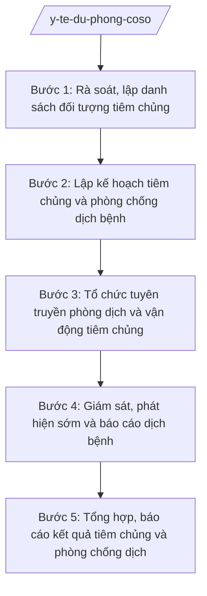

# Skill: Y tế dự phòng cơ sở

## 2. Khi nào dùng

- Khi xã cần lập kế hoạch tiêm chủng mở rộng hằng năm/quý, phối hợp với Trạm Y tế xã (nhiệm vụ y tế cơ sở giao Phòng Văn hóa – Xã hội theo TT 20/2025/TT-BYT).
- Khi cần rà soát, lập danh sách đối tượng tiêm chủng (trẻ em, phụ nữ có thai) trên địa bàn các thôn.
- Khi cần tổ chức tuyên truyền phòng chống dịch bệnh (sốt xuất huyết, tay chân miệng, cúm, bệnh theo mùa).
- Khi cần giám sát, phát hiện sớm ca bệnh nghi ngờ và báo cáo dịch bệnh theo quy định.

## 3. Đầu vào (Input)

| Trường | Mô tả | Bắt buộc |
|--------|-------|----------|
| `doi_tuong_tiem_chung` | Danh sách đối tượng tiêm chủng theo thôn: trẻ em trong độ tuổi, phụ nữ có thai | Có |
| `lich_tiem_chung` | Lịch tiêm chủng của Trạm Y tế xã (ngày tiêm cố định, tiêm vét) | Có |
| `tinh_hinh_dich_benh` | Tình hình dịch bệnh trên địa bàn và vùng lân cận (loại bệnh, số ca) | Có |
| `thon_xom` | Danh sách thôn/xóm, trưởng thôn, cộng tác viên y tế thôn | Có |
| `van_ban_chi_dao` | Văn bản chỉ đạo phòng chống dịch của cấp trên (nếu có) | Không |
| `ky_ke_hoach` | Kỳ kế hoạch (năm, quý, đợt chiến dịch) | Có |
| `so_lieu_ky_truoc` | Tỷ lệ tiêm chủng, số ca bệnh kỳ trước (nếu có) | Không |

## 4. Quy trình

**Bước 1. Rà soát, lập danh sách đối tượng tiêm chủng**
- Làm gì: Phối hợp Trạm Y tế xã rà soát từng thôn: trẻ em đến tuổi tiêm các mũi, trẻ tiêm thiếu mũi, phụ nữ có thai cần tiêm; lập danh sách theo thôn, đối chiếu sổ theo dõi của trạm.
- Dùng input: `doi_tuong_tiem_chung`, `thon_xom`, `lich_tiem_chung`.
- Vai trò: Công chức văn hóa – xã hội phụ trách lĩnh vực y tế phối hợp Trạm Y tế xã và cộng tác viên y tế thôn rà soát; AI hỗ trợ tổng hợp danh sách theo thôn, đánh dấu đối tượng tiêm thiếu mũi (~1 ngày).
- Lưu ý nghiệp vụ: Danh sách phải khớp với sổ quản lý của Trạm Y tế; không bỏ sót trẻ tạm trú; thông tin cá nhân của đối tượng chỉ dùng cho công tác tiêm chủng.
- → Kết quả bước: Danh sách đối tượng tiêm chủng theo thôn (đủ mũi/thiếu mũi).

**Bước 2. Lập kế hoạch tiêm chủng và phòng chống dịch bệnh**
- Làm gì: Lập kế hoạch: mục tiêu (tỷ lệ tiêm chủng đầy đủ, số đợt tiêm vét); thời gian, địa điểm từng đợt tiêm; phân công (Trạm Y tế thực hiện chuyên môn, thôn vận động đối tượng, Phòng VH-XH tuyên truyền); nội dung phòng chống dịch (vệ sinh môi trường, diệt bọ gậy, giám sát ca bệnh); kinh phí.
- Dùng input: Danh sách bước 1, `lich_tiem_chung`, `tinh_hinh_dich_benh`, `van_ban_chi_dao`, `ky_ke_hoach`.
- Vai trò: Công chức văn hóa – xã hội soạn kế hoạch; Trưởng phòng Văn hóa – Xã hội (ông Vũ Văn E) kiểm tra, trình Phó Chủ tịch UBND xã (bà Trần Thị B) phê duyệt; AI hỗ trợ soạn thảo theo thể thức NĐ 30/2020/NĐ-CP (~1 ngày).
- Lưu ý nghiệp vụ: Kế hoạch bám lịch tiêm chủng của Trạm Y tế; có phương án tiêm vét cho đối tượng vắng mặt; nội dung phòng dịch phù hợp tình hình dịch tễ thực tế.
- → Kết quả bước: Dự thảo Kế hoạch tiêm chủng mở rộng và phòng chống dịch bệnh (kỳ …).

**Bước 3. Tổ chức tuyên truyền phòng dịch và vận động tiêm chủng**
- Làm gì: Tuyên truyền trên đài truyền thanh cơ sở, họp thôn, nhóm Zalo: lịch tiêm chủng, lợi ích tiêm chủng đầy đủ; biện pháp phòng dịch theo mùa (diệt bọ gậy, vệ sinh ăn uống, đeo khẩu trang khi có dịch hô hấp); vận động gia đình đưa trẻ đi tiêm đúng lịch.
- Dùng input: Kế hoạch bước 2, `tinh_hinh_dich_benh`, `thon_xom`.
- Vai trò: Công chức văn hóa – xã hội biên tập nội dung tuyên truyền; trưởng thôn, cộng tác viên y tế thôn vận động trực tiếp; AI hỗ trợ soạn tin bài tuyên truyền ngắn gọn, dễ hiểu (~0,5 ngày, triển khai suốt kỳ).
- Lưu ý nghiệp vụ: Nội dung tuyên truyền phải đúng chuyên môn (theo hướng dẫn của Trạm Y tế); không gây hoang mang khi có ca bệnh; ưu tiên hộ có đối tượng tiêm chủng.
- → Kết quả bước: Tin bài tuyên truyền + danh sách hộ đã vận động.

**Bước 4. Giám sát, phát hiện sớm và báo cáo dịch bệnh**
- Làm gì: Theo dõi tình hình qua cộng tác viên y tế thôn: phát hiện sớm ca bệnh nghi ngờ, ổ dịch nhỏ; báo ngay cho Trạm Y tế xã xử lý chuyên môn; tổng hợp số ca, diễn biến theo tuần/tháng.
- Dùng input: `tinh_hinh_dich_benh`, `thon_xom`, `ky_ke_hoach`.
- Vai trò: Cộng tác viên y tế thôn phát hiện, báo cáo; công chức văn hóa – xã hội tổng hợp; Trạm Y tế xã xử lý chuyên môn; AI hỗ trợ lập bảng theo dõi diễn biến ca bệnh theo thôn (~0,5 ngày, cập nhật suốt kỳ).
- Lưu ý nghiệp vụ: Phát hiện ca nghi ngờ phải báo ngay, không chờ tổng hợp định kỳ; việc chẩn đoán, xử lý ổ dịch do Trạm Y tế/cơ quan chuyên môn thực hiện — Phòng VH-XH chỉ phối hợp tuyên truyền, vận động.
- → Kết quả bước: Bảng theo dõi diễn biến dịch bệnh + báo cáo nhanh khi có ca nghi ngờ/ổ dịch.

**Bước 5. Tổng hợp, báo cáo kết quả tiêm chủng và phòng chống dịch**
- Làm gì: Tổng hợp kết quả: số đối tượng đã tiêm/tổng số (tỷ lệ %), số đợt tiêm vét; kết quả phòng chống dịch (số ca, ổ dịch đã xử lý); khó khăn; đề xuất kỳ tới.
- Dùng input: Danh sách bước 1, bảng theo dõi bước 4, `so_lieu_ky_truoc`, `ky_ke_hoach`.
- Vai trò: Công chức văn hóa – xã hội soạn báo cáo; Trưởng phòng Văn hóa – Xã hội (ông Vũ Văn E) kiểm tra, trình Chủ tịch UBND xã (ông Nguyễn Văn A) ký gửi cấp trên; AI hỗ trợ tính tỷ lệ, soạn báo cáo theo thể thức NĐ 30/2020/NĐ-CP (~0,5 ngày).
- Lưu ý nghiệp vụ: Số liệu tiêm chủng lấy từ Trạm Y tế xã, phải khớp sổ sách; nêu rõ nguyên nhân đối tượng chưa tiêm (vắng mặt, chống chỉ định, từ chối) và giải pháp.
- → Kết quả bước: Báo cáo kết quả tiêm chủng mở rộng và phòng chống dịch bệnh (kỳ …) trình ký.

## Luồng quy trình (Workflow)

## 5. Đầu ra (Output)

**Danh sách sản phẩm:**
1. Kế hoạch tiêm chủng mở rộng và phòng chống dịch bệnh (kỳ …) (sản phẩm chính 1).
2. Báo cáo kết quả tiêm chủng mở rộng và phòng chống dịch bệnh (kỳ …) (sản phẩm chính 2).
3. Danh sách đối tượng tiêm chủng theo thôn (phụ lục kế hoạch).
4. Bảng theo dõi diễn biến dịch bệnh theo thôn/tuần (phụ lục báo cáo).
5. Tin bài tuyên truyền phòng dịch, vận động tiêm chủng (tài liệu kèm theo).

**Cấu trúc output chuẩn — Kế hoạch tiêm chủng/phòng chống dịch (đúng thể thức NĐ 30/2020/NĐ-CP):**

1. Quốc hiệu – tiêu ngữ: "CỘNG HÒA XÃ HỘI CHỦ NGHĨA VIỆT NAM / Độc lập – Tự do – Hạnh phúc".
2. Số, ký hiệu văn bản: số/ký hiệu theo quy định (vd: 123/KH-UBND).
3. Địa danh, ngày tháng năm ban hành: "Xã A, ngày … tháng … năm …".
4. Tên loại và trích yếu: "KẾ HOẠCH — Tiêm chủng mở rộng và phòng chống dịch bệnh xã A năm … (quý …/đợt …)".
5. Căn cứ: TT 20/2025/TT-BYT; chùm TT 14–19/2025/TT-BYT (TT 19 về phòng bệnh); lịch tiêm chủng của Trạm Y tế; văn bản chỉ đạo cấp trên (nếu có).
6. Nội dung: I. Mục đích, yêu cầu; II. Mục tiêu (tỷ lệ tiêm chủng, chỉ tiêu phòng dịch); III. Đối tượng, thời gian, địa điểm; IV. Nội dung, biện pháp (tiêm chủng; tiêm vét; tuyên truyền; giám sát dịch bệnh); V. Tổ chức thực hiện (Trạm Y tế, Phòng VH-XH, các thôn, cộng tác viên y tế); VI. Kinh phí; VII. Chế độ báo cáo.
7. Nơi nhận: lưu VP, Phòng VH-XH, Trạm Y tế xã, các thôn.
8. Chữ ký: Phó Chủ tịch UBND xã (hoặc Chủ tịch) ký, đóng dấu UBND xã.

**Cấu trúc output chuẩn — Báo cáo kết quả (đúng thể thức NĐ 30/2020/NĐ-CP):**

1. Quốc hiệu "CỘNG HÒA XÃ HỘI CHỦ NGHĨA VIỆT NAM" – Tiêu ngữ "Độc lập – Tự do – Hạnh phúc".
2. Số, ký hiệu văn bản: số/ký hiệu theo quy định (vd: 123/BC-UBND).
3. Địa danh, ngày tháng năm ban hành.
4. Tên loại và trích yếu: "BÁO CÁO — Kết quả tiêm chủng mở rộng và phòng chống dịch bệnh xã A (quý …/năm …)".
5. Căn cứ: Kế hoạch số …/KH-UBND; TT 20/2025/TT-BYT.
6. Nội dung: I. Tình hình triển khai; II. Kết quả tiêm chủng (bảng: thôn, đối tượng, đã tiêm, tỷ lệ); III. Kết quả phòng chống dịch (số ca, ổ dịch, biện pháp đã xử lý); IV. Đánh giá chung; V. Khó khăn, vướng mắc; VI. Đề xuất, kiến nghị; VII. Phương hướng kỳ tới.
7. Nơi nhận: UBND tỉnh A (Sở Y tế), lưu VP, Phòng VH-XH, Trạm Y tế xã.
8. Chữ ký: Chủ tịch UBND xã ký, đóng dấu.

## 6. Checklist nghiệm thu

- [ ] Danh sách đối tượng tiêm chủng đầy đủ theo thôn, khớp sổ quản lý của Trạm Y tế xã, đánh dấu rõ đủ/thiếu mũi.
- [ ] Kế hoạch có mục tiêu tỷ lệ tiêm chủng cụ thể, lịch tiêm vét, phân công rõ Trạm Y tế – Phòng VH-XH – thôn.
- [ ] Nội dung phòng chống dịch bám đúng tình hình dịch tễ thực tế, đúng hướng dẫn chuyên môn của Trạm Y tế.
- [ ] Có phương án giám sát, phát hiện sớm ca nghi ngờ và quy trình báo ngay cho Trạm Y tế.
- [ ] Báo cáo có bảng số liệu tiêm chủng theo thôn, khớp sổ sách Trạm Y tế; nêu rõ nguyên nhân đối tượng chưa tiêm.
- [ ] Văn bản đúng thể thức NĐ 30/2020/NĐ-CP (quốc hiệu, số/ký hiệu, nơi nhận, chữ ký, con dấu).
- [ ] Số liệu, tên thôn, tên người trong văn bản khớp đúng Input; không bịa số liệu dịch tễ.
- [ ] Đã qua human gate: Trưởng phòng kiểm tra, lãnh đạo UBND xã phê duyệt/ký.

## 7. Ví dụ mô phỏng

*Dữ liệu dưới đây là giả lập 100% phục vụ minh họa.*

**Input mẫu:**
- doi_tuong_tiem_chung: 200 trẻ trong độ tuổi (Thôn 1: 50, Thôn 2: 40, Thôn 3: 45, Thôn 4: 35, Thôn 5: 30); 30 phụ nữ có thai; 15 trẻ tiêm thiếu mũi
- lich_tiem_chung: tiêm cố định ngày 10 hằng tháng tại Trạm Y tế xã; tiêm vét ngày 20
- tinh_hinh_dich_benh: 5 ca sốt xuất huyết tại Thôn 3 trong tháng 9 (đã xử lý ổ dịch)
- thon_xom: 5 thôn, mỗi thôn 1 cộng tác viên y tế
- ky_ke_hoach: quý IV/2026

**Output mẫu — Kế hoạch:**

> CỘNG HÒA XÃ HỘI CHỦ NGHĨA VIỆT NAM
> Độc lập – Tự do – Hạnh phúc
>
> Số: 123/KH-UBND
>
> Xã A, ngày 09 tháng 10 năm 2026
>
> **KẾ HOẠCH**
> **Tiêm chủng mở rộng và phòng chống dịch bệnh xã A quý IV năm 2026**
>
> Căn cứ Thông tư số 20/2025/TT-BYT ngày 23/6/2025 của Bộ Y tế;
> Căn cứ Thông tư số 19/2025/TT-BYT về phòng bệnh;
>
> **I. MỤC ĐÍCH, YÊU CẦU**
> 1. Bảo đảm 100% trẻ trong độ tuổi được tiêm chủng đầy đủ, đúng lịch.
> 2. Chủ động phòng chống dịch bệnh, không để bùng phát ổ dịch trên địa bàn.
>
> **II. MỤC TIÊU**
> 1. Tỷ lệ tiêm chủng đầy đủ đạt ≥ 95% (190/200 trẻ); 100% phụ nữ có thai được tiêm phòng uốn ván.
> 2. Tiêm vét 15 trẻ thiếu mũi trong tháng 10/2026.
> 3. Không phát sinh ổ dịch sốt xuất huyết mới tại Thôn 3.
>
> **III. THỜI GIAN, ĐỊA ĐIỂM**
> 1. Tiêm cố định: ngày 10 hằng tháng tại Trạm Y tế xã A.
> 2. Tiêm vét: ngày 20 hằng tháng; lưu động tại Thôn 4, Thôn 5 nếu cần.
>
> **IV. NỘI DUNG, BIỆN PHÁP**
> 1. Rà soát, lập danh sách đối tượng theo thôn (hoàn thành trước 12/10/2026).
> 2. Tuyên truyền trên đài truyền thanh, họp thôn về lịch tiêm và phòng chống sốt xuất huyết.
> 3. Giám sát ca bệnh qua cộng tác viên y tế thôn; báo ngay Trạm Y tế khi có ca nghi ngờ.
>
> **V. TỔ CHỨC THỰC HIỆN**
> 1. Trạm Y tế xã: thực hiện chuyên môn tiêm chủng, xử lý ổ dịch.
> 2. Phòng Văn hóa – Xã hội: tham mưu kế hoạch, tuyên truyền, tổng hợp báo cáo.
> 3. Trưởng các thôn, cộng tác viên y tế: vận động đối tượng, giám sát dịch bệnh.
>
> **VI. KINH PHÍ:** từ nguồn ngân sách xã và nguồn hợp pháp khác.
>
> **VII. CHẾ ĐỘ BÁO CÁO:** hằng tháng trước ngày 25 về Phòng VH-XH.
>
> **Nơi nhận:**
> - Lưu: VP, Phòng VH-XH;
> - Trạm Y tế xã; các thôn 1–5.
>
> **KT. CHỦ TỊCH**
> **PHÓ CHỦ TỊCH**
>
> *(Ký, đóng dấu)*
> **Trần Thị B**

## 8. Human gate (người kiểm duyệt)

- Công chức văn hóa – xã hội phụ trách lĩnh vực y tế soạn kế hoạch, báo cáo; phối hợp Trạm Y tế xã về nội dung chuyên môn.
- Trưởng phòng Văn hóa – Xã hội (ông Vũ Văn E) kiểm tra nội dung, số liệu, thể thức.
- Phó Chủ tịch UBND xã (bà Trần Thị B) phê duyệt Kế hoạch tiêm chủng và phòng chống dịch bệnh.
- Chủ tịch UBND xã (ông Nguyễn Văn A) ký báo cáo kết quả gửi cấp trên.
- Nội dung chuyên môn (lịch tiêm, biện pháp phòng dịch) do Trạm Y tế xã xác nhận trước khi ban hành.

## 9. Giới hạn (guardrails)

- AI KHÔNG ra quyết định hành chính thay người có thẩm quyền; không tự phê duyệt kế hoạch.
- AI KHÔNG tự ký, đóng dấu hoặc phát hành văn bản dưới danh nghĩa UBND xã hay cá nhân lãnh đạo.
- AI KHÔNG bịa số liệu tiêm chủng, số ca bệnh, số hiệu văn bản, căn cứ pháp lý.
- AI KHÔNG đưa ra chẩn đoán, chỉ định điều trị hay hướng dẫn chuyên môn y tế vượt quá nội dung tuyên truyền đã được Trạm Y tế xác nhận.
- AI KHÔNG dùng văn bản đã hết hiệu lực; chỉ trích dẫn văn bản có trong tai-lieu-moi-nhat.md.

## 10. Căn cứ & lưu ý

- Thông tư số 20/2025/TT-BYT ngày 23/6/2025 của Bộ Y tế: hướng dẫn chức năng, nhiệm vụ, quyền hạn của cơ quan chuyên môn về y tế thuộc UBND cấp xã (Phòng Văn hóa – Xã hội tham mưu lĩnh vực y tế cơ sở).
- Chùm Thông tư 14–19/2025/TT-BYT: phân định thẩm quyền CQĐP 2 cấp trong các lĩnh vực y tế (TT 19 về phòng bệnh).
- Nghị định số 147/2025/NĐ-CP ngày 12/6/2025: phân định thẩm quyền CQĐP 2 cấp trong lĩnh vực quản lý nhà nước của Bộ Y tế.
- Nghị định số 148/2025/NĐ-CP ngày 12/6/2025: phân quyền, phân cấp trong lĩnh vực y tế.
- Nghị định số 150/2025/NĐ-CP ngày 12/6/2025: tổ chức Phòng Văn hóa – Xã hội cấp xã; sửa đổi bởi NĐ 370/2025/NĐ-CP.
- Nghị định số 30/2020/NĐ-CP của Chính phủ: thể thức văn bản hành chính.
- Lưu ý: công tác chuyên môn tiêm chủng và xử lý ổ dịch do Trạm Y tế xã thực hiện; Phòng Văn hóa – Xã hội làm nhiệm vụ tham mưu, tuyên truyền, vận động và tổng hợp báo cáo.
