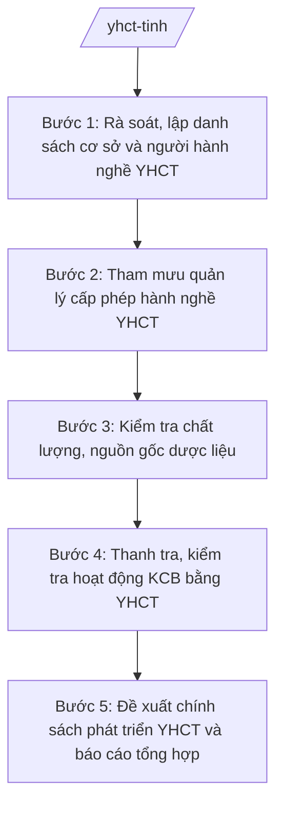

# Skill: Y học cổ truyền

## 2. Khi nào dùng

- Khi cần rà soát, lập danh sách cơ sở khám bệnh, chữa bệnh bằng y học cổ truyền và người hành nghề YHCT trên địa bàn tỉnh.
- Khi cần tham mưu quản lý việc cấp giấy phép hành nghề YHCT, giấy phép hoạt động cơ sở KCB bằng YHCT (phối hợp với nghiệp vụ cấp phép chung).
- Khi cần kiểm tra chất lượng, nguồn gốc dược liệu lưu thông, sử dụng trên địa bàn tỉnh.
- Khi cần thanh tra, kiểm tra hoạt động khám bệnh, chữa bệnh bằng YHCT, xử lý vi phạm (hành nghề không phép, quảng cáo sai sự thật).
- Khi cần đề xuất chính sách phát triển YHCT của tỉnh (kết hợp YHCT với y học hiện đại, bảo tồn bài thuốc, phát triển dược liệu) và tổng hợp báo cáo gửi Bộ Y tế, UBND tỉnh.

## 3. Đầu vào (Input)

| Trường | Mô tả | Bắt buộc |
|--------|-------|----------|
| `danh_sach_cs_yhct` | Danh sách cơ sở KCB bằng YHCT: tên, địa chỉ, loại hình (bệnh viện YHCT, khoa YHCT, phòng chẩn trị YHCT tư nhân), tình trạng giấy phép | Có |
| `danh_sach_nguoi_hanh_nghe` | Danh sách người hành nghề YHCT: họ tên, văn bằng/chứng chỉ, phạm vi hành nghề, tình trạng giấy phép | Có |
| `du_lieu_duoc_lieu` | Thông tin về cơ sở kinh doanh, sử dụng dược liệu: nguồn gốc, chất lượng, kiểm nghiệm (nếu có) | Không |
| `phan_anh_vi_pham` | Phản ánh về hành nghề YHCT không phép, quảng cáo chữa bệnh sai sự thật (nếu có) | Không |
| `de_xuat_phat_trien` | Đề xuất, nhu cầu phát triển YHCT của các cơ sở, địa phương | Không |
| `van_ban_chi_dao` | Văn bản chỉ đạo của Bộ Y tế, UBND tỉnh về YHCT (nếu có) | Không |

## 4. Quy trình

**Bước 1. Rà soát, lập danh sách cơ sở và người hành nghề YHCT**
- Làm gì: Rà soát toàn tỉnh: bệnh viện YHCT, khoa YHCT tại bệnh viện đa khoa, phòng chẩn trị YHCT tư nhân, lương y hành nghề; đối chiếu với cơ sở dữ liệu cấp phép; phân loại (có phép/đang làm thủ tục/chưa có phép); lập danh sách quản lý.
- Dùng input: `danh_sach_cs_yhct`, `danh_sach_nguoi_hanh_nghe`.
- Vai trò: Chuyên viên phụ trách YHCT thuộc Sở Y tế rà soát, phối hợp phòng cấp phép đối chiếu dữ liệu; AI hỗ trợ lập bảng danh sách, đối chiếu, phân loại ⏱ ~2 ngày (ước tính).
- Lưu ý nghiệp vụ: Rà soát cả đối tượng hành nghề tự phát, quảng cáo trên mạng; phân biệt hành nghề YHCT có phép với hành nghề trái phép; dữ liệu phải cập nhật, không dùng danh sách cũ.
- → Kết quả bước: Danh sách cơ sở KCB bằng YHCT và người hành nghề YHCT trên địa bàn (đã phân loại tình trạng pháp lý).

**Bước 2. Tham mưu quản lý cấp phép hành nghề YHCT**
- Làm gì: Trên cơ sở danh sách bước 1, hướng dẫn các đối tượng chưa có phép hoàn thiện hồ sơ đề nghị cấp giấy phép hành nghề/phép hoạt động (phối hợp với quy trình của skill cap-phep-hanh-nghe-y); theo dõi tiến độ giải quyết; đôn đốc cơ sở hết hạn giấy phép làm thủ tục cấp lại.
- Dùng input: Danh sách bước 1.
- Vai trò: Chuyên viên phụ trách YHCT hướng dẫn, đôn đốc; phối hợp chuyên viên phụ trách cấp phép; Trưởng phòng kiểm tra; AI hỗ trợ soạn văn bản đôn đốc, danh sách theo dõi ⏱ ~1 ngày (ước tính).
- Lưu ý nghiệp vụ: Việc cấp phép thực hiện theo đúng quy trình cấp phép chung (không tạo quy trình riêng); hướng dẫn rõ điều kiện đối với người hành nghề YHCT; không gây khó dễ, không bỏ sót đối tượng phải cấp phép.
- → Kết quả bước: Văn bản đôn đốc + danh sách theo dõi tiến độ cấp phép YHCT.

**Bước 3. Kiểm tra chất lượng, nguồn gốc dược liệu**
- Làm gì: Lập kế hoạch kiểm tra cơ sở kinh doanh, sử dụng dược liệu: nguồn gốc xuất xứ, điều kiện bảo quản, chất lượng (cảm quan, kiểm nghiệm khi cần); phối hợp lấy mẫu kiểm nghiệm; lập biên bản; xử lý dược liệu không rõ nguồn gốc, kém chất lượng theo thẩm quyền.
- Dùng input: `du_lieu_duoc_lieu`, `danh_sach_cs_yhct`.
- Vai trò: Chuyên viên phụ trách YHCT/dược soạn kế hoạch; đoàn kiểm tra của Sở Y tế thực hiện; AI hỗ trợ soạn kế hoạch, mẫu biên bản, bảng tổng hợp ⏱ ~2 ngày (ước tính).
- Lưu ý nghiệp vụ: Kiểm tra đúng nội dung, có trọng tâm (cơ sở có dấu hiệu vi phạm, dược liệu nhập không rõ nguồn gốc); mẫu kiểm nghiệm phải bảo quản, gửi đúng quy trình; xử lý nghiêm dược liệu giả, kém chất lượng.
- → Kết quả bước: Kế hoạch kiểm tra + biên bản kiểm tra dược liệu + kết quả xử lý.

**Bước 4. Thanh tra, kiểm tra hoạt động KCB bằng YHCT**
- Làm gì: Tổ chức thanh tra, kiểm tra cơ sở KCB bằng YHCT: điều kiện hành nghề, phạm vi chuyên môn được phép, việc kê đơn, quảng cáo dịch vụ; xác minh phản ánh hành nghề không phép, quảng cáo chữa bệnh sai sự thật; lập biên bản, tham mưu xử lý vi phạm theo thẩm quyền.
- Dùng input: Danh sách bước 1, `phan_anh_vi_pham`.
- Vai trò: Đoàn thanh tra/kiểm tra của Sở Y tế (do Phó Giám đốc Sở hoặc Trưởng phòng làm Trưởng đoàn) thực hiện; chuyên viên lập biên bản, tổng hợp; AI hỗ trợ soạn kế hoạch, tổng hợp vi phạm ⏱ ~2 ngày (ước tính).
- Lưu ý nghiệp vụ: Kiểm tra khách quan, đúng phạm vi; xác minh kỹ phản ánh trước khi kết luận; vi phạm vượt thẩm quyền chuyển cấp có thẩm quyền; phối hợp xử lý quảng cáo sai sự thật với cơ quan quản lý liên quan.
- → Kết quả bước: Biên bản thanh kiểm tra + hồ sơ xử lý vi phạm hành nghề YHCT.

**Bước 5. Đề xuất chính sách phát triển YHCT và báo cáo tổng hợp**
- Làm gì: Tổng hợp kết quả quản lý YHCT toàn tỉnh; đề xuất chính sách phát triển YHCT của tỉnh (kết hợp YHCT – y học hiện đại tại bệnh viện, bảo tồn bài thuốc, phát triển vùng dược liệu, đào tạo nhân lực YHCT); soạn báo cáo gửi Bộ Y tế (Cục Quản lý Y, Dược cổ truyền) và UBND tỉnh.
- Dùng input: Kết quả các bước 1–4, `de_xuat_phat_trien`, `van_ban_chi_dao`.
- Vai trò: Chuyên viên tổng hợp, soạn báo cáo và đề xuất chính sách; Trưởng phòng kiểm tra; Phó Giám đốc Sở (ông Đỗ Văn U) chỉ đạo hoàn thiện; Giám đốc Sở (ông Hoàng Văn S) ký báo cáo, trình UBND tỉnh đề án/chính sách (khi vượt thẩm quyền Sở); AI hỗ trợ soạn thảo theo thể thức NĐ 30/2020/NĐ-CP ⏱ ~2 ngày (ước tính).
- Lưu ý nghiệp vụ: Đề xuất chính sách phải sát thực tế tỉnh, có lộ trình, nguồn lực; báo cáo trung thực, số liệu khớp; chính sách thuộc thẩm quyền HĐND/UBND tỉnh thì trình theo đúng trình tự.
- → Kết quả bước: Báo cáo công tác YHCT tỉnh (kỳ …) + đề xuất chính sách phát triển YHCT.

## Luồng quy trình (Workflow)

## 5. Đầu ra (Output)

**Danh sách sản phẩm:**
1. Báo cáo công tác y học cổ truyền tỉnh (sản phẩm chính 1).
2. Đề xuất chính sách/đề án phát triển YHCT của tỉnh (sản phẩm chính 2).
3. Danh sách cơ sở KCB bằng YHCT và người hành nghề YHCT (đã phân loại tình trạng pháp lý).
4. Kế hoạch kiểm tra dược liệu + biên bản kiểm tra.
5. Kế hoạch thanh kiểm tra hoạt động KCB bằng YHCT + biên bản + hồ sơ xử lý vi phạm.
6. Văn bản đôn đốc hoàn thiện thủ tục cấp phép YHCT.

**Cấu trúc output chuẩn — Báo cáo công tác YHCT:**
- Thể thức: tuân thủ Nghị định 30/2020/NĐ-CP về công tác văn thư.

1. Quốc hiệu "CỘNG HÒA XÃ HỘI CHỦ NGHĨA VIỆT NAM", Tiêu ngữ "Độc lập – Tự do – Hạnh phúc".
2. Số, ký hiệu văn bản: số/ký hiệu theo quy định (vd: 1234/BC-SYT).
3. Địa danh, ngày tháng năm ban hành: "Tỉnh A, ngày … tháng … năm …".
4. Tên loại và trích yếu: "BÁO CÁO — Công tác y học cổ truyền tỉnh A (kỳ …)".
5. Căn cứ: TT 20/2025/TT-BYT; TT 15/2025/TT-BYT.
6. Nội dung: I. Tình hình tổ chức, nhân lực YHCT (bảng số liệu cơ sở, người hành nghề); II. Công tác cấp phép; III. Quản lý dược liệu; IV. Thanh tra, kiểm tra và xử lý vi phạm; V. Kết quả thực hiện chính sách phát triển YHCT; VI. Khó khăn, vướng mắc; VII. Kiến nghị, đề xuất.
7. Nơi nhận: Bộ Y tế, UBND tỉnh, lưu VP Sở.
8. Chữ ký: Giám đốc Sở Y tế ký, đóng dấu.

**Cấu trúc output chuẩn — Đề xuất chính sách phát triển YHCT (tờ trình + đề án):**

1. Quốc hiệu "CỘNG HÒA XÃ HỘI CHỦ NGHĨA VIỆT NAM", Tiêu ngữ "Độc lập – Tự do – Hạnh phúc".
2. Số, ký hiệu văn bản: số/ký hiệu theo quy định (vd: 1234/TTr-SYT).
3. Địa danh, ngày tháng năm ban hành.
4. Tên loại và trích yếu: "TỜ TRÌNH — Về việc ban hành chính sách phát triển y học cổ truyền tỉnh A (giai đoạn …)".
5. Căn cứ: TT 20/2025/TT-BYT; TT 15/2025/TT-BYT; chủ trương của Tỉnh ủy, UBND tỉnh về phát triển YHCT (nếu có).
6. Nội dung: I. Sự cần thiết; II. Thực trạng YHCT của tỉnh; III. Mục tiêu; IV. Nhiệm vụ, giải pháp (kết hợp YHCT – y học hiện đại; bảo tồn bài thuốc; phát triển dược liệu; đào tạo nhân lực); V. Kinh phí và lộ trình; VI. Tổ chức thực hiện. (Kèm dự thảo đề án/nghị quyết.)
7. Nơi nhận: UBND tỉnh (HĐND tỉnh nếu thuộc thẩm quyền), lưu VP Sở.
8. Chữ ký: Giám đốc Sở Y tế ký, đóng dấu.

## 6. Checklist nghiệm thu

- [ ] Danh sách cơ sở và người hành nghề YHCT đầy đủ, đã phân loại tình trạng pháp lý (có phép/đang làm thủ tục/chưa có phép), dữ liệu cập nhật.
- [ ] Công tác đôn đốc cấp phép rõ đối tượng, tiến độ; việc cấp phép thực hiện đúng quy trình cấp phép chung, không tạo quy trình riêng.
- [ ] Kế hoạch kiểm tra dược liệu có trọng tâm; biên bản ghi rõ nguồn gốc, chất lượng; dược liệu giả/kém chất lượng được xử lý nghiêm.
- [ ] Thanh kiểm tra hoạt động KCB bằng YHCT khách quan, đúng phạm vi; phản ánh được xác minh kỹ trước khi kết luận; vi phạm vượt thẩm quyền được chuyển cấp có thẩm quyền.
- [ ] Đề xuất chính sách phát triển YHCT sát thực tế, có mục tiêu, lộ trình, nguồn lực; trình đúng thẩm quyền.
- [ ] Báo cáo trung thực, số liệu khớp giữa các bảng; đúng thể thức NĐ 30/2020/NĐ-CP.
- [ ] Tên cơ sở, cá nhân, số liệu trong văn bản khớp đúng Input; không bịa kết quả kiểm tra, số hiệu văn bản, căn cứ pháp lý.
- [ ] Đã qua human gate: Trưởng phòng kiểm tra, Giám đốc Sở/Chủ tịch UBND tỉnh ký duyệt theo thẩm quyền.

## 7. Ví dụ mô phỏng

*Dữ liệu dưới đây là giả lập 100% phục vụ minh họa.*

**Input mẫu:**
- danh_sach_cs_yhct: 1 Bệnh viện YHCT tỉnh A (100 giường); 5 khoa YHCT tại bệnh viện đa khoa; 20 phòng chẩn trị YHCT tư nhân (18 có giấy phép, 2 chưa có phép)
- danh_sach_nguoi_hanh_nghe: 50 người hành nghề YHCT (45 có giấy phép hành nghề, 5 chưa có); 3 lương y gia truyền đang làm thủ tục
- du_lieu_duoc_lieu: 10 cơ sở kinh doanh dược liệu; 2 cơ sở bị phản ánh bán dược liệu không rõ nguồn gốc
- phan_anh_vi_pham: 1 phòng chẩn trị quảng cáo "chữa khỏi ung thư bằng thuốc nam" trên mạng xã hội
- de_xuat_phat_trien: Bệnh viện YHCT tỉnh A đề nghị đầu tư khu điều trị kết hợp YHCT – vật lý trị liệu; 2 xã đề nghị hỗ trợ phát triển vùng trồng dược liệu

**Output mẫu — Báo cáo công tác YHCT (trích):**

> CỘNG HÒA XÃ HỘI CHỦ NGHĨA VIỆT NAM
> Độc lập – Tự do – Hạnh phúc
>
> Số: 1234/BC-SYT
>
> Tỉnh A, ngày 15 tháng 01 năm 2027
>
> **BÁO CÁO**
> **Công tác y học cổ truyền tỉnh A năm 2026**
>
> Căn cứ Thông tư số 20/2025/TT-BYT ngày 23/6/2025 của Bộ Y tế hướng dẫn chức năng, nhiệm vụ, quyền hạn của cơ quan chuyên môn về y tế thuộc UBND cấp tỉnh;
> Căn cứ Thông tư số 15/2025/TT-BYT của Bộ Y tế quy định phân định thẩm quyền trong lĩnh vực y dược cổ truyền;
>
> **I. TÌNH HÌNH TỔ CHỨC, NHÂN LỰC**
> 1. Toàn tỉnh có 01 Bệnh viện YHCT (100 giường), 05 khoa YHCT tại bệnh viện đa khoa, 20 phòng chẩn trị YHCT tư nhân.
> 2. Có 50 người hành nghề YHCT; 45 người đã được cấp giấy phép hành nghề, 05 người đang hoàn thiện hồ sơ.
>
> **II. CÔNG TÁC CẤP PHÉP**
> 1. Trong năm đã cấp mới 03 giấy phép hành nghề YHCT, 02 giấy phép hoạt động phòng chẩn trị.
> 2. Đã đôn đốc 02 phòng chẩn trị chưa có phép hoàn thiện hồ sơ theo quy định.
>
> **III. QUẢN LÝ DƯỢC LIỆU**
> 1. Kiểm tra 10 cơ sở kinh doanh dược liệu; phát hiện 02 cơ sở kinh doanh dược liệu không rõ nguồn gốc, đã lập biên bản và xử lý theo thẩm quyền.
>
> **IV. THANH TRA, KIỂM TRA VÀ XỬ LÝ VI PHẠM**
> 1. Kiểm tra 12 cơ sở KCB bằng YHCT; phát hiện 01 phòng chẩn trị quảng cáo chữa bệnh sai sự thật ("chữa khỏi ung thư bằng thuốc nam"), đã yêu cầu gỡ bỏ quảng cáo và xử lý theo quy định.
>
> **V. KHÓ KHĂN, VƯỚNG MẮC**
> 1. Còn tình trạng hành nghề YHCT tự phát, quảng cáo sai sự thật trên mạng xã hội, khó kiểm soát.
> 2. Nguồn dược liệu chưa ổn định, giá cả biến động.
>
> **VI. KIẾN NGHỊ, ĐỀ XUẤT**
> 1. Đề nghị UBND tỉnh xem xét chính sách hỗ trợ phát triển vùng trồng dược liệu tại 02 xã và đầu tư khu điều trị kết hợp YHCT – vật lý trị liệu tại Bệnh viện YHCT tỉnh A.
>
> **Nơi nhận:** Bộ Y tế; UBND tỉnh A; lưu VP Sở.
>
> **GIÁM ĐỐC**
> *(Ký, đóng dấu)*
> Hoàng Văn S

## 8. Human gate (người kiểm duyệt)

- Chuyên viên phụ trách YHCT thuộc Sở Y tế rà soát, soạn thảo kế hoạch, báo cáo, văn bản; phối hợp thanh kiểm tra.
- Trưởng phòng phụ trách YHCT kiểm tra nội dung chuyên môn, số liệu, thể thức.
- Phó Giám đốc Sở (ông Đỗ Văn U) chỉ đạo hoàn thiện; làm Trưởng đoàn các đợt thanh kiểm tra lớn.
- Giám đốc Sở (ông Hoàng Văn S) ký báo cáo gửi Bộ Y tế, quyết định xử lý thuộc thẩm quyền Sở.
- Đề án/chính sách phát triển YHCT vượt thẩm quyền Sở: trình Chủ tịch UBND tỉnh (ông Phạm Văn P) / HĐND tỉnh quyết định theo thẩm quyền.

## 9. Giới hạn (guardrails)

- AI KHÔNG ra quyết định hành chính thay người có thẩm quyền; không tự quyết định xử lý vi phạm, không tự phê duyệt chính sách.
- AI KHÔNG tự ký, đóng dấu hoặc phát hành văn bản dưới danh nghĩa Sở Y tế hay lãnh đạo tỉnh.
- AI KHÔNG bịa danh sách cơ sở, người hành nghề, kết quả kiểm tra dược liệu, số hiệu văn bản, căn cứ pháp lý.
- AI KHÔNG cổ xúy, quảng bá bài thuốc, phương pháp chữa bệnh chưa được kiểm chứng; không đưa ra tư vấn điều trị cho cá nhân.
- AI KHÔNG dùng văn bản đã hết hiệu lực; chỉ trích dẫn văn bản có trong tai-lieu-moi-nhat.md.

## 10. Căn cứ & lưu ý

- Thông tư số 20/2025/TT-BYT ngày 23/6/2025 của Bộ Y tế: hướng dẫn chức năng, nhiệm vụ, quyền hạn của Sở Y tế thuộc UBND cấp tỉnh (trong đó có nhiệm vụ y dược cổ truyền).
- Thông tư số 15/2025/TT-BYT của Bộ Y tế: quy định phân định thẩm quyền chính quyền địa phương 2 cấp trong lĩnh vực y dược cổ truyền.
- Nghị định số 147/2025/NĐ-CP ngày 12/6/2025: phân định thẩm quyền CQĐP 2 cấp trong lĩnh vực quản lý nhà nước của Bộ Y tế.
- Nghị định số 148/2025/NĐ-CP ngày 12/6/2025: phân quyền, phân cấp trong lĩnh vực y tế.
- Nghị định số 150/2025/NĐ-CP ngày 12/6/2025: tổ chức Sở Y tế thuộc UBND cấp tỉnh; sửa đổi bởi NĐ 370/2025/NĐ-CP.
- Nghị định số 30/2020/NĐ-CP của Chính phủ: thể thức văn bản hành chính.
- Lưu ý: cấp tỉnh quản lý nhà nước về YHCT trên địa bàn (quản lý cơ sở, người hành nghề, dược liệu, thanh kiểm tra, tham mưu chính sách phát triển); hoạt động khám chữa bệnh bằng YHCT trực tiếp do các cơ sở thực hiện — định vị tham mưu/quản lý, không trùng với skill cấp xã.
